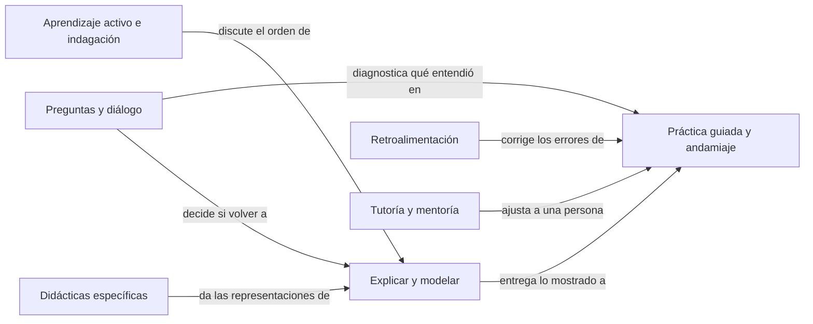

# Didáctica

La didáctica estudia la enseñanza: qué hace quien enseña para que otro aprenda algo concreto, desde explicar y mostrar hasta hacer practicar, preguntar y devolver. Es el lado de quien enseña en la pedagogía.

En el triángulo pedagógico de Houssaye (el saber, quien enseña, quien aprende) es la relación entre quien enseña y el saber puesto al alcance de otro. Para Camilloni es una disciplina teórica que describe, explica y da normas para la acción de enseñar. Se apoya en las [Ciencias del aprendizaje](../Ciencias-del-aprendizaje/ciencias-del-aprendizaje.md) para saber cómo aprende la gente; el armado de un curso entero es [Diseño instruccional](../Diseno-instruccional/diseno-instruccional.md), comprobar lo aprendido es [Evaluación educativa](../Evaluacion-educativa/evaluacion-educativa.md) y enseñar con software es [Tecnología educativa](../Tecnologia-educativa/tecnologia-educativa.md). La didáctica es lo que pasa en la clase o en la sesión: los minutos en que alguien enseña y otro aprende.

Casi toda la evidencia del tema viene de escuelas y universidades. Las notas lo dicen cada vez que la llevan a adultos o a enseñar un oficio técnico, porque ahí es inferencia.

## De qué está hecha la enseñanza

El campo trata la enseñanza como una secuencia: explicar en pasos chicos, practicar con ayuda, practicar solo, con preguntas y retroalimentación todo el tiempo. Así la ordenan los [principios de Rosenshine](Explicar-y-modelar/principios-de-rosenshine.md), la guía del [What Works Clearinghouse](Fundamentos/evidencia-en-educacion.md#los-resúmenes-de-evidencia-y-cómo-leer-cada-uno) (el sitio de revisiones de evidencia del gobierno de EE. UU.) y el marco de formación docente de Inglaterra. El tema tiene siete partes, las del diagrama y la lista. Las cuatro primeras (explicar, practicar con ayuda, preguntar y devolver) son tramos de esa secuencia; las otras tres son la alternativa que discute su orden (aprendizaje activo e indagación), el formato uno a uno (tutoría y mentoría) y lo que cambia según el contenido (didácticas específicas).

- [Explicar y modelar](Explicar-y-modelar/explicar-y-modelar.md): presentar lo nuevo en pasos chicos, pensar en voz alta y los ejemplos resueltos. Es el núcleo de la instrucción explícita; entrá acá para preparar una explicación.
- [Práctica guiada y andamiaje](Practica-guiada-y-andamiaje/practica-guiada-y-andamiaje.md): hacer con ayuda y retirarla hasta que el otro hace solo, cuánto guiar según cuánto sabe y el aprendizaje para el dominio.
- [Preguntas y diálogo](Preguntas-y-dialogo/preguntas-y-dialogo.md): preguntar para hacer pensar y para ver qué se entendió, y pedir que expliquen.
- [Retroalimentación](Retroalimentacion/retroalimentacion.md): qué devolver, cuándo y cómo graduar las pistas. Puede tener mucho efecto y también perjudicar.
- [Aprendizaje activo e indagación](Aprendizaje-activo-e-indagacion/aprendizaje-activo-e-indagacion.md): la disputa entre guía y descubrimiento, la falla productiva, el aprendizaje activo en clase y el aprendizaje basado en problemas.
- [Tutoría y mentoría](Tutoria-y-mentoria/tutoria-y-mentoria.md): enseñar uno a uno o a un grupo chico, y por qué acompañar una carrera es otra cosa.
- [Didácticas específicas](Didacticas-especificas/didacticas-especificas.md): lo que cambia según qué se enseña, con la programación como caso desarrollado.

## Cuánta guía y cuándo

La pregunta que atraviesa todo el tema es cuánta ayuda dar, de qué tipo y en qué momento. El metaanálisis de Alfieri et al. (2011), con 164 estudios, la deja planteada así: el descubrimiento sin ayuda pierde contra la instrucción explícita (d = −0,38; la d es el [tamaño de efecto](Fundamentos/glosario-de-didactica.md#leer-la-evidencia), la diferencia entre grupos en desviaciones estándar) y el descubrimiento con ayuda gana contra otras formas de instrucción (d = 0,30). En sus palabras, «unassisted discovery does not benefit learners, whereas feedback, worked examples, scaffolding, and elicited explanations do». Los dos bandos aceptan ese dato y discuten si el aprendizaje basado en problemas y la indagación cuentan como ayuda suficiente. La disputa completa está en [guía o descubrimiento](Aprendizaje-activo-e-indagacion/guia-o-descubrimiento.md).

La respuesta cambia con quien aprende. La guía que sirve al novato estorba a quien ya sabe ([inversión de la experticia](Practica-guiada-y-andamiaje/inversion-de-la-experticia.md)), así que toda decisión de cuánto guiar empieza por averiguar cuánto sabe el otro. Intentar un problema antes de la explicación puede rendir más en algunos casos ([falla productiva](Aprendizaje-activo-e-indagacion/falla-productiva.md)).

## Qué leer según lo que estés haciendo

- Si tenés que preparar una clase o una explicación: [principios de Rosenshine](Explicar-y-modelar/principios-de-rosenshine.md) y [modelado y ejemplos resueltos](Explicar-y-modelar/modelado-y-ejemplos-resueltos.md).
- Si tenés que decidir si explicar primero o dejar que prueben: [guía o descubrimiento](Aprendizaje-activo-e-indagacion/guia-o-descubrimiento.md), [falla productiva](Aprendizaje-activo-e-indagacion/falla-productiva.md) e [inversión de la experticia](Practica-guiada-y-andamiaje/inversion-de-la-experticia.md).
- Si enseñás a un grupo con niveles muy distintos: [inversión de la experticia](Practica-guiada-y-andamiaje/inversion-de-la-experticia.md) y [andamiaje](Practica-guiada-y-andamiaje/andamiaje.md).
- Si tenés que acompañar a alguien uno a uno en una habilidad: [tutoría](Tutoria-y-mentoria/tutoria.md), [aprendizaje cognitivo](Practica-guiada-y-andamiaje/aprendizaje-cognitivo.md) y [escalera de pistas](Retroalimentacion/escalera-de-pistas.md).
- Si te piden ser mentor de alguien: [mentoría](Tutoria-y-mentoria/mentoria.md), que explica qué cambia respecto de enseñar.
- Si tenés que corregir un trabajo o devolver sobre un error: [niveles de retroalimentación](Retroalimentacion/niveles-de-retroalimentacion.md) y [retroalimentación inmediata o diferida](Retroalimentacion/retroalimentacion-inmediata-o-diferida.md).
- Si querés saber si entendieron sin preguntar «¿se entendió?»: [preguntas en clase](Preguntas-y-dialogo/preguntas-en-clase.md) y [autoexplicación](Preguntas-y-dialogo/autoexplicacion.md).
- Si tenés que dar una clase larga o expositiva: [aprendizaje activo](Aprendizaje-activo-e-indagacion/aprendizaje-activo.md).
- Si enseñás programación: [enseñar programación](Didacticas-especificas/ensenar-programacion.md) y, si quien aprende usa asistentes de código, [enseñar programación con IA](Didacticas-especificas/ensenar-programacion-con-ia.md).
- Si tenés que enseñar una herramienta (control de versiones, línea de comandos): no hay nota específica. Lo más cercano es la secuencia de los [principios de Rosenshine](Explicar-y-modelar/principios-de-rosenshine.md), [modelado y ejemplos resueltos](Explicar-y-modelar/modelado-y-ejemplos-resueltos.md) para mostrar los comandos pensando en voz alta, la [máquina nocional](Didacticas-especificas/ensenar-programacion.md#la-máquina-nocional) de [enseñar programación](Didacticas-especificas/ensenar-programacion.md) (el modelo simplificado de qué pasa por dentro al ejecutar algo; llevarlo a una herramienta es inferencia) y la [escalera de pistas](Retroalimentacion/escalera-de-pistas.md) para ayudar cuando se traba.
- Si tenés que armar un curso completo, con objetivos y secuencia: no es didáctica sino [Diseño instruccional](../Diseno-instruccional/diseno-instruccional.md), que arranca por los [objetivos de aprendizaje](../Diseno-instruccional/Objetivos-de-aprendizaje/objetivos-de-aprendizaje.md) y la [secuencia](../Diseno-instruccional/Secuencia-y-curriculo/secuencia-y-curriculo.md); lo más cercano acá es [práctica independiente y dominio](Practica-guiada-y-andamiaje/practica-independiente-y-dominio.md).
- Si alguien te cita una cifra o un método «probado»: [evidencia en educación](Fundamentos/evidencia-en-educacion.md) y [mitos de la enseñanza](Fundamentos/mitos-de-la-ensenanza.md).

## Del orden de una clase a sus disputas

1. [Evidencia en educación](Fundamentos/evidencia-en-educacion.md), para saber cuánto creerle a cada cifra del tema.
2. [Principios de Rosenshine](Explicar-y-modelar/principios-de-rosenshine.md), que da el esqueleto de una clase.
3. [Explicar y modelar](Explicar-y-modelar/explicar-y-modelar.md), [Práctica guiada y andamiaje](Practica-guiada-y-andamiaje/practica-guiada-y-andamiaje.md), [Preguntas y diálogo](Preguntas-y-dialogo/preguntas-y-dialogo.md) y [Retroalimentación](Retroalimentacion/retroalimentacion.md), en ese orden, que es el de la secuencia.
4. [Guía o descubrimiento](Aprendizaje-activo-e-indagacion/guia-o-descubrimiento.md), la disputa que discute ese orden.
5. [Tutoría y mentoría](Tutoria-y-mentoria/tutoria-y-mentoria.md) y [Didácticas específicas](Didacticas-especificas/didacticas-especificas.md), según lo que enseñes y a quién.

[Fundamentos](Fundamentos/fundamentos-de-didactica.md) reúne lo que cruza todo el tema y toda el área Pedagogía: la [historia de la didáctica](Fundamentos/historia-de-la-didactica.md), cómo leer la evidencia, los mitos y el [glosario](Fundamentos/glosario-de-didactica.md).
