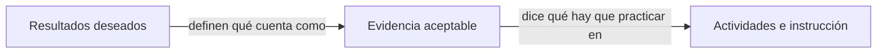

# Diseño hacia atrás

El diseño hacia atrás es armar un curso empezando por el final: primero qué tienen que poder hacer, después qué evidencia lo mostraría y recién al último las actividades. Su versión más conocida es Understanding by Design, de Wiggins y McTighe (1998); su evaluación empírica se reduce a unos pocos estudios, entre ellos un cuasiexperimento chico sin sorteo.

Dentro de los [modelos de diseño](modelos-de-diseno.md) es un orden de decisiones, no un proceso de proyecto como [ADDIE](addie-y-sam.md). Por lectura de esta base, es la forma de trabajo que produce la [alineación constructiva](../Objetivos-de-aprendizaje/alineacion-constructiva.md): si la evidencia se decide antes que las actividades, estas tienden a apuntar a ella. Las dos ideas tienen el mismo antecedente en Tyler (1949) y son un solo hallazgo conceptual, no dos confirmaciones independientes.

## Las tres etapas

Según las guías universitarias que resumen el libro (el capítulo ocupa las páginas 13 a 34 de la edición de 1998):

1. **Identificar los resultados deseados.** «What should students know, understand, and be able to do?» Sale en forma de [objetivos de aprendizaje](../Objetivos-de-aprendizaje/objetivos-de-aprendizaje.md).
2. **Determinar la evidencia aceptable.** «What will we accept as evidence of student understanding and proficiency?» Se diseñan las tareas de evaluación antes que la enseñanza.
3. **Planificar las experiencias y la instrucción.** Las actividades se eligen para que quien aprende llegue a producir esa evidencia.

## La práctica y la marca

El orden que invierte es el habitual: elegir un tema, armar las clases y escribir al final un examen sobre lo que se dio. Esa descripción del orden habitual es de esta base, no de una cita del libro.

Wikipedia aclara que UbD es un ejemplo de una práctica más amplia, la de partir de los resultados; «diseño hacia atrás» nombra la práctica, y UbD, una versión de esa práctica.

## Cómo se combina con otros modelos

El diseño hacia atrás no dice cómo ordenar los contenidos ni qué lleva una buena lección: para eso están la [secuencia](../Secuencia-y-curriculo/secuencia-y-curriculo.md) y los [principios de instrucción](principios-de-instruccion.md). Para habilidades complejas, [4C/ID](4c-id.md) hace algo parecido con más detalle: sus pasos 1 y 2 son diseñar las tareas de aprendizaje y las evaluaciones de desempeño antes que la información de apoyo.

## Qué evidencia hay

La evidencia empírica de UbD es escasa y de diseño débil. Ostinelli (2024) lo resume así: «rarely has this methodology been the object of experimental or quasi-experimental studies». Cita cuatro estudios previos de ese tipo; uno, Yurtseven y Altun (2017), es según su resumen una investigación-acción con 10 docentes de inglés y 436 estudiantes.

Su propio estudio es un cuasiexperimento en una escuela de comercio de Chiasso, Suiza. Un mismo docente de matemática dio relaciones y funciones con UbD a dos cursos, de 15 y 18 alumnos, y de la forma habitual a un tercero, de 16. Los dos cursos con UbD rindieron más, y la ventaja seguía en una tercera prueba, cinco meses después de la segunda. El autor reconoce que la falta de sorteo y los grupos chicos limitan las conclusiones. Además, quien propuso el estudio fue el asesor-investigador que había llevado UbD a esa escuela.

Uluçınar (2021) reunió 12 estudios cualitativos, de 48 encontrados. Según su resumen, al armar unidades con UbD los docentes en general no completaron bien sus etapas, «mostly due to model inexperience, the school's facilities/conditions, teacher stagnation and emotional state, and inadequate pedagogy knowledge». Los mismos estudios reportan mejoras en los estudiantes, con método cualitativo.

La crítica académica encontrada es un artículo de argumentación sobre la historia del diseño instruccional, sin datos propios. McCreary (2022), según su resumen, menciona las críticas de siempre a los objetivos de aprendizaje: que «overly instrumentalize the educational process» o que no se centran en quien aprende. Su propio argumento es otro: fijar de antemano qué se sabrá al final deja afuera aprender en el presente. Hay además un libro blanco de una editorial, con interés comercial y no leído. Como el resto de los modelos, vale por el orden que impone al trabajo.

> [!NOTE] Sin fuente todavía: un ensayo con sorteo o una revisión sistemática de UbD, y el texto completo de alguna crítica académica de los objetivos de aprendizaje.
