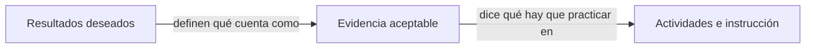

# Diseño hacia atrás

El diseño hacia atrás es armar un curso empezando por el final: primero qué tienen que poder hacer, después qué evidencia lo mostraría y recién al último las actividades. Su versión más conocida es Understanding by Design, de Wiggins y McTighe (1998); no tiene evaluación empírica encontrada.

Dentro de los [modelos de diseño](modelos-de-diseno.md) es un orden de decisiones, no un proceso de proyecto como [ADDIE](addie-y-sam.md). Por lectura de esta base, es la forma de trabajo que produce la [alineación constructiva](../Objetivos-de-aprendizaje/alineacion-constructiva.md): si la evidencia se decide antes que las actividades, estas tienden a apuntar a ella. Las dos ideas tienen el mismo antecedente en Tyler (1949) y son un solo hallazgo conceptual, no dos confirmaciones independientes.

## Las tres etapas

Según las guías universitarias que resumen el libro (el capítulo ocupa las páginas 13 a 34 de la edición de 1998):

1. **Identificar los resultados deseados.** «What should students know, understand, and be able to do?» Sale en forma de [objetivos de aprendizaje](../Objetivos-de-aprendizaje/objetivos-de-aprendizaje.md).
2. **Determinar la evidencia aceptable.** «What will we accept as evidence of student understanding and proficiency?» Se diseñan las tareas de evaluación antes que la enseñanza.
3. **Planificar las experiencias y la instrucción.** Las actividades se eligen para que quien aprende llegue a producir esa evidencia.

## La práctica y la marca

El orden que invierte es el habitual: elegir un tema, armar las clases y escribir al final un examen sobre lo que se dio. Esa descripción del orden habitual es de esta base, no de una cita del libro.

Wikipedia aclara que UbD es un ejemplo de una práctica más amplia, la de partir de los resultados; «diseño hacia atrás» nombra la práctica, y UbD, una versión de esa práctica.

## Cómo se combina con otros modelos

El diseño hacia atrás no dice cómo ordenar los contenidos ni qué lleva una buena lección: para eso están la [secuencia](../Secuencia-y-curriculo/secuencia-y-curriculo.md) y los [principios de instrucción](principios-de-instruccion.md). Para habilidades complejas, [4C/ID](4c-id.md) hace algo parecido con más detalle: sus pasos 1 y 2 son diseñar las tareas de aprendizaje y las evaluaciones de desempeño antes que la información de apoyo.

## Qué evidencia hay

No se encontró ninguna evaluación empírica de UbD ni críticas académicas. Hay un libro blanco de una editorial, con interés comercial y no leído. Como el resto de los modelos, vale por el orden que impone al trabajo.

> [!NOTE] Sin fuente todavía: una evaluación empírica de Understanding by Design y sus críticas académicas.
