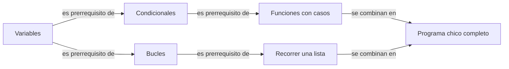

# Jerarquía de aprendizaje

Una jerarquía de aprendizaje es el árbol de prerrequisitos de una habilidad: se parte de la tarea final y se pregunta qué hay que saber hacer antes, hacia abajo. Hoy se representa como un grafo de competencias, cuya base formal es la teoría de espacios de conocimiento; es una herramienta de representación, no una teoría de diseño.

Dentro de la [secuencia](secuencia-y-curriculo.md) contesta la pregunta de qué va antes de qué. Su materia prima es el [análisis cognitivo de tareas](../Analisis-previo/analisis-cognitivo-de-tareas.md), y en el modelo de Dick y Carey es justamente el «análisis instruccional», segundo de sus diez componentes.

## Cómo se arma la jerarquía de Gagné

Para habilidades intelectuales, Gagné propone partir de la tarea final y preguntar qué tiene que poder hacer quien aprende antes de poder hacerla. Cada respuesta es una habilidad subordinada, y a cada una se le hace la misma pregunta, hasta llegar a lo que el grupo ya domina. El resultado es un árbol cuyas hojas son el punto de partida y cuya raíz es el objetivo. Los prerrequisitos salen del análisis de la tarea y fijan el orden: no se enseña un nodo antes que sus hijos.

La fuente es *The Conditions of Learning* (3.ª ed. 1977), que no se leyó; la pregunta guía literal no se pudo confirmar.

## Qué tan validada está

White (1974) propuso un procedimiento de nueve etapas para validar jerarquías, y Dayton y Macready (1976), un análisis estructural alternativo. Según un resumen de un informe técnico archivado en DTIC, la investigación previa tenía «serious methodological flaws», y la hipótesis central, que los prerrequisitos median la [transferencia](../../Ciencias-del-aprendizaje/Transferencia/transferencia.md) (usar lo aprendido en otra situación), nunca se probó bien. No se encontró una revisión reciente.

## Del árbol al grafo

Por inferencia de esta base, un árbol supone que cada habilidad sirve a una sola de arriba, y en un dominio real una habilidad puede ser prerrequisito de varias. La representación actual es un grafo dirigido: cada nodo es una competencia y cada flecha dice «esto va antes». Según un resumen, Willcox y Huang muestran que un mapa de currículo en tabla esconde relaciones que un grafo deja ver: vacíos, solapamientos y caminos.

La base formal es la teoría de espacios de conocimiento de Doignon y Falmagne (1985):

- Hay un conjunto de conceptos y un conjunto de estados de conocimiento posibles, cerrado por unión.
- En un espacio bien graduado se llega a cualquier estado agregando un concepto por vez; la inclusión entre estados define un orden parcial que expresa los prerrequisitos.
- El borde interno de un estado es lo que la persona acaba de aprender; el borde externo, lo que está lista para aprender.

El borde externo es la idea que vuelve útil al grafo para diseñar: dice qué ofrecer a continuación a cada persona. Un sistema comercial de matemática se construyó sobre esta teoría; el detalle de producto queda fuera de esta nota.

El diagrama es un ejemplo ilustrativo, no sale de una fuente.

## Para qué se usa y qué no se sabe

Según su resumen, una revisión sistemática de grafos de conocimiento en educación (*Heliyon*, 2024) encuentra cinco usos: aprendizaje adaptativo, diseño curricular (en crecimiento), mapas conceptuales, búsqueda semántica y otros; las limitaciones son el conocimiento que cambia y los errores de extracción automática. Para medir lo que sabe alguien recorriendo el grafo, ver [análisis de quien aprende](../Analisis-previo/analisis-de-quien-aprende.md) y, en Evaluación educativa, [espacios de conocimiento](../../Evaluacion-educativa/Evaluacion-adaptativa/espacios-de-conocimiento.md), que es la teoría de esos tests adaptativos.

Los grafos de prerrequisitos de las plataformas no tienen, en lo encontrado, evaluación comparada de resultados. Las patentes describen el método pero no son evidencia. Por inferencia de esta base, el grafo hereda la validez de las jerarquías: si los prerrequisitos están mal identificados, ordena mal con mucha precisión.
