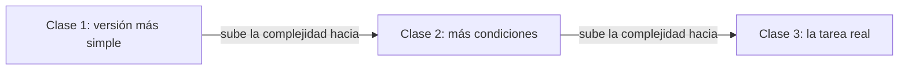

# Secuencia por tareas completas

La secuencia por tareas completas ordena un curso por tareas auténticas enteras en lugar de por temas: se arranca por la versión más simple de la tarea real y se sube la complejidad en clases. Es el núcleo de 4C/ID y pariente de las condiciones simplificadoras de Reigeluth.

Dentro de la [secuencia](secuencia-y-curriculo.md) es la respuesta a la pregunta de qué tarea va primero, distinta de la [secuencia de contenidos](secuencia-de-contenidos.md), que ordena conceptos. El modelo que la usa como eje, con sus otros tres componentes, está en [4C/ID](../Modelos-de-diseno/4c-id.md); acá se explica solo el orden.

## Clases de tareas

En 4C/ID las tareas de aprendizaje se agrupan en clases, de la más simple a la más compleja (paso 3 de los diez pasos). Todas las tareas de una clase son tareas completas, no partes: piden integrar todo lo que pide la tarea real, en una versión más chica. 

Un ejemplo ilustrativo, sin fuente (el diagrama también lo es): un curso de operación de servidores que arranca con «poner en marcha un servicio en una máquina limpia con instrucciones paso a paso», sigue con la misma tarea sin instrucciones, después «poner en marcha un servicio con dependencias y un error de configuración» y termina en un incidente real con varias causas. Cada clase es la tarea entera; lo que cambia es cuántas condiciones la complican.

> [!NOTE] Sin fuente todavía: cómo se gradúa la ayuda dentro de cada clase, y si se retira de una tarea a otra. Está en el libro, que no se leyó.

## Las condiciones simplificadoras de Reigeluth

La teoría de la elaboración tiene una versión para tareas: el método de condiciones simplificadoras. Se busca la versión más simple de la tarea que todavía represente al conjunto (el epítome de la tarea) y se elaboran versiones cada vez más complejas, más o menos igual de auténticas y menos representativas. Es la misma idea que las clases de tareas: las dos parten de la tarea completa más simple y suben. Cuál influyó en cuál no se verificó.

## Por qué tareas completas y no partes

El libro, que no se leyó, da su propia justificación. La lectura de esta base, que es inferencia: una tarea compleja no es la suma de sus partes, y quien aprende las partes por separado después tiene que aprender a coordinarlas. 4C/ID no descarta las partes: las que hay que automatizar tienen su lugar como práctica de partes.

## Qué evidencia hay

El metaanálisis de Costa, Miranda y Melo (2022) da para 4C/ID un efecto grande sobre el desempeño, [d](../../Didactica/Fundamentos/glosario-de-didactica.md#leer-la-evidencia) = 0,79, y que el nivel educativo modera el efecto («the higher-education level is more suitable»). No se pudo ver cuántos estudios entraron ni su calidad. El efecto es del modelo entero; no aísla la secuencia por tareas completas. Leerlo como «funciona mejor con adultos» sobreinterpreta: la fuente habla de nivel educativo, no de edad ni de capacitación laboral.
