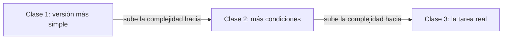

# Secuencia por tareas completas

La secuencia por tareas completas ordena un curso por tareas auténticas enteras en lugar de por temas: se arranca por la versión más simple de la tarea real y se sube la complejidad en clases. Es el núcleo de 4C/ID y pariente de las condiciones simplificadoras de Reigeluth.

Dentro de la [secuencia](secuencia-y-curriculo.md) es la respuesta a la pregunta de qué tarea va primero, distinta de la [secuencia de contenidos](secuencia-de-contenidos.md), que ordena conceptos. El modelo que la usa como eje, con sus otros tres componentes, está en [4C/ID](../Modelos-de-diseno/4c-id.md); acá se explica solo el orden.

## Clases de tareas

En 4C/ID las tareas de aprendizaje se agrupan en clases, de la más simple a la más compleja (paso 3 de los diez pasos). Todas las tareas de una clase son tareas completas, no partes: piden integrar todo lo que pide la tarea real, en una versión más chica. 

Un ejemplo ilustrativo, sin fuente (el diagrama también lo es): un curso de operación de servidores que arranca con «poner en marcha un servicio en una máquina limpia con instrucciones paso a paso», sigue con la misma tarea sin instrucciones, después «poner en marcha un servicio con dependencias y un error de configuración» y termina en un incidente real con varias causas. Cada clase es la tarea entera; lo que cambia es cuántas condiciones la complican.

## La ayuda dentro de cada clase

Dentro de una clase, la ayuda se retira de una tarea a otra, y vuelve a ser alta al empezar la clase siguiente. Frerejean, van Merriënboer y otros (2019) lo describen así: la ayuda y la guía «are gradually withdrawn until the learners are able to independently carry out tasks of a certain level of complexity before engaging in more complex tasks (i.e., the next task class)».

En su caso de un curso de desarrollo de apps para Android, cada clase sigue tres escalones:

1. **Ejemplos de modelado y tareas de imitación**: el docente desarrolla una app pensando en voz alta y los estudiantes construyen una igual.
2. **Tareas para completar**: «students receive partially‐completed applications they must finish (i.e., completion tasks)».
3. **Tareas convencionales**: «the final tasks in a task class are conventional tasks without any support and guidance».

El artículo resume: «support gradually decreases as the student progresses through the task class». Las notas de una conferencia de van Merriënboer de 2013, en el EduTechWiki, llaman a esa forma «a sawtooth pattern» (diente de sierra): mucha ayuda en la primera tarea de la clase y ninguna en la última. Es un resumen de terceros, no un texto del autor. Cómo se arma un ejemplo resuelto está en [modelado y ejemplos resueltos](../../Didactica/Explicar-y-modelar/modelado-y-ejemplos-resueltos.md).

Van Merriënboer ya había probado en 1990 una «completion strategy» frente a la generación de programas nuevos, en un curso de programación de secundaria. Según el resumen de ERIC, esa estrategia «emphasized the modification and extension of existing programs». Que sea el antecedente de las tareas para completar es una lectura de esta base.

> [!NOTE] Sin fuente todavía: el detalle del libro *Ten Steps to Complex Learning* sobre la graduación de la ayuda (otros formatos de tarea, criterios para pasar de clase), que no se leyó.

## Las condiciones simplificadoras de Reigeluth

La teoría de la elaboración tiene una versión para tareas: el método de condiciones simplificadoras. Se busca la versión más simple de la tarea que todavía represente al conjunto (el epítome de la tarea) y se elaboran versiones cada vez más complejas, más o menos igual de auténticas y menos representativas. Es la misma idea que las clases de tareas: las dos parten de la tarea completa más simple y suben. Cuál influyó en cuál no se verificó.

## Por qué tareas completas y no partes

Frerejean y otros (2019) dan dos razones contra el enfoque por objetivos separados. La primera: hacer una tarea profesional compleja «requires more than just the stacking of these constituent elements». La segunda es la fragmentación: la enseñanza por partes «provides little opportunity to learn how to coordinate the performance of these separate parts into a coherent whole». 4C/ID no descarta las partes: las que hay que automatizar tienen su lugar como práctica de partes.

## Qué evidencia hay

El metaanálisis de Costa, Miranda y Melo (2022) da para 4C/ID un efecto grande sobre el desempeño, [d](../../Didactica/Fundamentos/glosario-de-didactica.md#leer-la-evidencia) = 0,79, y que el nivel educativo modera el efecto («the higher-education level is more suitable»). No se pudo ver cuántos estudios entraron ni su calidad. El efecto es del modelo entero; no aísla la secuencia por tareas completas. Leerlo como «funciona mejor con adultos» sobreinterpreta: la fuente habla de nivel educativo, no de edad ni de capacitación laboral.
