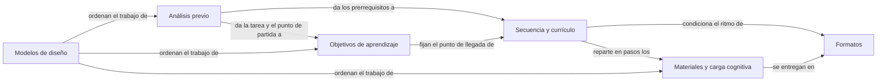

# Diseño instruccional

El diseño instruccional es el oficio de armar una experiencia de aprendizaje entera, un curso, un programa o un camino, decidiendo qué se aprende, en qué orden, con qué materiales y en qué formato.

Trabaja una escala arriba de la [didáctica](../Didactica/didactica.md): el recorrido completo, en lugar de una explicación o una clase. Toma de las [ciencias del aprendizaje](../Ciencias-del-aprendizaje/ciencias-del-aprendizaje.md) cómo se aprende, planifica desde el principio cómo se va a comprobar con la [evaluación educativa](../Evaluacion-educativa/evaluacion-educativa.md) y deja a la [tecnología educativa](../Tecnologia-educativa/tecnologia-educativa.md) las plataformas en que se entrega. Es uno de los cinco temas del área Pedagogía. El mecanismo psicológico del aprendizaje está en [Aprendizaje y memoria](../Psicologia/Aprendizaje-y-memoria/aprendizaje-y-memoria.md), de Psicología.

La idea que ordena el tema es que un curso se diseña desde el final y desde el problema: primero se averigua si hace falta enseñar y qué hace de verdad quien domina la tarea, después se fija qué va a poder hacer quien aprenda y cómo se va a comprobar, y recién al final se eligen el orden, los materiales y el formato. La segunda idea es que la evidencia es despareja. Los principios para armar materiales tienen decenas de comparaciones experimentales cada uno; los modelos de diseño, casi ninguna.

## De qué está hecho un curso diseñado

Wikipedia define el campo como «the practice of systematically designing, developing and delivering instructional materials and experiences». Los manuales lo dividen por fases; el de Dick y Carey, en diez componentes que van de la meta a la evaluación sumativa. Esta base lo corta en cinco partes del producto, más los modelos que dicen cómo recorrerlas.

- [Análisis previo](Analisis-previo/analisis-previo.md): si el problema se arregla enseñando, qué hace el experto sin darse cuenta y desde dónde arranca quien aprende. Entrá acá antes de escribir el primer objetivo.
- [Objetivos de aprendizaje](Objetivos-de-aprendizaje/objetivos-de-aprendizaje.md): qué va a poder hacer alguien al terminar, cómo se escribe, cómo se clasifica con Bloom y cómo se alinea con la actividad y la evaluación.
- [Secuencia y currículo](Secuencia-y-curriculo/secuencia-y-curriculo.md): en qué orden van los contenidos y en qué orden van las tareas; los prerrequisitos, el grafo de competencias y los conceptos umbral.
- [Materiales y carga cognitiva](Materiales-y-carga-cognitiva/materiales-y-carga-cognitiva.md): cómo se arma un material que no gaste la memoria de trabajo en lo que no enseña, con los principios de Mayer y sus límites.
- [Formatos](Formatos/formatos.md): presencial, en línea o mixto; cohorte o ritmo propio; curso o trabajo, con el nivel de evidencia de cada eje.
- [Modelos de diseño](Modelos-de-diseno/modelos-de-diseno.md): ADDIE, SAM, diseño hacia atrás, 4C/ID, Merrill y Gagné, separados en procesos, órdenes de decisión y listas de principios.
- [Fundamentos](Fundamentos/fundamentos-de-diseno-instruccional.md): la historia del oficio, los manuales de referencia, los mitos y el glosario.

## Dónde está la evidencia y dónde no

| Parte | Qué evidencia hay |
|---|---|
| Materiales | Experimentos de laboratorio con efectos medianos a grandes (Mayer), con una crítica seria a cómo se mide la carga (de Jong 2010) |
| Formatos, medio | Metaanálisis grandes: en línea empata con presencial; mixto rinde más, con confusión de tiempo y recursos (Means et al. 2013) |
| Análisis | Un metaanálisis de instrucción basada en análisis cognitivo de tareas (g = 0,871); herramientas de necesidades sin validar |
| Objetivos | Estudios viejos con efectos chicos y focalizados; la alineación constructiva, con evidencia observacional |
| Secuencia | Casos descriptivos y un programa de validación de los 70 con fallas |
| Modelos | Un metaanálisis de 4C/ID (d = 0,79, sin detalles) y una revisión de baja calidad de Gagné; nada para los demás |
| Formatos, ritmo y contexto | Ninguna comparación; el 70-20-10 es folklore |

Casi todo viene de escuelas, universidades y salud. Llevarlo a adultos que aprenden en el trabajo, o a la enseñanza de IT, es una extrapolación que cada nota marca.

## Qué leer según lo que estés haciendo

- Si te piden un curso para resolver un problema de desempeño: [análisis de necesidades](Analisis-previo/analisis-de-necesidades.md), antes de diseñar nada.
- Si tenés que armar una capacitación desde cero: el orden de [diseño hacia atrás](Modelos-de-diseno/diseno-hacia-atras.md), con [objetivo de desempeño](Objetivos-de-aprendizaje/objetivo-de-desempeno.md) y [alineación constructiva](Objetivos-de-aprendizaje/alineacion-constructiva.md); si la habilidad es compleja, [4C/ID](Modelos-de-diseno/4c-id.md).
- Si sos experto en el tema y vas a enseñarlo: [análisis cognitivo de tareas](Analisis-previo/analisis-cognitivo-de-tareas.md), por lo que vas a omitir sin darte cuenta, y [conceptos umbral](Secuencia-y-curriculo/conceptos-umbral.md).
- Si tenés que ordenar un temario: [jerarquía de aprendizaje](Secuencia-y-curriculo/jerarquia-de-aprendizaje.md), [secuencia de contenidos](Secuencia-y-curriculo/secuencia-de-contenidos.md) y [secuencia por tareas completas](Secuencia-y-curriculo/secuencia-por-tareas-completas.md).
- Si tenés que armar slides, un video o un tutorial: [principios multimedia](Materiales-y-carga-cognitiva/principios-multimedia.md) y [carga cognitiva en el aprendizaje](Materiales-y-carga-cognitiva/carga-cognitiva-en-el-aprendizaje.md).
- Si el grupo mezcla novatos y gente con experiencia: [análisis de quien aprende](Analisis-previo/analisis-de-quien-aprende.md).
- Si tenés que elegir entre presencial, en línea o mixto: [en línea, presencial y mixto](Formatos/en-linea-presencial-y-mixto.md).
- Si tenés que decidir entre cohorte y ritmo propio: [cohorte o ritmo propio](Formatos/cohorte-o-ritmo-propio.md); no hay evidencia comparativa, y la nota lo dice.
- Si alguien justifica una decisión con el 70-20-10 o con «los adultos aprenden distinto»: [mitos del diseño instruccional](Fundamentos/mitos-del-diseno-instruccional.md).
- Si tenés que elegir o defender un modelo de diseño para un equipo: [modelos de diseño](Modelos-de-diseno/modelos-de-diseno.md) y [ADDIE y SAM](Modelos-de-diseno/addie-y-sam.md).
- Si tenés que escribir las preguntas de evaluación del curso: no hay nota en este tema; lo más cercano es [alineación constructiva](Objetivos-de-aprendizaje/alineacion-constructiva.md), y, en Evaluación educativa, [instrumentos](../Evaluacion-educativa/Instrumentos/instrumentos.md) y [opción múltiple](../Evaluacion-educativa/Instrumentos/opcion-multiple.md).
- Si tenés que decidir si un curso funcionó: no hay nota en este tema; está en [evaluar un programa](../Evaluacion-educativa/Evaluar-un-programa/evaluar-un-programa.md) y [niveles de Kirkpatrick](../Evaluacion-educativa/Evaluar-un-programa/niveles-de-kirkpatrick.md), de Evaluación educativa.

## De la pregunta al curso: un orden de lectura

1. [Análisis previo](Analisis-previo/analisis-previo.md), empezando por [análisis de necesidades](Analisis-previo/analisis-de-necesidades.md).
2. [Objetivos de aprendizaje](Objetivos-de-aprendizaje/objetivos-de-aprendizaje.md) y [alineación constructiva](Objetivos-de-aprendizaje/alineacion-constructiva.md).
3. [Secuencia y currículo](Secuencia-y-curriculo/secuencia-y-curriculo.md), con [jerarquía de aprendizaje](Secuencia-y-curriculo/jerarquia-de-aprendizaje.md) antes que las otras dos formas de ordenar.
4. [Materiales y carga cognitiva](Materiales-y-carga-cognitiva/materiales-y-carga-cognitiva.md): primero la teoría, después los principios.
5. [Formatos](Formatos/formatos.md).
6. [Modelos de diseño](Modelos-de-diseno/modelos-de-diseno.md), que se entienden mejor después de conocer las partes que ordenan.
7. [Fundamentos](Fundamentos/fundamentos-de-diseno-instruccional.md): la historia, los mitos y el glosario, cuando haga falta.
