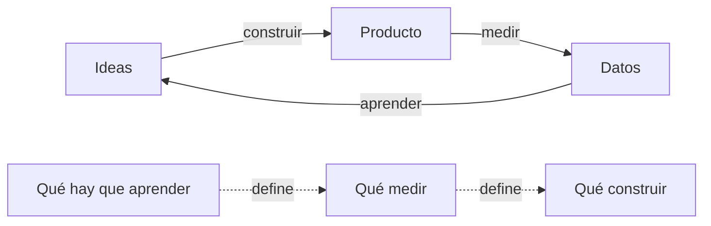

# Construir-medir-aprender

Construir-medir-aprender es el ciclo de Ries en el que una empresa nueva convierte una idea en producto, mide cómo responden los clientes y aprende si pivotar o perseverar; lo que produce cada vuelta es aprendizaje validado, y la ventaja está en dar vueltas rápidas con lotes pequeños.

La página de principios del Lean Startup lo dice así: «The fundamental activity of a startup is to turn ideas into products, measure how customers respond, and then learn whether to pivot or persevere». En ese ciclo, el [producto mínimo viable](producto-minimo-viable.md) es lo que se construye, la [contabilidad de la innovación](contabilidad-de-la-innovacion.md) es cómo se mide, y [pivotar o perseverar](pivotar-o-perseverar.md) es lo que se decide con lo aprendido.

## El aprendizaje validado es la unidad de avance

Ries mide el avance de una empresa nueva en aprendizaje validado, que define en su blog como el que «demonstrates that the key risks in the business have been addressed by the current product» (2009). La página de principios lo llama «a rigorous method for demonstrating progress when one is embedded in the soil of extreme uncertainty».

Validado quiere decir que hay un dato detrás. «Aprendimos que a los clientes les gusta» no lo es; «la tasa de compra pasó del 1% al 3% cuando cambiamos el segmento» sí, si el número se puede auditar. El ejemplo es ilustrativo. Los riesgos que el aprendizaje tiene que despejar son las [hipótesis de salto de fe](hipotesis-de-salto-de-fe.md).

## El ciclo se recorre en un sentido y se planifica en el otro

Las flechas del ciclo van de construir a medir a aprender. Según un resumen del proceso, la planificación va al revés: primero se decide qué hay que aprender, después qué medir para saberlo y recién al final qué producto construir para ese experimento.

Planificar así evita construir primero y buscar después qué medir: un producto construido sin una pregunta previa genera datos que no refutan nada (inferencia de la base sobre el principio anterior).

## Los lotes pequeños aceleran la vuelta

Según un resumen del capítulo Batch, trabajar en lotes pequeños ayuda a «identify problems and find out the truth faster». Un lote es la cantidad de trabajo que se termina antes de mostrarla: una función entera, una versión completa o un cambio chico. Cuanto más chico, antes vuelve el dato y menos trabajo se tira si la hipótesis era falsa (descripción de la base).

El principio viene de la manufactura lean. En lo investigado no aparece una fuente primaria que lo documente para empresas nuevas fuera del propio libro.

> [!NOTE]
> Sin fuente todavía: la cita literal de Ries sobre lotes pequeños y el ejemplo que usa en el libro.

## Experimentar como lógica económica

Kerr, Nanda y Rhodes-Kropf (2014) describen emprender como experimentar, y las probabilidades de éxito como «low, extremely skewed and unknowable until an investment is made» (según el buscador). La lectura de la base: si el resultado no se puede saber sin invertir, conviene invertir poco por vuelta y dar muchas vueltas. El mismo marco marca un límite, porque el valor viene de pocos éxitos extremos y no de mejorar el promedio.

La cantidad de vueltas posibles depende de la caja. Cuánto tiempo queda antes de quedarse sin plata está en [Finanzas](../Finanzas/finanzas.md); cuántas decisiones de rumbo entran en ese tiempo, en [pivotar o perseverar](pivotar-o-perseverar.md).

## Los capítulos Experiment, Test y Batch

En *The Lean Startup*, los capítulos Experiment, Test y Batch, según los nombres que dan los resúmenes. Fijarse en dos cosas: que el ciclo se diseña empezando por la pregunta que se quiere responder, y que la ventaja es la velocidad de la vuelta y no la cantidad de funciones.
