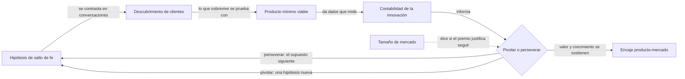

# Validación

La validación es la parte de emprender que comprueba, antes de construir en serio, si hay un problema real y alguien dispuesto a pagar por resolverlo: convierte los supuestos del plan en hipótesis, las pone a prueba con clientes y decide con esa evidencia si se sigue igual o se cambia de rumbo.

Es la primera parte del tema. Los supuestos que prueba están escritos en el [modelo de negocio](../Modelo-de-negocio/modelo-de-negocio.md), que es donde se ven todos juntos. Cada vuelta de prueba consume caja, así que la cantidad de vueltas posibles la fija la pista de [Finanzas](../Finanzas/finanzas.md). Termina en el [encaje producto-mercado](../Crecimiento/encaje-producto-mercado.md): cuando las hipótesis centrales se sostienen, el trabajo pasa de averiguar a crecer, y eso es [Crecimiento](../Crecimiento/crecimiento.md).

Ries resume el problema que la origina con una frase de su blog: «Very few startups fail for lack of technology. They almost always fail for lack of customers» (2008). Casi todo lo de esta parte es suyo y de Steve Blank. Según resúmenes del libro, la segunda parte de *The Lean Startup*, Steer, tiene cuatro capítulos (Leap, Test, Measure, Pivot) que coinciden con el recorrido de abajo.

## De supuesto a evidencia a decisión

Una hipótesis recorre siempre el mismo camino. Empieza como un supuesto del plan que, si es falso, hunde todo lo demás: una [hipótesis de salto de fe](hipotesis-de-salto-de-fe.md). Se enuncia de forma que un dato la pueda refutar. Primero se la contrasta con conversaciones, en el [descubrimiento de clientes](descubrimiento-de-clientes.md), y después con conducta medida, con un [producto mínimo viable](producto-minimo-viable.md). La [contabilidad de la innovación](contabilidad-de-la-innovacion.md) dice si los números se movieron, y con eso se decide [pivotar o perseverar](pivotar-o-perseverar.md).

El recorrido es un ciclo, y cada vuelta es una vuelta de [construir-medir-aprender](construir-medir-aprender.md). Lo que avanza en cada vuelta es el aprendizaje validado: lo que se sabe ahora con evidencia y antes se suponía. Por eso, según un resumen del libro, el ciclo se planifica al revés: primero qué hay que aprender, después qué medir y recién al final qué construir.

El [tamaño de mercado](tamano-de-mercado.md) entra de costado. Es un cálculo que viene de Bill Aulet (MIT) y de la práctica de inversión, fuera de la escuela lean, y responde otra pregunta. Las seis notas restantes preguntan si un supuesto es verdad; el tamaño de mercado pregunta si, siendo verdad, el premio justifica el esfuerzo.

## Cómo falla la validación

Las fallas típicas están en cada paso del recorrido:

| Paso | Falla | Dónde se trata |
|---|---|---|
| Elegir qué probar | Se prueba lo fácil y no lo riesgoso, o se prioriza por intuición | [hipótesis de salto de fe](hipotesis-de-salto-de-fe.md) |
| Conversar | Se cuenta la idea y se vuelve con elogios, que según Fitzpatrick son mal dato | [descubrimiento de clientes](descubrimiento-de-clientes.md) |
| Probar con un MVP | Se construye un producto chico que no prueba ninguna hipótesis concreta | [producto mínimo viable](producto-minimo-viable.md) |
| Medir | Se miran totales que suben solos en vez de métricas que muestran causa y efecto | [contabilidad de la innovación](contabilidad-de-la-innovacion.md) |
| Decidir | Se persevera sin evidencia, o se cambia de idea sin conservar lo aprendido | [pivotar o perseverar](pivotar-o-perseverar.md) |
| Dimensionar | Se calcula el mercado grande en vez del segmento donde se va a empezar | [tamaño de mercado](tamano-de-mercado.md) |

Hay también una falla del método entero, con evidencia experimental. Ries advierte que el desarrollo de clientes «is emphatically not an excuse to slow down or change the plan every day» (2008). Y en un experimento con 261 emprendedores, Novelli y Spina (2024) encontraron, según un resumen de su abstract, que quienes tenían el modelo de negocio poco desarrollado usaron el enfoque de hipótesis para replantear supuestos básicos y tuvieron peores resultados económicos de corto plazo que el grupo de control.

> [!IMPORTANT]
> Qué tan bien funciona validar así está en discusión. A favor: en un ensayo aleatorio con 116 startups italianas, las entrenadas para decidir con hipótesis rindieron mejor, pivotaron más y no abandonaron más que las de control (Camuffo et al., 2020); una replicación con 759 firmas en cuatro ensayos encontró más terminación de ideas (2024, según su abstract). En contra o con matices: lo que se midió son mejores decisiones (terminar ideas, pivotar) y no un ingreso garantizado, y en 2020 solo 17 de las 116 tenían ingresos; el efecto depende de qué tan maduro está el modelo (Novelli y Spina, 2024); y la crítica de practicantes como Peter Thiel lee al método como falta de plan. El detalle está en [pivotar o perseverar](pivotar-o-perseverar.md) y en [producto mínimo viable](producto-minimo-viable.md); la comparación con [effectuation](../Fundamentos/glosario-de-emprender.md), el plan de negocios y el enfoque científico, en [Escuelas de emprender](../Fundamentos/escuelas-de-emprender.md).

## Las siete piezas de la validación, en orden de lectura

1. [Hipótesis de salto de fe](hipotesis-de-salto-de-fe.md): los supuestos de valor y de crecimiento que se prueban primero.
2. [Descubrimiento de clientes](descubrimiento-de-clientes.md): salir a hablar con clientes sin sesgar las respuestas; el puente entre Blank y Ries.
3. [Construir-medir-aprender](construir-medir-aprender.md): el ciclo de Ries, el aprendizaje validado y los lotes pequeños. Ordena las tres notas que siguen.
4. [Producto mínimo viable](producto-minimo-viable.md): qué es un MVP, sus tipos y cómo se elige el más barato que prueba una hipótesis.
5. [Contabilidad de la innovación](contabilidad-de-la-innovacion.md): medir el avance con métricas accionables, no de vanidad.
6. [Pivotar o perseverar](pivotar-o-perseverar.md): la decisión, los tipos de pivote y la evidencia experimental sobre pivotar.
7. [Tamaño de mercado](tamano-de-mercado.md): el TAM del mercado cabeza de playa de Aulet y la tríada TAM, SAM y SOM de la práctica de inversión; un cálculo, no un experimento. Se puede leer en cualquier momento.

Para quién compra y por qué, que la validación da por supuesto que hay que averiguar, el tema dueño es [Mercado y cliente](../../Marketing/Mercado-y-cliente/mercado-y-cliente.md).
