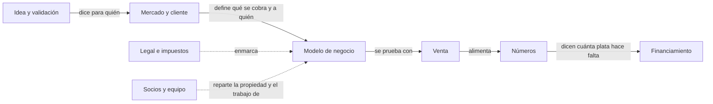

# Emprender

Emprender es armar una empresa desde una idea: validarla, entender a quién se le vende, definir cómo cobra, conseguir los primeros clientes y que las cuentas, lo legal, los socios y la plata acompañen.

Lo que va acá es lo que se aprende de libros, cursos y la práctica, sin nombrar a ninguna empresa nuestra: cómo lo aplica cada una se escribe en su repo, que enlaza la nota de acá. La experiencia propia vale como fuente y se cita como «experiencia propia, <mes y año>, <tipo de empresa>».

El tema todavía no tiene notas: cada parte entra cuando se vuelque algo leído o vivido sobre ella. Mientras tenga menos de una docena, las partes son secciones de esta entrada y las notas quedan en `Emprender/`.

## Las ocho partes

Las partes van más o menos en el orden en que aparecen al armar una empresa, pero cada una se lee sola.

### Idea y validación

Cómo nace una idea de negocio y cómo se comprueba, antes de invertir en ella, que resuelve un problema real para alguien dispuesto a pagar.

### Mercado y cliente

Quién compra, qué problema tiene y cómo se mide el tamaño del mercado al que apunta una empresa. Quién compra y por qué ya está desarrollado del lado del marketing, en [Mercado y cliente](../Marketing/Mercado-y-cliente/mercado-y-cliente.md); acá va lo que mira quien funda, como el tamaño del mercado.

### Modelo de negocio

Cómo una empresa crea, entrega y cobra el valor que ofrece, y las herramientas para describirlo, como el canvas. El precio es la parte que comparte con la [Propuesta](../Marketing/Propuesta/propuesta.md) de marketing.

### Venta

Cómo una empresa consigue sus primeros clientes y cómo arma un proceso de venta que se pueda repetir.

### Números

Las cuentas de una empresa que empieza: el caso de negocio, la economía por unidad, la caja y el punto de equilibrio. La economía por unidad vista desde el marketing está en [Economía unitaria](../Marketing/Medicion/economia-unitaria.md).

### Legal e impuestos

Las formas legales y el régimen impositivo de una empresa que empieza en Argentina, del monotributo a la SAS.

### Socios y equipo

Cómo se reparten la propiedad, las decisiones y el trabajo entre quienes fundan una empresa, y cuándo se suma gente.

### Financiamiento

De dónde sale la plata para empezar y crecer: fondos propios, clientes, deuda e inversión, con lo que cuesta cada una.
