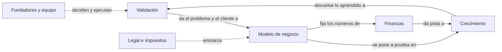

# Emprender

Emprender es armar una empresa nueva en condiciones de incertidumbre: descubrir si hay un problema por el que alguien paga, encontrar un modelo de negocio que lo resuelva de forma rentable y repetible, y hacerlo crecer con la plata, las personas y el marco legal que eso pide.

Una empresa que empieza se distingue de una que ya funciona por lo que no sabe. La establecida ejecuta un modelo de negocio conocido; la nueva todavía lo está buscando, y casi todo lo que cree sobre sus clientes es una suposición. La escuela que ordena este tema, el Lean Startup de Eric Ries y el desarrollo de clientes de Steve Blank, parte de ahí: al principio el trabajo es averiguar, con el menor esfuerzo posible, cuáles de esas suposiciones son ciertas. Otras escuelas discrepan en cómo se aprende y cuánto se planifica; están en [Escuelas de emprender](Fundamentos/escuelas-de-emprender.md).

El tema termina donde empieza la gestión de una empresa que ya encontró su modelo. Quién compra y por qué, la marca y los canales son marketing, y viven en [Marketing](../Marketing/marketing.md); el análisis de cohortes y la retención como técnica viven en [Datos](../Datos/datos.md). Lo que aplica cada empresa de la organización se escribe en su repo, que enlaza las notas de acá.

## De qué está hecho emprender

Son seis partes. La primera decide si vale la pena seguir; las otras dan por hecho que sí, y cada una vuelve a la validación cuando lo que aprende contradice un supuesto.

- [Validación](Validacion/validacion.md) — si hay un problema real y alguien dispuesto a pagar por resolverlo: hipótesis, descubrimiento de clientes, producto mínimo viable, el ciclo construir-medir-aprender y la decisión de pivotar. Es la primera parte que se trabaja.
- [Modelo de negocio](Modelo-de-negocio/modelo-de-negocio.md) — cómo la empresa crea, entrega y cobra el valor que ofrece, y cómo se describe en un canvas para ver qué supuestos lo sostienen.
- [Crecimiento](Crecimiento/crecimiento.md) — de los primeros clientes al encaje producto-mercado, y de ahí a crecer de forma repetible con un motor de crecimiento.
- [Finanzas](Finanzas/finanzas.md) — la caja, el consumo mensual y la pista que queda, el punto de equilibrio, y de dónde sale la plata con lo que cuesta cada fuente.
- [Fundadores y equipo](Fundadores-y-equipo/fundadores-y-equipo.md) — cómo se reparten la propiedad, las decisiones y el trabajo entre quienes fundan, y cuándo se suma gente.
- [Legal e impuestos](Legal-e-impuestos/legal-e-impuestos.md) — las formas legales y el régimen impositivo para empezar en Argentina.

## La idea que cruza todo el tema

Cada parte está llena de supuestos, y conviene probar primero aquellos de los que depende todo lo demás. Ries los llama [hipótesis de salto de fe](Validacion/hipotesis-de-salto-de-fe.md) y distingue dos: la de valor (el producto le sirve a quien lo usa) y la de crecimiento (cómo descubren el producto los clientes nuevos). Si alguna de las dos es falsa, el plan de finanzas y la sociedad sirven de poco; por eso [Validación](Validacion/validacion.md) va primero y las otras partes se arman con lo mínimo hasta que las dos se sostienen.

En la práctica, el avance se mide en aprendizaje y no en producto construido. Eso es la [contabilidad de la innovación](Validacion/contabilidad-de-la-innovacion.md), y su decisión central es [pivotar o perseverar](Validacion/pivotar-o-perseverar.md).

## Cómo recorrer el tema

Para entender el campo, empezá por [Qué es una startup](Fundamentos/que-es-una-startup.md) y seguí por la entrada de cada parte en el orden del diagrama. Dentro de Validación, el orden de lectura está en su entrada. Para consultar, [Fundamentos](Fundamentos/fundamentos-de-emprender.md) reúne lo que cruza todo el tema: las escuelas y su evidencia, los mitos que los datos desmienten, la bibliografía, las fuentes y el glosario.
