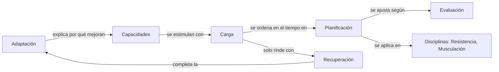

# Propuesta por capas (pendiente de fusionar con el tema existente)

Alcance y entrada redactados el 2026-11-27, antes de descubrir que otra sesión armaba Entrenamiento/ por objetivos. Se usan al ampliar el tema cuando ese PR esté en main.

## ALCANCE propuesto

---
tema: Entrenamiento
para: entender cómo se entrena el cuerpo y armar el propio plan, con una capa general que vale para cualquier disciplina y una carpeta por disciplina; la leen Matías y Fer
nivel: adultos que entrenan por salud y objetivos personales, sin formación en educación física; no atletas de competencia
escuela: basada en evidencia (metaanálisis y posturas del ACSM y la NSCA), con la tradición del profesorado (Matveyev, Platonov, Bompa) contada como origen y marcada donde la evidencia la discute
fuera: [la enseñanza escolar de la educación física, la nutrición (vive en Nutricion/), la rehabilitación de lesiones (se deriva a profesionales), el deporte de competencia de alto rendimiento, la técnica y la táctica de deportes de conjunto]
fuentes: []
preguntas:
  - ¿Por qué el cuerpo mejora cuando entreno y por qué se estanca?
  - ¿Cómo sé si una sesión fue fuerte o suave, y cuánto conviene entrenar por semana?
  - Quiero correr 10 km (o 21 km) en unos meses, ¿cómo armo el plan y a qué ritmos?
  - Voy al gimnasio 3 días, ¿cuántas series, cuántas repeticiones, qué rutina y cómo progreso?
  - ¿Cómo combino correr y gimnasio sin que uno arruine al otro?
  - ¿Cómo me doy cuenta de que me estoy pasando o de que se viene una lesión?
aprobado: 2026-11-27
---

# Alcance: Entrenamiento

Base para entender cómo se entrena el cuerpo: una capa general, agnóstica a la disciplina, que sigue los bloques de la teoría del entrenamiento de los profesorados y las certificaciones (adaptación, capacidades, carga, planificación, evaluación, recuperación), y debajo una carpeta por disciplina que la baja a lo concreto. Salió de la conversación del 2026-11-27: las primeras disciplinas son la resistencia, con correr como caso hondo, y la musculación en el gimnasio. Lo que se come para entrenar vive en [Nutrición](../Nutricion/nutricion.md).

## Árbol

```
Entrenamiento/
  entrenamiento.md              el todo; qué leer según lo que quieras hacer
  Adaptacion/                   por qué el cuerpo cambia cuando entrena
    sistemas-energeticos        de dónde sale la energía según duración e intensidad
    supercompensacion           estímulo, fatiga y rebote; modelo fitness-fatiga
    especificidad               el cuerpo se adapta a lo que hace
    desentrenamiento            qué se pierde, qué tan rápido y cómo se mantiene
  Capacidades/                  qué se entrena
    fuerza                      qué es y sus manifestaciones
    resistencia                 qué es y sus tipos
    velocidad
    movilidad-y-flexibilidad
    capacidades-coordinativas
  Carga/                        cuánto se entrena
    principios-del-entrenamiento  sobrecarga progresiva, individualidad, variación
    componentes-de-la-carga     volumen, intensidad, densidad, frecuencia
    carga-interna-y-externa     RPE, frecuencia cardíaca, sRPE
    dosis-minima-para-la-salud  ficha: recomendaciones OMS y ACSM
  Planificacion/                cómo se ordena en el tiempo
    ciclos                      macro, meso, microciclo y sesión
    modelos-de-periodizacion    clásica, bloques, ondulante, con su evidencia
    entrenamiento-concurrente   fuerza y resistencia juntas
    descarga-y-taper            bajar para rendir
  Evaluacion/                   cómo se sabe si funciona
    tests-de-capacidad          tests de campo de fuerza y de resistencia
    registro-y-monitoreo        qué anotar y cómo leerlo
  Recuperacion/                 lo que hace que la carga sirva
    sueno-y-recuperacion
    sobreentrenamiento          overreaching, sobreentrenamiento y RED-S
    lesiones-por-sobreuso       carga y lesión, señales de alarma
  Resistencia/                  disciplina; correr como caso hondo
    zonas-de-intensidad         umbrales y zonas por ritmo, FC y RPE
    distribucion-de-intensidad  polarizado, umbral, piramidal
    metodos-de-resistencia      continuo, intervalos, fartlek, cuestas
    plan-de-carrera             de 0 a 5 k y de 10 k a 21 k
    tecnica-de-carrera          cadencia y pisada
    calzado-y-relojes           ficha volátil
  Musculacion/                  disciplina; fuerza e hipertrofia en el gimnasio
    hipertrofia                 mecanismos, volumen y cercanía al fallo
    variables-de-la-rutina      series, repeticiones, RIR, descanso, frecuencia
    progresion-en-el-gimnasio   doble progresión, autorregulación
    tipos-de-rutina             full body, torso-pierna, push-pull-legs
    ejercicios-basicos          patrones de movimiento
    tecnica-y-seguridad
  Fundamentos/                  historia, escuelas, fuentes, glosario
```

## Supuestos

- El lector es un adulto que entrena por salud y objetivos personales, no un atleta de competencia.
- Resistencia en lugar de Running: la fisiología y la planificación son comunes a correr, bici y natación; correr es el caso que va hondo y las otras entran como subcarpetas si hace falta.
- Cada disciplina enlaza la capa general y no la repite; una disciplina nueva es otra carpeta del mismo tipo.
- Dueño por defecto (`matias`).

## Entrada propuesta

---
resumen: >-
  Entrenar es aplicarle al cuerpo una carga planificada para que se adapte y rinda más; esta base explica primero cómo funciona eso en cualquier disciplina y después lo baja a la resistencia (correr) y a la musculación en el gimnasio.
estado: borrador
estabilidad: semi
fuentes:
  - https://www.nsca.com/essentials-strength/
  - https://www.who.int/publications/i/item/9789240015128
  - https://pubmed.ncbi.nlm.nih.gov/20199119/
aliases: [Teoría del entrenamiento, Entrenamiento deportivo, Educación física, Training]
creado: 2026-11-27
revisado:
---

# Entrenamiento

Entrenar es aplicarle al cuerpo una carga planificada para que se adapte y rinda más; esta base explica primero cómo funciona eso en cualquier disciplina y después lo baja a la resistencia (correr) y a la musculación en el gimnasio.

Una sesión de entrenamiento no mejora a nadie en el momento: cansa. La mejora llega después, mientras el cuerpo se recupera y se ajusta a lo que se le pidió. De ahí sale la idea que ordena todo el tema: el entrenamiento es una dosis. Tiene un tipo (qué capacidad se estimula), una cantidad (la carga), un orden en el tiempo (la planificación) y una respuesta que se mide (la evaluación), y solo sirve si se recupera. Correr y levantar pesas se ven muy distintos, pero las dos prácticas obedecen esas mismas reglas.

La base sigue la división de la materia "Teoría y metodología del entrenamiento" de los profesorados y licenciaturas de educación física, y de los manuales de certificación como el de la NSCA. Se escribe desde la evidencia (metaanálisis y posturas del ACSM y la NSCA). La tradición del profesorado (Matveyev, Platonov, Bompa) aparece como el origen de las ideas, con la marca de dónde la evidencia la discute. Quedan afuera la enseñanza escolar de la educación física, la comida (vive en [Nutrición](../Nutricion/nutricion.md)) y la rehabilitación de lesiones ([alcance](ALCANCE.md)).

> [!IMPORTANT]
> Esta base resume libros de texto, posturas de sociedades científicas y estudios, y dice cuál es cuál. No reemplaza a un médico, a un kinesiólogo ni a un profesor de educación física. Un dolor que no se va, un síntoma al hacer esfuerzo (dolor de pecho, mareo, falta de aire fuera de lo normal) o una enfermedad previa se consultan antes de seguir entrenando.

## De qué está hecho el entrenamiento

El tema tiene dos capas. La de arriba vale para cualquier disciplina y tiene seis partes. Debajo, cada disciplina toma esas seis partes y las vuelve concretas: qué capacidades pide, en qué unidades se mide la carga, cómo se arma la semana y cómo se lastima quien la practica.



- [Adaptación](Adaptacion/adaptacion.md) — por qué el cuerpo cambia cuando entrena: de dónde saca la energía, el ciclo de carga, fatiga y mejora, por qué se adapta solo a lo que hace y qué pierde cuando deja.
- [Capacidades](Capacidades/capacidades.md) — qué se entrena: fuerza, resistencia, velocidad, movilidad y coordinación, qué es cada una y qué familias de métodos la mejoran.
- [Carga](Carga/carga.md) — cuánto se entrena: los principios del entrenamiento, los componentes de la carga, cómo se mide lo que se hizo y lo que costó, y la dosis mínima para la salud.
- [Planificación](Planificacion/planificacion.md) — cómo se ordena en el tiempo: los ciclos, los modelos de periodización, cómo se combinan fuerza y resistencia, y cuándo se baja la carga.
- [Evaluación](Evaluacion/evaluacion.md) — cómo se sabe si funciona: tests de campo y el registro de cada sesión.
- [Recuperación](Recuperacion/recuperacion.md) — lo que hace que la carga sirva: el sueño, el límite entre cansancio útil y sobreentrenamiento, y las lesiones por sobreuso.

Las disciplinas:

- [Resistencia](Resistencia/resistencia.md) — sostener un esfuerzo largo, con correr como el caso que va más hondo: zonas de intensidad, cómo repartirlas en la semana, los métodos, el plan para una carrera, la técnica y el equipo.
- [Musculación](Musculacion/musculacion.md) — fuerza e hipertrofia en el gimnasio: cómo crece el músculo, las variables de una rutina, cómo progresar, los tipos de rutina, los ejercicios básicos y la seguridad.

Una disciplina nueva (natación, ciclismo, un deporte) entra como otra carpeta del mismo tipo, que enlaza la capa general y no la repite.

Aparte de las partes, [Fundamentos](Fundamentos/fundamentos-de-entrenamiento.md) reúne lo que las cruza: la historia de la teoría del entrenamiento, las escuelas, la bibliografía del profesorado y la evidencia, y el glosario.

## Por qué la capa general va primero

Las dos disciplinas parecen opuestas: una busca durar y la otra, hacer fuerza. Pero las preguntas de quien entrena son las mismas: cuánto, qué tan fuerte, cada cuánto, cuándo descansar y cómo saber si funciona. La capa general responde esas preguntas una sola vez. Cada disciplina pone solo sus unidades: el ritmo por kilómetro y las zonas en la resistencia, las series y las repeticiones en reserva en la musculación.

Combinar las dos también es una pregunta de la capa general. Correr y levantar pesas en la misma semana compiten por la misma recuperación, y esa interacción está en [entrenamiento concurrente](Planificacion/entrenamiento-concurrente.md).

## Qué leer según lo que quieras hacer

- Si estás por empezar a entrenar y no sabés por dónde: [dosis mínima para la salud](Carga/dosis-minima-para-la-salud.md), [principios del entrenamiento](Carga/principios-del-entrenamiento.md) y la entrada de la disciplina que elijas.
- Si querés entender por qué mejorás o por qué te estancaste: [supercompensación](Adaptacion/supercompensacion.md), [especificidad](Adaptacion/especificidad.md) y [progresión en el gimnasio](Musculacion/progresion-en-el-gimnasio.md).
- Si tenés que medir qué tan fuerte fue una sesión: [carga interna y externa](Carga/carga-interna-y-externa.md) y [zonas de intensidad](Resistencia/zonas-de-intensidad.md).
- Si querés correr una distancia en una fecha: [plan de carrera](Resistencia/plan-de-carrera.md), [zonas de intensidad](Resistencia/zonas-de-intensidad.md) y [distribución de la intensidad](Resistencia/distribucion-de-intensidad.md).
- Si vas al gimnasio y tenés que armar la rutina: [variables de la rutina](Musculacion/variables-de-la-rutina.md), [tipos de rutina](Musculacion/tipos-de-rutina.md) y [ejercicios básicos](Musculacion/ejercicios-basicos.md).
- Si querés correr y hacer pesas a la vez: [entrenamiento concurrente](Planificacion/entrenamiento-concurrente.md) y [ciclos](Planificacion/ciclos.md).
- Si sospechás que te estás pasando o algo te duele: [sobreentrenamiento](Recuperacion/sobreentrenamiento.md) y [lesiones por sobreuso](Recuperacion/lesiones-por-sobreuso.md).
- Si lo que te importa es qué comer para entrenar: [rendimiento](../Nutricion/Objetivos-del-adulto/rendimiento.md) y [masa muscular y recomposición](../Nutricion/Objetivos-del-adulto/masa-muscular-y-recomposicion.md), en Nutrición.

## Del mecanismo a la práctica

Para aprender el tema de cero, el orden es de arriba hacia abajo:

1. [Adaptación](Adaptacion/adaptacion.md), empezando por [supercompensación](Adaptacion/supercompensacion.md): el modelo mental de todo lo demás.
2. [Capacidades](Capacidades/capacidades.md), para saber qué se puede entrenar.
3. [Carga](Carga/carga.md) y [Recuperación](Recuperacion/recuperacion.md), las dos caras de la dosis.
4. [Planificación](Planificacion/planificacion.md) y [Evaluación](Evaluacion/evaluacion.md).
5. La disciplina que practiques.
6. [Fundamentos](Fundamentos/fundamentos-de-entrenamiento.md), para ver de dónde vienen las ideas y cuáles se discuten.
