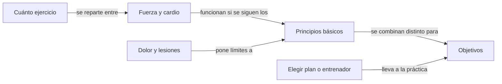

# Entrenamiento

Entrenar es hacer ejercicio con un plan para cambiar algo del cuerpo o de lo que puede hacer; esta base lo explica al nivel de las decisiones, para adultos que entrenan por su cuenta: cuánto hace falta, qué pide cada objetivo, los principios que no se saltean y cuándo un dolor es para consultar.

La mayor parte del resultado sale de pocas cosas: entrenar fuerza y algo de cardio, subiendo de a poco la exigencia. Los detalles finos de una rutina, como el orden de los ejercicios o el esquema de series, pesan bastante menos, según la posición 2026 de la ACSM. Por eso esta base no enseña a programar un plan ni la técnica de cada ejercicio: para eso están un profesor o un programa probado, y [elegir un plan o un entrenador](elegir-plan-o-entrenador.md) dice cómo reconocerlos.

Lo que se come para cada objetivo está en [Nutrición](../Nutricion/nutricion.md), sobre todo en [objetivos del adulto](../Nutricion/Objetivos-del-adulto/objetivos-del-adulto.md). La actividad física de los chicos está en [Crianza](../Crianza/Salud-y-rutinas/actividad-fisica.md). Quedan afuera la programación detallada, el alto rendimiento y la rehabilitación de lesiones ([alcance](ALCANCE.md)).

> [!IMPORTANT]
> Esta base resume guías de organismos de salud, posturas de sociedades de medicina del deporte y revisiones de estudios, y dice cuál es cuál. No reemplaza a un médico ni a un profesional del ejercicio: un dolor en el pecho, un mareo o una lesión se consultan antes de seguir.

## De qué está hecho entrenar

El tema tiene tres capas. Abajo está la base: cuánto movimiento necesita cualquier adulto y qué aportan la fuerza y el cardio. En el medio, los principios que hacen que un entrenamiento funcione. Arriba, los objetivos, que combinan la base y los principios de distinta forma. Al costado corren la seguridad y los mitos, que tocan todo.

- [Cuánto ejercicio](cuanto-ejercicio.md) — lo mínimo que piden las guías para la salud y qué pasa si se hace más.
- [Fuerza y cardio](fuerza-y-cardio.md) — qué aporta cada uno, intervalos o continuo, y si combinarlos hace perder músculo.
- [Principios básicos](principios-basicos.md) — progresar de a poco, qué tan cerca del límite terminar una serie, cuánto volumen alcanza, y constancia y descanso (esto último, sin fuente todavía).
- [Bajar grasa y ganar músculo](bajar-grasa-y-ganar-musculo.md) — lo que pide ese objetivo en el entrenamiento y qué esperar.
- [Rendir y coordinar](rendir-y-coordinar.md) — capacidad aeróbica, coordinación, equilibrio y potencia de adulto.
- [Estética y entrenamiento](estetica-y-entrenamiento.md) — lo que el entrenamiento puede cambiar y lo que no.
- [Elegir un plan o un entrenador](elegir-plan-o-entrenador.md) — cómo reconocer un programa serio y un buen profesional.
- [Dolor y lesiones](dolor-y-lesiones.md) — antes de empezar, cuándo seguir, parar o consultar, y qué lesiones son frecuentes.
- [Mitos del entrenamiento](mitos-del-entrenamiento.md) — bajar grasa de una zona, el cardio que come músculo, estirar para no lesionarse y otros.

## Qué leer según tu objetivo

- Si querés bajar grasa y ganar músculo: [bajar grasa y ganar músculo](bajar-grasa-y-ganar-musculo.md), [principios básicos](principios-basicos.md) y, para la comida, [pérdida de grasa](../Nutricion/Objetivos-del-adulto/perdida-de-grasa.md) y [masa muscular y recomposición](../Nutricion/Objetivos-del-adulto/masa-muscular-y-recomposicion.md).
- Si querés rendir más, coordinar mejor y cuidar la salud: [rendir y coordinar](rendir-y-coordinar.md), [cuánto ejercicio](cuanto-ejercicio.md) y [fuerza y cardio](fuerza-y-cardio.md).
- Si buscás un cambio estético: [estética y entrenamiento](estetica-y-entrenamiento.md) y, en Nutrición, [estética](../Nutricion/Objetivos-del-adulto/estetica.md).
- Si estás por empezar o volver después de mucho tiempo: [dolor y lesiones](dolor-y-lesiones.md), [cuánto ejercicio](cuanto-ejercicio.md) y [elegir un plan o un entrenador](elegir-plan-o-entrenador.md).
- Si arrancás de cero después de años y con poco tiempo, en este orden: [dolor y lesiones](dolor-y-lesiones.md) (antes de empezar), [cuánto ejercicio](cuanto-ejercicio.md), [principios básicos](principios-basicos.md), [fuerza y cardio](fuerza-y-cardio.md) (intervalos) y [elegir un plan o un entrenador](elegir-plan-o-entrenador.md).
- Si tenés poco tiempo: [fuerza y cardio](fuerza-y-cardio.md) (intervalos) y [principios básicos](principios-basicos.md) (cuánto volumen alcanza).
- Si te duele algo: [dolor y lesiones](dolor-y-lesiones.md).
- Si leíste algo en redes que suena demasiado bien: [mitos del entrenamiento](mitos-del-entrenamiento.md).
