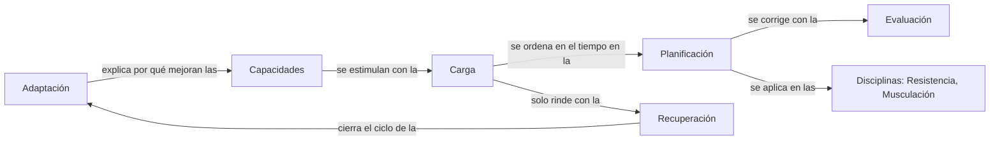

# Entrenamiento

Entrenar es aplicarle al cuerpo una carga planificada para que se adapte y pueda más; esta base lo explica primero al nivel de las decisiones y después baja a cómo funciona en cualquier disciplina y a dos disciplinas concretas, la resistencia (correr) y la musculación en el gimnasio.

Según el modelo clásico, que hoy se trata como metáfora útil y no como mecanismo medido ([supercompensación](Adaptacion/supercompensacion.md)), una sesión no mejora a nadie en el momento: cansa. La mejora llega después, mientras el cuerpo se recupera y se ajusta a lo que se le pidió. De ahí sale la idea que ordena el tema: el entrenamiento es una dosis. Tiene un tipo (qué capacidad se estimula), una cantidad (la carga), un orden en el tiempo (la planificación) y una respuesta que se mide (la evaluación), y solo sirve si se recupera. Correr y levantar pesas se ven distintos, pero obedecen esas mismas reglas.

La mayor parte del resultado sale de pocas cosas: entrenar fuerza y algo de cardio, subir de a poco la exigencia y sostenerlo en el tiempo (lectura de esta base a partir de las guías de [principios básicos](Carga/principios-basicos.md) y [cuánto ejercicio](Carga/cuanto-ejercicio.md)). Los detalles finos de una rutina pesan bastante menos: según la posición 2026 del ACSM, leída completa, pocas variables de la prescripción afectaron las adaptaciones principales. Por eso la base tiene dos alturas: arriba, las decisiones que alcanzan para entrenar bien; abajo, la teoría y las disciplinas, para quien quiera entender por qué o armar su propio plan.

Lo que se come para cada objetivo está en [Nutrición](../Nutricion/nutricion.md), sobre todo en [objetivos del adulto](../Nutricion/Objetivos-del-adulto/objetivos-del-adulto.md). La actividad física de los chicos está en [Crianza](../Crianza/Salud-y-rutinas/actividad-fisica.md). Quedan afuera la enseñanza escolar de la educación física, la técnica paso a paso de cada ejercicio, el alto rendimiento y la rehabilitación de lesiones ([alcance](ALCANCE.md)).

> [!IMPORTANT]
> Esta base resume guías de organismos de salud, posturas de sociedades de medicina del deporte y revisiones de estudios, y dice cuál es cuál. No reemplaza a un médico ni a un profesional del ejercicio: un dolor en el pecho, un mareo o una lesión se consultan antes de seguir.

## De qué está hecho el entrenamiento

La parte general vale para cualquier disciplina y tiene seis piezas. Sigue la división de la materia "Teoría y metodología del entrenamiento" de los programas de profesorado de educación física consultados; los manuales de certificación como el de la NSCA no se abrieron. Debajo, cada disciplina toma esas seis piezas y las vuelve concretas: qué capacidades pide, en qué unidades se mide la carga, cómo se arma la semana y cómo se lastima quien la practica.

- [Adaptación](Adaptacion/adaptacion.md) — por qué el cuerpo cambia cuando entrena: de dónde saca la energía, el ciclo de carga, fatiga y mejora, por qué se adapta solo a lo que hace y qué pierde cuando deja.
- [Capacidades](Capacidades/capacidades.md) — qué se entrena: fuerza, resistencia aeróbica, velocidad, movilidad y coordinación, y qué familias de métodos mejoran cada una.
- [Carga](Carga/carga.md) — cuánto se entrena: los principios básicos, cuánto ejercicio hace falta para la salud, los componentes de la carga y cómo se mide lo que se hizo y lo que costó.
- [Planificación](Planificacion/planificacion.md) — cómo se ordena en el tiempo: fuerza y cardio juntos, los ciclos, los modelos de periodización y cuándo se baja la carga.
- [Evaluación](Evaluacion/evaluacion.md) — cómo se sabe si funciona: tests de campo y el registro de cada sesión.
- [Recuperación](Recuperacion/recuperacion.md) — lo que hace que la carga sirva: el sueño, el límite entre cansancio útil y sobreentrenamiento, y qué hacer con un dolor.

Las disciplinas:

- [Resistencia](Resistencia/resistencia.md) — sostener un esfuerzo largo, con correr como el caso que va más hondo: zonas de intensidad, cómo repartirlas en la semana, los métodos, el plan para una carrera, la técnica y el equipo.
- [Musculación](Musculacion/musculacion.md) — fuerza e hipertrofia en el gimnasio: cómo crece el músculo, las variables de una rutina, cómo progresar, los tipos de rutina, los ejercicios básicos y la seguridad.

Una disciplina nueva (natación, ciclismo, un deporte) entra como otra carpeta del mismo tipo, que enlaza la parte general y no la repite.

Aparte, [Fundamentos](Fundamentos/fundamentos-de-entrenamiento.md) reúne lo que cruza todo: los mitos, cómo elegir un plan o un entrenador, la historia de la teoría del entrenamiento y sus escuelas, la bibliografía y el glosario.

## Los objetivos como puerta de entrada

Quien empieza casi nunca pregunta por la supercompensación: quiere bajar grasa, rendir más o verse distinto. Tres notas parten de esos objetivos y dicen qué pide cada uno, con enlaces hacia las piezas de abajo:

- [Bajar grasa y ganar músculo](bajar-grasa-y-ganar-musculo.md) — lo que pide ese objetivo en el entrenamiento y qué esperar.
- [Rendir y coordinar](rendir-y-coordinar.md) — capacidad aeróbica, coordinación, equilibrio y potencia de adulto.
- [Estética y entrenamiento](estetica-y-entrenamiento.md) — lo que el entrenamiento puede cambiar, en cuánto tiempo, y lo que no.

## Por qué la parte general va primero

Las dos disciplinas parecen opuestas: una busca durar y la otra, hacer fuerza. Pero las preguntas de quien entrena son las mismas: cuánto, qué tan fuerte, cada cuánto, cuándo descansar y cómo saber si funciona. La parte general responde esas preguntas una sola vez, y cada disciplina pone solo sus unidades: el ritmo por kilómetro y las zonas en la resistencia, las series y las repeticiones en reserva en la musculación.

Combinar las dos también es una pregunta general. Correr y levantar pesas en la misma semana pueden restarse algo, sobre todo en la fuerza explosiva (Schumann y otros, 2022, un metaanálisis de 43 estudios leído completo), y esa interacción está en [fuerza y cardio](Planificacion/fuerza-y-cardio.md).

## Qué leer según tu objetivo

- Si querés bajar grasa y ganar músculo: [bajar grasa y ganar músculo](bajar-grasa-y-ganar-musculo.md), [principios básicos](Carga/principios-basicos.md) y, para la comida, [pérdida de grasa](../Nutricion/Objetivos-del-adulto/perdida-de-grasa.md) y [masa muscular y recomposición](../Nutricion/Objetivos-del-adulto/masa-muscular-y-recomposicion.md).
- Si querés rendir más, coordinar mejor y cuidar la salud: [rendir y coordinar](rendir-y-coordinar.md), [cuánto ejercicio](Carga/cuanto-ejercicio.md) y [fuerza y cardio](Planificacion/fuerza-y-cardio.md).
- Si buscás un cambio estético: [estética y entrenamiento](estetica-y-entrenamiento.md) y, en Nutrición, [estética](../Nutricion/Objetivos-del-adulto/estetica.md).
- Si estás por empezar o volver después de mucho tiempo: [dolor y lesiones](Recuperacion/dolor-y-lesiones.md), [cuánto ejercicio](Carga/cuanto-ejercicio.md) y [elegir un plan o un entrenador](Fundamentos/elegir-plan-o-entrenador.md).
- Si querés entender por qué mejorás o por qué te estancaste: [supercompensación](Adaptacion/supercompensacion.md), [especificidad](Adaptacion/especificidad.md) y [progresión en el gimnasio](Musculacion/progresion-en-el-gimnasio.md).
- Si tenés que medir qué tan fuerte fue una sesión: [carga interna y externa](Carga/carga-interna-y-externa.md), [zonas de intensidad](Resistencia/zonas-de-intensidad.md) si corrés, [repeticiones en reserva](Musculacion/variables-de-la-rutina.md#repeticiones-en-reserva-qué-tan-cerca-del-límite) si hacés pesas, y [registro y monitoreo](Evaluacion/registro-y-monitoreo.md) para ver la tendencia.
- Si querés correr una distancia en una fecha: [plan de carrera](Resistencia/plan-de-carrera.md), [zonas de intensidad](Resistencia/zonas-de-intensidad.md), [distribución de la intensidad](Resistencia/distribucion-de-intensidad.md) y [métodos de resistencia](Resistencia/metodos-de-resistencia.md).
- Si vas al gimnasio y tenés que armar la rutina: [variables de la rutina](Musculacion/variables-de-la-rutina.md), [tipos de rutina](Musculacion/tipos-de-rutina.md), [ejercicios básicos](Musculacion/ejercicios-basicos.md) y [técnica y seguridad](Musculacion/tecnica-y-seguridad.md).
- Si alguien arranca de cero y quiere correr y hacer pesas: [dolor y lesiones](Recuperacion/dolor-y-lesiones.md) (antes de empezar), [cuánto ejercicio](Carga/cuanto-ejercicio.md), [principios básicos](Carga/principios-basicos.md), el tramo de 0 a 5 km de [plan de carrera](Resistencia/plan-de-carrera.md), una rutina de cuerpo completo de [tipos de rutina](Musculacion/tipos-de-rutina.md) y [fuerza y cardio](Planificacion/fuerza-y-cardio.md) para juntarlas. Cuántos días en total son prudentes para quien parte de cero no tiene fuente todavía.
- Si querés correr y hacer pesas a la vez: [fuerza y cardio](Planificacion/fuerza-y-cardio.md) y [ciclos](Planificacion/ciclos.md).
- Si tenés poco tiempo: [fuerza y cardio](Planificacion/fuerza-y-cardio.md) (intervalos) y [principios básicos](Carga/principios-basicos.md) (cuánto volumen alcanza).
- Si sospechás que te estás pasando o algo te duele: [sobreentrenamiento](Recuperacion/sobreentrenamiento.md) y [dolor y lesiones](Recuperacion/dolor-y-lesiones.md).
- Si leíste algo en redes que suena demasiado bien: [mitos del entrenamiento](Fundamentos/mitos-del-entrenamiento.md).

## Del mecanismo a la práctica

Para aprender el tema de cero, el orden es de arriba hacia abajo:

1. [Adaptación](Adaptacion/adaptacion.md), empezando por [supercompensación](Adaptacion/supercompensacion.md): el modelo mental de todo lo demás.
2. [Capacidades](Capacidades/capacidades.md), para saber qué se puede entrenar.
3. [Carga](Carga/carga.md) y [Recuperación](Recuperacion/recuperacion.md), las dos caras de la dosis.
4. [Planificación](Planificacion/planificacion.md) y [Evaluación](Evaluacion/evaluacion.md).
5. La disciplina que practiques.
6. [Fundamentos](Fundamentos/fundamentos-de-entrenamiento.md), para ver de dónde vienen las ideas y cuáles se discuten.
