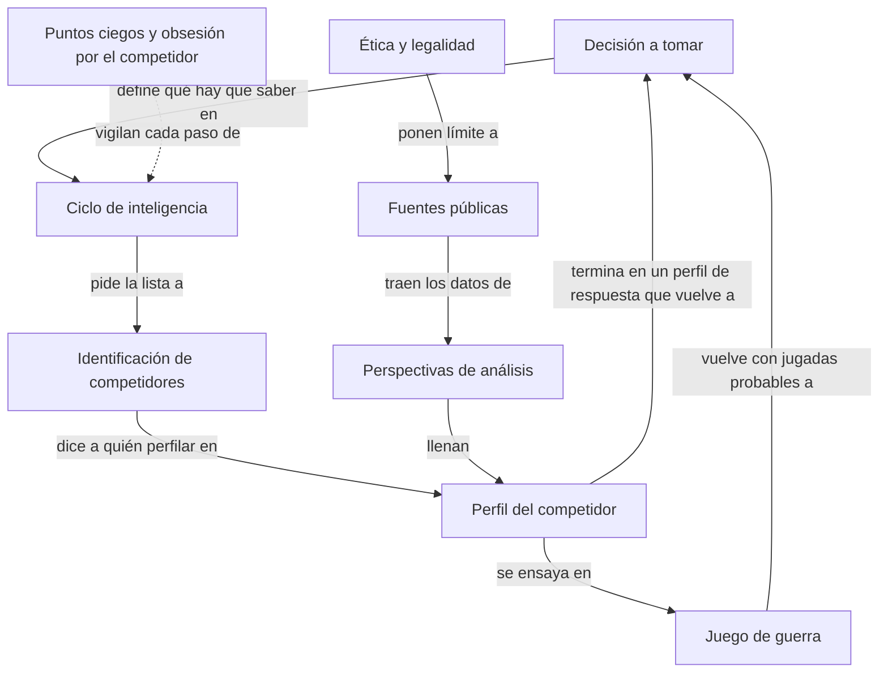

# Análisis de competidores

Analizar competidores, para diseñar un producto, es averiguar quién más puede resolverle el problema al cliente, qué hace, qué quiere y cómo respondería a una jugada propia, para decidir qué construir y dónde no pelear. Es la parte práctica de la estrategia competitiva: identificar rivales, perfilarlos, mirarlos desde varias perspectivas, juntar información de forma legal y no engañarse.

Dentro de [Estrategia competitiva](../estrategia-competitiva.md) es la vertical que baja la teoría a rivales con nombre. Toma del [análisis de industria](../Analisis-de-industria/analisis-de-industria.md) quiénes compiten de verdad contra quién, de [fuentes de ventaja](../Fuentes-de-ventaja/fuentes-de-ventaja.md) qué haría difícil copiar a un rival, y de [dinámica competitiva](../Dinamica-competitiva/dinamica-competitiva.md) cuándo un rival responde. Entrega opciones y riesgos a la [estrategia de producto](../../Producto/Estrategia/estrategia-de-producto.md) y alternativas al [posicionamiento](../../Marketing/Propuesta/posicionamiento.md).

## Para diseñar un producto, no para vender

La misma práctica sirve a dos fines. Para vender, termina en argumentos para ganar una venta concreta contra un rival concreto. Para diseñar, termina en una decisión: qué oportunidades quedan abiertas, qué no conviene construir y cómo va a reaccionar el rival si el producto entra. Esta vertical trata el segundo fin y entrega un perfil de respuesta por rival; la decisión se toma en la estrategia de producto. La distinción es de esta base.

Quien diseña necesita, además de lo que el rival hace, sus objetivos y supuestos, que según Porter reciben mucha menos atención. Y corre un riesgo propio: copiar lo que el rival tiene en vez de mirar al cliente.

## El recorrido: de la decisión al perfil de respuesta

El análisis arranca con una decisión y termina en una predicción de cómo se va a mover cada rival.

1. **Decidir qué hay que saber.** El [ciclo de inteligencia](ciclo-de-inteligencia.md) empieza por la decisión que el análisis tiene que apoyar. Sin ella, recolectar no termina nunca.
2. **Identificar.** La [identificación de competidores](identificacion-de-competidores.md) arma la lista con directos, indirectos, sustitutos, potenciales y el no consumo. Bergen y Peteraf (2002) sostienen, según su abstract, que los gerentes suelen errar sobre todo con los sustitutos del lado de la oferta y con los indirectos o potenciales.
3. **Perfilar.** El [perfil del competidor](perfil-del-competidor.md) de Porter tiene cuatro componentes (objetivos futuros, supuestos, estrategia actual y capacidades) y termina en un perfil de respuesta. El [análisis propio](analisis-propio.md) aplica la misma vara a la empresa propia, con fortalezas y debilidades relativas a cada rival.
4. **Mirar desde varias perspectivas.** Las [perspectivas de análisis](perspectivas-de-analisis.md) llenan el perfil, cada una con su técnica. Dos tienen nota propia: el [desarme de producto](desarme-de-producto.md) para la mirada de producto y la [lectura de reportes públicos](lectura-de-reportes-publicos.md) para la financiera.
5. **Recolectar dentro de la ley.** Las [fuentes públicas](fuentes-publicas.md) son la etapa de recolección del ciclo, y cada dato vale según quién lo dice y si otra fuente lo confirma. La [ética y la legalidad](etica-y-legalidad.md) marcan qué se puede averiguar y cómo, y la [ley argentina](ley-argentina-y-competidores.md) pone el límite legal.
6. **Anticipar.** El [juego de guerra](juego-de-guerra.md) ensaya las jugadas del rival con personas que actúan su papel.
7. **No engañarse.** Los [puntos ciegos](puntos-ciegos.md) son los sesgos de quien analiza, como no ver al competidor ausente. La [obsesión por el competidor](obsesion-por-el-competidor.md) es el riesgo de convertir al rival en el objetivo.

El orden es de esta base: Porter da el perfil y la literatura de inteligencia competitiva el ciclo, pero ninguna fuente arma el recorrido entero.

## Cuánto respaldo tiene cada paso

El respaldo es desparejo, y cada nota lo dice. El marco de Porter es fundacional pero es de preguntas, y no se encontró contraste empírico de que mejore decisiones; tampoco de que la tipología de competidores o el catálogo de perspectivas, que ayudan a no olvidar a nadie, mejoren el resultado.

La simulación con roles es lo único con números. Armstrong (2002), comentando el trabajo de Green, reporta 61 % de pronósticos correctos con juego de roles frente a 28 % con teoría de juegos, igual que el azar, en conflictos genéricos jugados mayormente por estudiantes. Para el juego de guerra empresarial no se encontró evaluación publicada.

El ciclo de inteligencia y las fuentes públicas son práctica razonable; la evidencia de que la inteligencia competitiva mejore resultados es escasa y mixta (estudios sueltos, transversales y con desempeño autoinformado). La evidencia más fuerte es en contra de un uso del análisis: fijarse como objetivo ganarle al rival se asocia con menos rentabilidad en el estudio de Armstrong y Collopy (1996), cuyas cifras y límites están en [obsesión por el competidor](obsesion-por-el-competidor.md).

## Cómo falla el análisis de competidores

Las fallas se repiten en cada paso del recorrido, y cada una tiene su nota:

| Falla | Qué pasa | Dónde se trata |
|---|---|---|
| Recolectar sin decisión | se junta todo y no se entrega nada útil | [ciclo de inteligencia](ciclo-de-inteligencia.md) |
| Mirar solo a los parecidos | el rival que gana viene de otra categoría o es el statu quo | [identificación](identificacion-de-competidores.md), [puntos ciegos](puntos-ciegos.md) |
| Llenar solo lo observable | se sabe qué hace el rival pero no qué quiere ni qué cree | [perfil del competidor](perfil-del-competidor.md) |
| Usar la matriz de funcionalidades como lista de pendientes | se construye lo que el rival tiene porque lo tiene | [desarme de producto](desarme-de-producto.md) |
| Tomar una estimación como dato | cifras de tráfico o ingresos de terceros se leen como exactas | [fuentes públicas](fuentes-publicas.md), [lectura de reportes](lectura-de-reportes-publicos.md) |
| Cruzar la línea legal | se obtiene lo que el rival protege, o se finge ser otro para conseguirlo | [ética y legalidad](etica-y-legalidad.md) |
| Hacerlo una sola vez | el análisis envejece y el rival se mueve sin que nadie mire | [puntos ciegos](puntos-ciegos.md) |
| Convertir al rival en el objetivo | se sacrifica rentabilidad o cliente por ganarle | [obsesión por el competidor](obsesion-por-el-competidor.md) |

Zajac y Bazerman (1991), según su abstract, sostienen que los puntos ciegos al prever a los rivales son predecibles ([puntos ciegos](puntos-ciegos.md)). Por eso, según esta base, las fallas piden método y alguien que pregunte desde el cliente, además de datos.

## Qué hay adentro del análisis de competidores

- [Identificación de competidores](identificacion-de-competidores.md): directos, indirectos, sustitutos, potenciales y el no consumo, y por qué los gerentes ven pocos rivales. Se lee primero.
- [Perfil del competidor](perfil-del-competidor.md): los cuatro componentes de Porter, el perfil de respuesta y las señales de mercado.
- [Análisis propio](analisis-propio.md): la misma vara aplicada a uno mismo, la matriz de Grant y la evidencia de sobreconfianza.
- [FODA](foda.md): la matriz TOWS, sus críticas y cómo usarlo para decidir.
- [Perspectivas de análisis](perspectivas-de-analisis.md): qué pregunta contesta cada mirada, con qué técnica y qué no contesta, y FAROUT.
  - [Análisis de ventas ganadas y perdidas](analisis-de-ventas-ganadas-y-perdidas.md): el win/loss, sus siete pasos, sus límites y la muestra inicial.
- [Desarme de producto](desarme-de-producto.md): teardown, matriz de funcionalidades y cuándo la paridad cuesta clientes.
- [Lectura de reportes públicos](lectura-de-reportes-publicos.md): el 10-K y el 20-F, el flujo de caja del rival y los límites de estimar su economía unitaria.
- [Ciclo de inteligencia](ciclo-de-inteligencia.md): planificar, recolectar, analizar y entregar.
- [Fuentes públicas](fuentes-publicas.md): de dónde sale cada dato de un rival y cuánto vale.
  - [Registros públicos argentinos](registros-publicos-argentinos.md): ficha fechada con qué registro da qué dato de una empresa argentina.
- [Ética y legalidad](etica-y-legalidad.md): qué se puede averiguar y cómo, el código de SCIP y el *scraping* en EE. UU.
  - [Ley argentina y competidores](ley-argentina-y-competidores.md): secretos comerciales, delitos informáticos, datos personales y defensa de la competencia.
- [Juego de guerra](juego-de-guerra.md): ensayar las jugadas del rival con personas que actúan su papel.
- [Puntos ciegos](puntos-ciegos.md): los sesgos de quien analiza, el competidor ausente y la alerta temprana.
- [Obsesión por el competidor](obsesion-por-el-competidor.md): cuándo mirar al rival daña, según Armstrong y Collopy.

## Lo que falta del análisis de competidores

La guía con plantilla ya está en el [recorrido de un análisis de competencia](../Fundamentos/recorrido-analisis-de-competencia.md). Falta, en otra pasada:

- Los datos de plataformas concretas, en fichas fechadas de un tema de dominio por industria.

> [!NOTE] Sin fuente todavía: los entregables de la inteligencia competitiva orientada a ventas (como las *battlecards*) y una comparación publicada entre el análisis que hacen los equipos de producto y el de la inteligencia competitiva formal.
