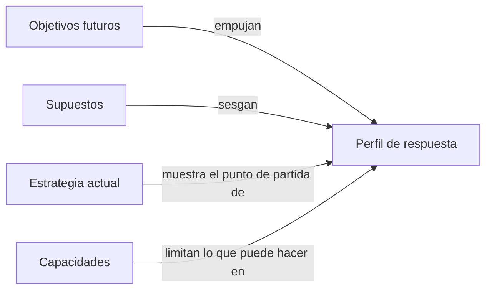

# Perfil del competidor

El perfil del competidor es el marco de Porter para entender a un rival por cuatro componentes: sus objetivos futuros, sus supuestos, su estrategia actual y sus capacidades. Su producto final es un perfil de respuesta: qué es probable que haga el rival y cómo reaccionaría a una jugada propia.

El perfil es el objeto que se arma sobre cada rival de la lista que dejó la [identificación de competidores](identificacion-de-competidores.md). Las [perspectivas de análisis](perspectivas-de-analisis.md) son los lugares desde donde se juntan los datos que lo llenan. Porter lo presenta en el capítulo 3 de *Competitive Strategy* (1980), y es el texto fundacional de la práctica.

## Los cuatro componentes de Porter

Porter lo dice así: "There are four diagnostic components to a competitor analysis (see Figure 3-1): future goals, current strategy, assumptions, and capabilities." (p. 48). Entenderlos "will allow an informed prediction of the competitor's response profile".

La Figura 3-1 los divide en dos lados. A la izquierda, "What Drives the Competitor": objetivos futuros y supuestos. A la derecha, "What the Competitor Is Doing and Can Do": estrategia actual y capacidades.

| Componente | Qué pregunta | Qué perspectiva lo alimenta (síntesis de esta base) |
|---|---|---|
| Objetivos futuros (p. 50) | ¿Qué quiere lograr y cuán satisfecho está? | estratégica, financiera, organizacional |
| Supuestos (p. 58) | ¿Qué cree de sí mismo y de la industria? | estratégica, de mercado |
| Estrategia actual | ¿Cómo compite hoy? | de producto, de precio, de canales, de cliente |
| Capacidades (p. 63) | ¿Qué puede hacer y qué no? | tecnológica, financiera, de producto, UX |

La tercera columna no es de Porter. Es la conexión que esta base hace con su catálogo de miradas.

## Lo que se llena y lo que se saltea

Porter advierte que la gente completa el lado derecho y descuida el izquierdo: "Most companies develop at least an intuitive sense for their competitors' current strategies and their strengths and weaknesses [...] Much less attention is usually directed at the left side, or understanding what is really driving the behavior of a competitor—its future goals and the assumptions it holds" (p. 48). Una matriz de funcionalidades es lado derecho puro: dice qué hace el rival, pero no por qué ni qué va a hacer.

También descarta dos creencias: "Competitors cannot be systematically analyzed" y "We know all about our competitors because we compete with them every day." Su respuesta: "Neither assumption is generally true." (pp. 47-48).

## Objetivos futuros

Los objetivos permiten predecir si el rival está satisfecho con su posición, cuán probable es que cambie de estrategia y con qué vigor va a reaccionar (p. 50). Incluyen metas no financieras, como el liderazgo de mercado, la posición tecnológica o el desempeño social. Porter pide diagnosticarlos "at multiple management levels": corporativo, de unidad de negocio y funcional.

Da once preguntas para diagnosticarlos: metas financieras explícitas e implícitas, actitud frente al riesgo, valores, estructura organizacional, sistemas de incentivos, convenciones contables, trayectoria del CEO, unanimidad de la dirección, composición del directorio, compromisos contractuales y restricciones regulatorias. Suma ocho más si el rival es una unidad de un grupo, como los resultados y las metas de la casa matriz o la importancia estratégica de la unidad.

En un SaaS, un rival que acaba de levantar capital para crecer en un segmento nuevo tiene otros objetivos que uno que busca rentabilidad para venderse. Lo primero se ve en los [reportes públicos](lectura-de-reportes-publicos.md) y en las señales de contratación.

## Supuestos y puntos ciegos del rival

Porter separa dos clases de supuestos: lo que el competidor cree de sí mismo y lo que cree de la industria y de los demás (p. 58). "Examining assumptions of all types can identify biases or blind spots" (p. 58). En esos puntos ciegos el rival "will either not see the significance of events [...] at all, will perceive them incorrectly, or will perceive them only very slowly" (p. 59).

Su ejemplo: si un rival cree tener la mayor lealtad de clientes y no la tiene, un recorte de precios provocador puede ganarle posición. Esos son los puntos ciegos del rival. Los de quien analiza, el otro lado del problema, están en [puntos ciegos](puntos-ciegos.md).

## Estrategia actual y capacidades

La estrategia actual es cómo compite hoy el rival, y se reconstruye con lo observable: producto, precio, canales y clientes. Las capacidades deciden qué puede hacer: "Its strengths and weaknesses will determine its ability to initiate or react to strategic moves." (p. 63). Porter las evalúa por área funcional (Figura 3-2) y frente a las [cinco fuerzas](../Analisis-de-industria/cinco-fuerzas.md) del capítulo 1.

Las capacidades que hacen difícil copiar a alguien se estudian aparte, en [recursos y capacidades](../Fuentes-de-ventaja/recursos-y-capacidades.md).

## El perfil de respuesta es el producto final

El perfil termina en preguntas: "Given an analysis of a competitor's future goals, assumptions, current strategies, and capabilities, we can begin to ask the critical questions that will lead to a profile of how a competitor is likely to respond." (p. 67). La Figura 3-1 las resume en cuatro:

1. ¿Está satisfecho con su posición actual?
2. ¿Qué movimientos o cambios de estrategia es probable que haga?
3. ¿Dónde es vulnerable?
4. ¿Qué provocará la represalia más fuerte y efectiva?

Porter las ordena en dos bloques. Los movimientos ofensivos miran la satisfacción con la posición, los movimientos probables y su fuerza y seriedad. La capacidad defensiva mira cómo respondería frente a una lista de jugadas factibles y de cambios del entorno. Ensayar esas respuestas en grupo es el [juego de guerra](juego-de-guerra.md), y la teoría de cuándo un rival responde está en [acción y respuesta](../Dinamica-competitiva/accion-y-respuesta.md).

El marco sirve también al revés. Porter lo propone para el autoanálisis y para anticipar qué conclusiones sacan los rivales sobre uno (p. 49).

## Las señales de mercado, un análisis de segundo orden

El capítulo 4 parte del perfil para leer lo que el rival comunica: "A market signal is any action by a competitor that provides a direct or indirect indication of its intentions, motives, goals, or internal situation." (p. 75). Porter avisa que no todas valen lo mismo: "Some signals are bluffs, some are warnings, and some are earnest commitments to a course of action."

Leer señales "rests on" haber hecho antes el análisis del capítulo 3. Porter lo llama "a second-order form of competitor analysis". El índice del capítulo trata los tipos de señales (p. 76), el uso de la historia (p. 86) y si prestar atención a las señales puede distraer (p. 87).

> [!NOTE] Sin fuente todavía: la lista de tipos de señal del capítulo 4 y lo que dice sobre la historia y la distracción; solo se leyó la apertura del capítulo.

## De dónde salen los datos del perfil

Porter lista las fuentes de un sistema de inteligencia (p. 71): "reports filed publicly, speeches by a competitor's management to security analysts, the business press, the sales force, a firm's customers or suppliers that are common to competitors, inspection of a competitor's products, estimates by the firm's engineering staff, knowledge gleaned from managers or other personnel who have left the competitor's employment". Advierte que los datos "come in trickles rather than rivers". Cómo se organiza esa recolección está en el [ciclo de inteligencia](ciclo-de-inteligencia.md) y en [fuentes públicas](fuentes-publicas.md); qué está permitido, en [ética y legalidad](etica-y-legalidad.md).

## Leer el capítulo 3

El recurso canónico es Porter (1980), capítulo 3, pp. 47-74, con la Figura 3-1 como ficha del perfil. Fijarse en tres cosas: la asimetría entre el lado izquierdo y el derecho; las preguntas sobre supuestos y puntos ciegos (p. 59); y que el producto es el perfil de respuesta, no el listado de datos. Después, la apertura del capítulo 4 (p. 75) para pasar de un perfil quieto a la lectura de señales.
