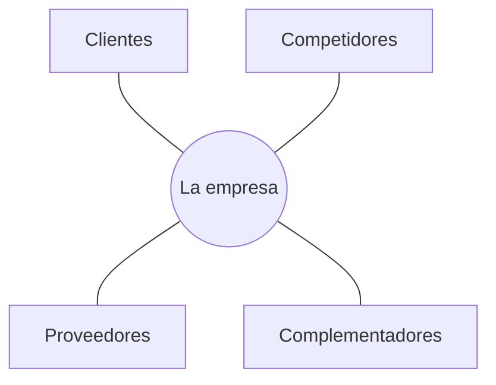

# Coopetición

La coopetición es cooperar y competir a la vez con el mismo actor. Su herramienta es la red de valor de Brandenburger y Nalebuff, que pone a cada actor en uno o más de cuatro papeles (cliente, proveedor, competidor, complementador) y pregunta cuánto valor se pierde si cada uno no está.

El resto de [Dinámica competitiva](dinamica-competitiva.md) trata al otro como rival: si va a responder, cuándo conviene mover. La coopetición agrega el caso en que el rival también es socio. Es el caso de quien vive sobre una plataforma: la plataforma le trae clientes y a la vez puede quedarse con su trabajo. El lado en que la plataforma compite está en [competencia con la plataforma](../../Producto/Plataformas/competencia-con-la-plataforma.md); acá está cómo pensar las dos cosas juntas.

## La red de valor: cuatro papeles, no dos

Brandenburger y Nalebuff publicaron *Co-opetition* en 1996. El libro no se leyó; las definiciones llegan por una tesis de NYU Stern que lo cita y por la reseña de Armstrong. La red de valor ordena a los actores en dos ejes. En el vertical están los clientes y los proveedores. En el horizontal, los competidores y los complementadores.

La diferencia entre los dos papeles horizontales está en lo que el cliente valora:

- Complementador: "A player is your complementor if customers value your product more when they have the other player's product than when they have your product alone". El ejemplo de los autores es el software para el hardware.
- Competidor: cualquier actor "whose presence causes customers to value your product or service less".

Un mismo actor puede tener los dos papeles, y por eso, según la tesis, "competitors are not always necessarily a firm's enemies, just as complementors are not always necessarily a firm's friend". La plataforma de tiendas es el caso claro, en una lectura de esta base que ninguna fuente hace. Es complementadora de una agencia que arma tiendas, porque sin la plataforma no hay tienda que armar. Puede ser competidora cuando ofrece una app gratis para que el comercio [mude su tienda](../../Comercio-electronico/Plataforma-de-tiendas/mudar-una-tienda.md) solo. Y es proveedora, porque la agencia usa sus herramientas y su programa de socios ([socios de una plataforma](../../Comercio-electronico/Plataforma-de-tiendas/socios-de-una-plataforma.md)).

Porter no cuenta a los complementos como una fuerza: los trata como un factor aparte ([cinco fuerzas](../Analisis-de-industria/cinco-fuerzas.md)). La red de valor les da un lugar propio en el mapa. Armstrong, en una reseña crítica, reconoce que ese es el aporte nuevo: "By naming complementors as a stakeholder group and including it on their checklist, B&N provide something new."

## El valor agregado decide cuánto se lleva cada uno

Los autores lo definen así en un artículo de 1997: "Added value equals total value created with you in the game, minus total value created without you in the game." Es cuánto se pierde si un actor sale del juego. Su ejemplo es el vidrio de la pantalla de una laptop: hace falta, pero hay varios proveedores, y cada uno aporta centavos. Agregan que un vidrio más resistente, que nadie más hiciera, podría valer dólares por equipo. La lectura de esta base es que quien tiene poco valor agregado se lleva poco, aunque su producto sea necesario.

Para un socio de una plataforma la pregunta es la misma: qué se pierde si la agencia no está. En una mudanza simple, la app propia de la plataforma hace el trabajo, y el valor agregado de la agencia tiende a cero. En una tienda con integraciones, datos sucios o un rubro con reglas propias, la app no alcanza. El razonamiento es de esta base; ningún estudio lo midió.

## Cambiar el juego: PARTS

El libro propone mirar cinco cosas que se pueden cambiar. Armstrong las resume en una línea:

| Letra | Pregunta |
|---|---|
| Players | Quién juega y quién debería jugar |
| Added values | Qué trae cada uno al juego |
| Rules | Cuáles son las reglas y si se pueden cambiar |
| Tactics | Qué tácticas alternativas hay |
| Scope | Si el juego se puede ampliar |

Es una lista de preguntas sin evidencia detrás. Armstrong dice que el libro "support[s] [its] conclusions with anecdotes", que buscó y no encontró evidencia de que la teoría de juegos mejore las predicciones, y que mucho del consejo es "overly general". Su veredicto: "though most of this seems to be old wine, it is fine wine".

## Dónde cooperar y dónde competir

Bengtsson y Kock estudiaron la coopetición en redes de empresas. Ninguno de los dos artículos se leyó; se conocen por Peng et al. (2012) y por fuentes secundarias. En 1999 distinguen cuatro relaciones con un competidor: coexistencia, cooperación, competencia y coopetición, y dicen que la relación puede cambiar con el tiempo. En 2000 proponen los factores que influyen en que dos competidores cooperen: recursos distintos entre las partes, la cercanía de la actividad al cliente, la posición y la conexión entre los competidores, y el conflicto y el consenso sobre los objetivos.

Del factor de la cercanía al cliente sale una regla que se les atribuye: cooperar en lo alejado del cliente (compras, investigación) y competir en lo cercano (venta, marketing). La regla llega solo por fuentes secundarias sin autor verificado, que la describen como un supuesto implícito más que como un hallazgo, y no se pudo comprobar en el original. Un caso de 2015 sobre una red de negocios chicos, conocido por un resumen, estudia justamente la cooperación cerca del cliente.

Según la lectura de esta base, al socio de una plataforma la regla le sirve poco: la agencia coopera con la plataforma cerca del cliente, cuando le trae comercios y los ayuda a abrir la tienda, y ese es el terreno que la plataforma le puede disputar.

## Qué dice la evidencia: rinde en promedio, no siempre

> [!IMPORTANT]
> Que la coopetición rinda tiene respaldo en promedio y resultados mixtos en el detalle.
>
> - A favor, el meta-análisis de Xie et al. (2023), con "49 primary studies with 62,057 participants" según su abstract, encuentra un efecto positivo sobre el desempeño financiero, de mercado y de innovación. El efecto depende de la cultura del país, la industria, la estructura de la coopetición y cómo se midió. En 15 años de una red de supermercados de Taiwán, Peng et al. (2012) encuentran que cooperar con competidores "did lead to better performance, at least over a period", una ventaja que llaman temporal.
> - Con límites, otro meta-análisis, de 2021 y conocido solo por un buscador, encuentra un efecto global positivo pero ninguna relación significativa entre la intensidad de la coopetición y el desempeño, y no encuentra que la industria modere el efecto sobre el desempeño general, como sí dicen Xie et al. Park, Srivastava y Gnyawali (2014) hallan, según su abstract, una relación "non-monotonic" con la innovación: rinde más la coopetición equilibrada, con competencia moderadamente alta y cooperación alta. Crick (2020), con 101 bodegas de Nueva Zelanda, encuentra relaciones cuadráticas con la satisfacción del cliente: mucha coopetición daña, y un resumen agrega que poca también.
> - Sobre el campo, Gnyawali y Charleton (2018) describen la literatura como polarizada entre un polo entusiasta y otro que subraya la "value destruction", por ejemplo la fuga de información. Proponen tres resultados posibles: valor creado en conjunto, valor que se lleva uno solo, o valor destruido.
>
> La lectura de esta base: la coopetición rinde cuando cada parte conserva algo que la otra necesita, y la dosis importa.

Casi toda esta evidencia viene de empresas de tamaño parecido, sobre todo en tecnología e investigación. La del socio chico frente a una plataforma grande sigue abajo.

## El socio chico frente a la plataforma

Los estudios más cercanos a una agencia sobre una plataforma de tiendas son de software empresarial. Ceccagnoli et al. (2012) siguieron a 1.210 empresas chicas de software independientes (ISV, por su sigla en inglés) entre 1996 y 2004. Asociarse a la plataforma de SAP se asoció con "an increase in sales and a greater likelihood of issuing an initial public offering (IPO)", es decir, de salir a la bolsa. El efecto fue mayor en las que tenían propiedad intelectual fuerte o capacidades cercanas al cliente: marca, marketing, distribución y servicio.

El mismo estudio nombra el riesgo. Al asociarse, el socio le transfiere conocimiento a la plataforma, y "the risk of platform owner entry into the ISV's market is likely to increase with partnership". El borrador de Huang et al. (2009) agrega dos datos. La propiedad intelectual y las capacidades cercanas al cliente funcionan como "substitutes to prevent expropriation by the platform owner". Y el ex CEO de SAP les dijo a los autores: "One rule is that we cannot protect the partner forever".

La dependencia corre para los dos lados. Según Digiday (2018), los socios de Shopify generaron unos US$ 800 millones en 2017, más que los US$ 673 millones que facturó la propia Shopify; un cofundador de Bold Commerce, que hace apps para Shopify, llamó a ese ecosistema "their moat". La lectura de esta base es que la plataforma necesita a sus socios y eso le da motivos para no aplastarlos, como el caso de Intel que cuenta [competencia con la plataforma](../../Producto/Plataformas/competencia-con-la-plataforma.md#dónde-entra-la-plataforma-zhu-y-liu-con-datos-de-amazon). No se encontró cómo medir ese poder, y los hechos también van en sentido contrario: en 2019 Shopify anunció que iba a restringir que sus socios buscaran comercios para llevárselos de la plataforma, y Modern Retail lo contó como "yet another example of platform dependency".

Kude y Huber (2024), según un resumen, siguieron a cuatro socios de software empresarial durante 14 años para ver cómo responden cuando la plataforma mueve. Encontraron tres respuestas básicas (insistir en la posición, pivotear o despegarse) que se combinan en tres patrones. El que se va alejando del ecosistema baja la dependencia, pero cuesta mantener varias plataformas a la vez. El que insiste devuelve la posición anterior con más dependencia, y deja al socio expuesto al próximo movimiento. El tercero se expande de a poco dentro del ecosistema.

## Qué conviene ser frente a la plataforma

Los pasos son de esta base, armados a partir de las fuentes de arriba. Ningún estudio los da juntos ni los probó en agencias de tiendas online:

1. Dibujá la red de valor del negocio: para cada actor (la plataforma, las apps, otras agencias, los comercios), en qué papel está hoy. La plataforma va a aparecer en más de uno.
2. Medí tu valor agregado servicio por servicio: qué se pierde si no estás. Lo que la plataforma ya resuelve con una herramienta propia (una mudanza simple, una plantilla) tiene poco valor agregado y es lo primero que se pierde.
3. Poné el valor donde la plataforma no entra: relación con el comercio, servicio, conocimiento de un rubro, integraciones a medida. Es lo que Ceccagnoli et al. llaman capacidades cercanas al cliente. Con datos de Amazon, Zhu y Liu encontraron que la plataforma entra menos donde crecer pide mucho trabajo del vendedor ([competencia con la plataforma](../../Producto/Plataformas/competencia-con-la-plataforma.md#dónde-entra-la-plataforma-zhu-y-liu-con-datos-de-amazon)).
4. Medí cuánto dependés de una sola plataforma. Trabajar en dos cuesta, pero es lo que permite despegarse si la plataforma entra ([costos de cambio](../Fuentes-de-ventaja/costos-de-cambio.md), y el multi-homing, estar en varias plataformas a la vez, visto desde el tercero en [competencia con la plataforma](../../Producto/Plataformas/competencia-con-la-plataforma.md#qué-hacen-los-terceros-cuando-la-plataforma-amenaza-o-entra)).
5. Leé las reglas antes de jugar: lo que el programa de socios prohíbe y lo que se reserva cambia el juego, y la plataforma lo puede cambiar sola ([socios de una plataforma](../../Comercio-electronico/Plataforma-de-tiendas/socios-de-una-plataforma.md#lo-que-la-plataforma-prohíbe-y-lo-que-se-reserva)).

La relación con la plataforma se administra en las dos puntas: se coopera donde la plataforma necesita a la agencia, y se compite donde la agencia hace algo que la plataforma no quiere hacer.

## Qué leer

"The Added-Value Theory of Business" (1997), de los mismos autores, es corto y abierto: fijate en la definición de valor agregado y en el ejemplo del vidrio. Leelo junto con la reseña de Armstrong (1997), que separa lo útil del libro (los complementadores, la lista PARTS) de lo que no está probado. Para el caso de un socio de plataforma, Ceccagnoli et al. (2012) tienen texto libre: la introducción y la discusión, fijándote en qué tipo de socio gana al asociarse.

> [!NOTE] Sin fuente todavía: el texto de Bengtsson y Kock (2000) y del libro de 1996; un estudio sobre agencias o implementadores de plataformas de tiendas online como socios y competidores a la vez; datos de Tiendanube, WooCommerce o América Latina.
