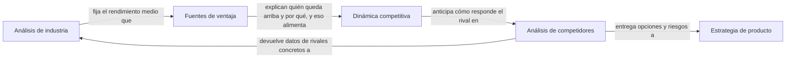

# Estrategia competitiva

La estrategia competitiva estudia por qué unas empresas ganan más que otras en un mismo mercado: qué tan rentable es la industria, de dónde sale una ventaja que dure, cómo se mueven los rivales y cómo se los analiza. Sirve para decidir dónde y cómo competir antes de diseñar un producto.

El tema junta dos cosas que los textos de referencia tratan juntas. Una es la teoría: Porter, la visión basada en recursos y la literatura sobre rivalidad. La otra es la práctica de analizar competidores, que Porter abre en el capítulo 3 de *Competitive Strategy* (1980) y que la inteligencia competitiva convirtió en oficio. Las dos se necesitan: la teoría sola no llega a una decisión sobre un rival concreto, y el análisis de rivales sin teoría tiende a quedar en una planilla de funcionalidades.

Termina donde empieza la [estrategia de producto](../Producto/Estrategia/estrategia-de-producto.md), que elige dónde jugar y cómo ganar con lo que este tema le da, y el [posicionamiento](../Marketing/Propuesta/posicionamiento.md), que decide contra qué alternativas se presenta el producto ante el cliente. La competencia entre plataformas de dos lados está en [Plataformas](../Producto/Plataformas/plataformas.md), del tema Producto.

Los ejemplos del tema son de software y en especial de SaaS: software que se usa por suscripción, alojado por quien lo vende. Los términos que se repiten entre notas, como VRIO, comunalidad de mercado o costos de cambio, están definidos en el [glosario](Fundamentos/glosario-de-estrategia-competitiva.md), con el enlace a la nota donde se explica cada uno.

## De qué está hecha la estrategia competitiva

Las cuatro partes van de lo más amplio a lo más concreto. La industria fija el piso de rentabilidad; la ventaja explica por qué una empresa queda por encima de ese piso; la dinámica muestra cómo se defiende esa ventaja en el tiempo; y el análisis de competidores aplica todo a rivales con nombre y apellido.

- [Análisis de industria](Analisis-de-industria/analisis-de-industria.md): las cinco fuerzas y los grupos estratégicos. Se entra para saber si un mercado vale la pena y quiénes compiten de verdad contra quién.
- [Fuentes de ventaja](Fuentes-de-ventaja/fuentes-de-ventaja.md): estrategias genéricas, cadena de valor, recursos y capacidades, los 7 Powers y los costos de cambio. Se entra para saber qué haría difícil copiar a un rival, o al producto propio.
- [Dinámica competitiva](Dinamica-competitiva/dinamica-competitiva.md): acción y respuesta, ventaja del primero, disrupción, océano azul y elegir el terreno. Se entra para anticipar qué pasa cuando alguien mueve.
- [Análisis de competidores](Analisis-de-competidores/analisis-de-competidores.md): identificar rivales, perfilarlos, mirarlos desde varias perspectivas, juntar información de forma legal y no engañarse. Es la parte práctica y la más desarrollada.

## La industria importa, pero la empresa importa más

Porter sostiene que la estructura de la industria fija la rentabilidad media de quienes compiten en ella. La visión basada en recursos sostiene que la ventaja sale de lo que cada empresa tiene y otros no pueden copiar. Los dos enfoques se midieron con un mismo método: descomponer las diferencias de rentabilidad entre unidades de negocio.

McGahan y Porter (1997) atribuyen el 19 % de esa varianza a la industria y el 32 % a la unidad de negocio. Rumelt (1991) había encontrado 4 % y 44,2 %, según la tabla de Misangyi et al. (2006). Los estudios no coinciden en las cifras, y Misangyi et al. atribuyen la diferencia "largely" a las técnicas de análisis. Sí coinciden en el orden: la unidad de negocio explica más que la industria en todos los estudios con cifras verificadas, y la industria no es nula. Por eso el tema tiene las dos partes, y ninguna alcanza sola. El detalle y las escuelas están en [Fundamentos](Fundamentos/fundamentos-de-estrategia-competitiva.md).

Todos esos datos son de empresas grandes, sobre todo de Estados Unidos y de décadas pasadas. No se encontró un estudio equivalente para software.

## Los marcos son listas de preguntas, no predicciones

Las cinco fuerzas, los 7 Powers o el modelo de acción y respuesta de Chen ordenan qué mirar, pero ninguno predice qué va a pasar con un producto. La evidencia es despareja: la descomposición de varianza respalda que la industria pesa, aunque menos que la unidad de negocio; la visión basada en recursos tiene una crítica de tautología abierta; los 7 Powers no tienen contraste empírico independiente; y el modelo de Chen tiene respaldo parcial. Cada nota dice cuánto respaldo tiene su marco. La regla de uso es tratar lo que sale de un marco como una hipótesis que se verifica con el caso.

## Mirar al rival sin perder de vista al cliente

> [!IMPORTANT]
> Analizar competidores y fijarse como objetivo ganarles son dos cosas distintas, con evidencia distinta. Armstrong y Collopy (1996) encontraron que, en 20 empresas, el objetivo de cuota de mercado se correlacionó negativamente con el retorno sobre la inversión (de -0,37 a -0,54), y que en experimentos más del 40 % de 1016 sujetos sacrificó beneficios por ganarle a un rival. La muestra es chica y no se encontró una réplica independiente. Del otro lado, el meta-análisis de Kirca et al. (2005) asocia la orientación al mercado (cliente más competidor más coordinación) con mejor desempeño, aunque en el texto leído no aparece una cifra separada para el componente competidor. La lectura de esta base: el análisis de competidores es una herramienta para decidir qué hacer por el cliente, no un objetivo. El detalle está en [obsesión por el competidor](Analisis-de-competidores/obsesion-por-el-competidor.md).

## Dónde entra en el diseño de un producto

El análisis de competencia es un paso del medio. Antes hace falta saber qué se quiere decidir, entender el dominio, definir el mercado y conocer al cliente; después vienen la síntesis, la decisión y el seguimiento. Cada paso tiene su nota, en este tema o en otro:

1. **La pregunta**: qué se quiere decidir con el análisis. Sin una decisión, la recolección no termina nunca ([ciclo de inteligencia](Analisis-de-competidores/ciclo-de-inteligencia.md)).
2. **El dominio**: cómo funciona la industria por dentro. Es un tema propio por industria, fuera de este.
3. **El mercado**: qué abarca ([definición de mercado](../Marketing/Mercado-y-cliente/definicion-de-mercado.md)), su tamaño ([tamaño de mercado](../Emprender/Validacion/tamano-de-mercado.md)) y su estructura ([análisis de industria](Analisis-de-industria/analisis-de-industria.md)).
4. **El cliente**: qué trabajo quiere resolver ([jobs to be done](../Marketing/Mercado-y-cliente/jobs-to-be-done.md)) y cómo se lo investiga ([métodos de investigación](../UX/Investigacion/metodos-de-investigacion.md)).
5. **Los rivales**: quiénes son ([identificación de competidores](Analisis-de-competidores/identificacion-de-competidores.md)) y cómo se los mira ([perspectivas de análisis](Analisis-de-competidores/perspectivas-de-analisis.md)).
6. **La síntesis**: qué oportunidades quedan ([árbol de oportunidades](../Producto/Descubrimiento/arbol-de-oportunidades.md)).
7. **La decisión**: dónde jugar y cómo ganar ([estrategia de producto](../Producto/Estrategia/estrategia-de-producto.md)), contra qué alternativas presentarse ([posicionamiento](../Marketing/Propuesta/posicionamiento.md)) y qué probar primero ([prueba de supuestos](../Producto/Descubrimiento/prueba-de-supuestos.md)).
8. **El seguimiento**: vigilar a los rivales de forma periódica y no una sola vez ([puntos ciegos](Analisis-de-competidores/puntos-ciegos.md)).

El recorrido de [Análisis de competidores](Analisis-de-competidores/analisis-de-competidores.md#el-recorrido-de-la-decisión-al-perfil-de-respuesta) es el detalle del paso 5. Arranca en la misma pregunta del paso 1 y entrega un perfil de respuesta por rival, que es lo que usan los pasos 6 y 7.

El orden es de esta base, armado a partir de las fuentes de cada paso; ninguna fuente lo da entero. La guía práctica que lo recorre con una plantilla va a sumarse en `Fundamentos/`.

## Orden de lectura

Para quien empieza: primero esta entrada, después [Análisis de competidores](Analisis-de-competidores/analisis-de-competidores.md), que es lo que se usa, y [obsesión por el competidor](Analisis-de-competidores/obsesion-por-el-competidor.md). Después [Análisis de industria](Analisis-de-industria/analisis-de-industria.md), [Fuentes de ventaja](Fuentes-de-ventaja/fuentes-de-ventaja.md) y [Dinámica competitiva](Dinamica-competitiva/dinamica-competitiva.md), en ese orden.

- [Fundamentos](Fundamentos/fundamentos-de-estrategia-competitiva.md): escuelas y evidencia, historia, bibliografía por necesidad, fuentes, mitos y glosario.
