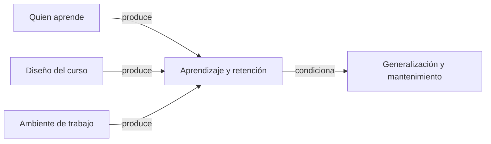

# Transferencia de la capacitación

La transferencia de la capacitación es que lo aprendido en un curso se generalice y se mantenga en el trabajo. Según el modelo de Baldwin y Ford (1988), depende de quien aprende, del diseño del curso y del ambiente de trabajo, y el ambiente pesa más en habilidades abiertas como el liderazgo que en cerradas como un software.

Una habilidad cerrada se aplica casi siempre de la misma forma (los pasos de un software); una abierta se adapta a cada situación y admite varias formas de hacerla bien (liderar una reunión).

Es el tercer nivel de [Kirkpatrick](niveles-de-kirkpatrick.md) visto como problema: no alcanza con medir si se usa, hay que saber de qué depende. La transferencia como fenómeno cognitivo (por qué cuesta usar algo en un contexto distinto del que se aprendió) está en [transferencia](../../Ciencias-del-aprendizaje/Transferencia/transferencia.md), de Ciencias del aprendizaje. Que los efectos caen mucho al pasar de criterios de aprendizaje a criterios de conducta, y qué hace quien aprende por su cuenta para que no caigan, está en [aprender por cuenta propia](../../Desarrollo-personal/Efectividad-personal/aprender-por-cuenta-propia.md).

## El modelo de Baldwin y Ford

Según Wikipedia, es «the most commonly cited model of transfer» y define la transferencia como «the generalization and maintenance of material learned in training to the work environment». El texto original no se pudo leer (es una imagen escaneada).

El modelo tiene dos fases. Primero, tres insumos producen aprendizaje y retención: las características de quien aprende, el diseño de la capacitación y el ambiente de trabajo. Después vienen las condiciones de transferencia: generalizar a situaciones nuevas y mantenerlo en el tiempo.

El resumen leído no detalla qué efecto directo tiene cada insumo sobre la transferencia.

## Qué predice que se use

Blume et al. (2010) metaanalizaron 89 estudios. Según el abstract, la transferencia se relacionó positivamente con la capacidad cognitiva, la responsabilidad, la motivación y un ambiente de trabajo que apoya. La mayoría de esos predictores pesaron más cuando lo enseñado era una habilidad «abierta» (liderazgo) que «cerrada» (un software). Y cuando la transferencia se midió con la misma fuente y en el mismo momento que los predictores, las relaciones salieron «consistently inflated». Los tamaños de efecto no se leyeron.

Grossman y Salas (2011) resumen los factores con relaciones más fuertes y consistentes:

| Grupo | Factores |
|---|---|
| Quien aprende | Capacidad cognitiva, autoeficacia, motivación, utilidad percibida |
| Diseño | Modelado de la conducta, manejo del error, ambientes realistas |
| Trabajo | Clima de transferencia, apoyo, oportunidad de practicar, seguimiento |

Según Bell et al. (2017), los factores tuvieron efectos distintos según se mida el uso o la efectividad, la evidencia sobre las intervenciones antes y después del curso «fail to provide compelling support», y las restricciones del ambiente se estudiaron poco.

## El mito del 10 %

Circula que «solo el 10 % de lo que se enseña en una capacitación se transfiere». No se encontró una fuente primaria que lo sostenga; Saks (2002) la discute, pero solo se halló el registro. Esta base no la usa.

## Lo que queda para quien enseña

Inferencia de esta base: tres cosas del cuadro dependen de quien arma el curso, la utilidad percibida, el diseño realista y el seguimiento. La oportunidad de practicar en el trabajo no depende del curso, y Grossman y Salas la cuentan entre los factores más fuertes. Que un curso corto de una herramienta (habilidad cerrada) dependa menos del ambiente que uno de liderazgo es lo que encontró Blume; trasladarlo a un curso concreto es inferencia.

> [!NOTE] Sin fuente todavía: los tamaños de efecto de Blume et al. (2010) y el texto de Baldwin y Ford (1988).
