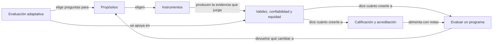

# Evaluación educativa

La evaluación educativa es cómo se sabe qué aprendió alguien: con qué propósito se evalúa, con qué instrumento, cuánto se puede confiar en el resultado y qué se hace con él, desde una pregunta al grupo hasta un certificado o la evaluación de un curso entero.

Cierra el ciclo de la [didáctica](../Didactica/didactica.md) y del [diseño instruccional](../Diseno-instruccional/diseno-instruccional.md): sin ella no se sabe si la enseñanza funcionó. Una parte mira a quien aprende (qué sabe ahora) y otra al programa (si el curso sirvió). Es uno de los cinco temas del área Pedagogía, junto a [Ciencias del aprendizaje](../Ciencias-del-aprendizaje/ciencias-del-aprendizaje.md), [Didáctica](../Didactica/didactica.md), [Diseño instruccional](../Diseno-instruccional/diseno-instruccional.md) y [Tecnología educativa](../Tecnologia-educativa/tecnologia-educativa.md).

La idea que ordena el tema es de los Standards de 2014: no hay pruebas válidas o inválidas, hay usos. La misma prueba de diez preguntas puede servir para decidir por dónde empezar y no servir para certificar. Por eso todo arranca del propósito.

El tema termina en tres bordes. Por qué recordar lo aprendido fija la memoria es de [Psicología](../Psicologia/Aprendizaje-y-memoria/practica-espaciada-y-recuperacion.md). Qué hace buena a una devolución es de [Didáctica](../Didactica/didactica.md). Los tests psicológicos clínicos están en [Psicología infantil](../Psicologia-infantil/Evaluacion/tests-psicologicos.md), y evaluar a empleados, en [evaluación del desempeño](../Liderazgo-y-direccion/Gestion-de-personas/evaluacion-del-desempeno.md).

## De qué está hecha la evaluación educativa

Cada evaluación responde a un propósito, junta evidencia con un instrumento, se juzga por su validez y termina en una decisión: ajustar la enseñanza, poner una nota, emitir un certificado o juzgar el curso.

- [Propósitos](Propositos/propositos.md): para qué se evalúa, diagnóstica, formativa o sumativa, y la prueba como práctica. Entrá acá primero.
- [Instrumentos](Instrumentos/instrumentos.md): opción múltiple, tareas de desempeño, rúbricas, autoevaluación y pares, y la corrección de código.
- [Validez, confiabilidad y equidad](Validez-confiabilidad-y-equidad/validez-confiabilidad-y-equidad.md): cuánto creerle a un resultado, y cómo se infla cuando se vuelve meta.
- [Evaluación adaptativa](Evaluacion-adaptativa/evaluacion-adaptativa.md): modelar lo que sabe cada uno, desde la teoría de respuesta al ítem hasta los espacios de conocimiento, y qué sobrevive con un grupo chico.
- [Calificación y acreditación](Calificacion-y-acreditacion/calificacion-y-acreditacion.md): de lo observado a una nota o un certificado, y qué le hace la nota a quien la recibe.
- [Evaluar un programa](Evaluar-un-programa/evaluar-un-programa.md): saber si un curso sirvió y no solo si gustó; Kirkpatrick, transferencia, retorno y grupo de comparación.
- [Fundamentos](Fundamentos/fundamentos-de-evaluacion-educativa.md): la historia de los conceptos, las dos culturas del campo, los mitos, las [fuentes](Fundamentos/fuentes-de-evaluacion-educativa.md) y el [glosario](Fundamentos/glosario-de-evaluacion-educativa.md).

## Casi toda la evidencia es escolar

Los experimentos sobre notas, evaluación formativa, diagnóstico rápido y dominio se hicieron con escolares y universitarios, casi siempre en matemática. La única literatura con adultos en el trabajo es la de capacitación en organizaciones, que mide otras cosas (reacción, transferencia) y casi nunca con grupo de comparación. Cada nota dice cuándo extrapola a adultos o a la enseñanza de informática, y lo marca como inferencia.

La otra advertencia es de escala. Buena parte del campo (la teoría de respuesta al ítem, los tests adaptativos, el funcionamiento diferencial de los ítems) necesita cientos de personas. Quien enseña a un grupo chico se lleva las preguntas de esos métodos, no sus cálculos.

## Qué leer según lo que estés haciendo

- Si tenés que ubicar a alguien que entra a un curso según lo que ya sabe: [evaluación diagnóstica](Propositos/evaluacion-diagnostica.md), [espacios de conocimiento](Evaluacion-adaptativa/espacios-de-conocimiento.md) y, para no fiarte de lo que la persona dice saber, [autoevaluación y evaluación entre pares](Instrumentos/autoevaluacion-y-evaluacion-entre-pares.md).
- Si tenés que saber si de verdad aprendieron, y no solo si les gustó: [niveles de Kirkpatrick](Evaluar-un-programa/niveles-de-kirkpatrick.md), [tareas de desempeño](Instrumentos/tareas-de-desempeno.md) y [evaluación con grupo de comparación](Evaluar-un-programa/evaluacion-con-grupo-de-comparacion.md).
- Si tenés que armar una prueba o un examen: [validez](Validez-confiabilidad-y-equidad/validez.md), [opción múltiple](Instrumentos/opcion-multiple.md) y [equidad y sesgo](Validez-confiabilidad-y-equidad/equidad-y-sesgo.md).
- Si tenés que corregir proyectos o código entre varias personas: [rúbrica](Instrumentos/rubrica.md), [confiabilidad](Validez-confiabilidad-y-equidad/confiabilidad.md) y [tareas de desempeño](Instrumentos/tareas-de-desempeno.md).
- Si tenés que decidir si poner nota, y cuándo: [notas y comentarios](Calificacion-y-acreditacion/notas-y-comentarios.md), [evaluación formativa](Propositos/evaluacion-formativa.md) y [calificación por dominio](Calificacion-y-acreditacion/calificacion-por-dominio.md).
- Si tenés que usar preguntas para que aprendan, no para medir: [evaluación como aprendizaje](Propositos/evaluacion-como-aprendizaje.md) y, para el mecanismo, [práctica espaciada y recuperación](../Psicologia/Aprendizaje-y-memoria/practica-espaciada-y-recuperacion.md).
- Si tenés que emitir un certificado o decidir cuánto vale uno: [certificados y microcredenciales](Calificacion-y-acreditacion/certificados-y-microcredenciales.md) y [referencia a norma y a criterio](Calificacion-y-acreditacion/referencia-a-norma-y-a-criterio.md).
- Si tenés que justificar con números que una capacitación valió la pena: [retorno de la capacitación](Evaluar-un-programa/retorno-de-la-capacitacion.md) y [transferencia de la capacitación](Evaluar-un-programa/transferencia-de-la-capacitacion.md).
- Si las notas suben y no sabés si aprenden más: [inflación de notas](Validez-confiabilidad-y-equidad/inflacion-de-notas.md).
- Si tenés que elegir un sistema que diagnostique solo: no hay nota de comparación de productos; lo más cercano es la [ficha de sistemas de diagnóstico adaptativo](Evaluacion-adaptativa/sistemas-de-diagnostico-adaptativo.md) y, para las herramientas, [Tecnología educativa](../Tecnologia-educativa/tecnologia-educativa.md).

## Del propósito a la decisión

1. [Propósitos](Propositos/propositos.md) y [evaluación formativa](Propositos/evaluacion-formativa.md): para qué se evalúa.
2. [Validez, confiabilidad y equidad](Validez-confiabilidad-y-equidad/validez-confiabilidad-y-equidad.md) y [validez](Validez-confiabilidad-y-equidad/validez.md): con qué se juzga cualquier resultado.
3. [Instrumentos](Instrumentos/instrumentos.md), empezando por la [rúbrica](Instrumentos/rubrica.md).
4. [Calificación y acreditación](Calificacion-y-acreditacion/calificacion-y-acreditacion.md), con [notas y comentarios](Calificacion-y-acreditacion/notas-y-comentarios.md).
5. [Evaluar un programa](Evaluar-un-programa/evaluar-un-programa.md).
6. [Evaluación adaptativa](Evaluacion-adaptativa/evaluacion-adaptativa.md), cuando lo anterior está claro.
7. [Fundamentos](Fundamentos/fundamentos-de-evaluacion-educativa.md), para la historia y los mitos.
