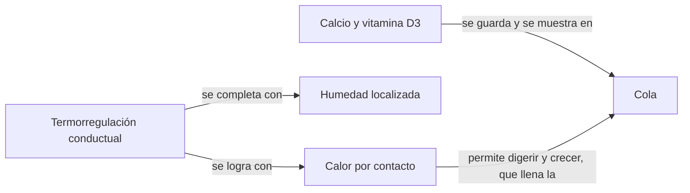

# Gecko leopardo

El gecko leopardo (*Eublepharis macularius*) es un lagarto nocturno y terrestre de zonas áridas del sur de Asia, y uno de los reptiles de terrario más criados (el tercero más popular según Valdez 2021, citado por Agarwal et al. 2022); esta base explica qué necesita, cómo se nota que está bien o mal y qué hacer.

Casi todo su cuidado sale de una sola idea: es un animal que no fabrica su propio calor y que en la naturaleza elige, a cada hora, dónde estar. El terrario le da opciones en lugar de "una temperatura": un piso caliente, un rincón fresco, un refugio húmedo en un ambiente seco. Lo que falla, en general, falla porque falta alguna de esas opciones o porque la comida no trae lo que su cuerpo no puede producir.

> [!IMPORTANT]
> Esta base resume fuentes veterinarias, estudios y práctica de criadores, y dice cuál es cuál. No reemplaza a un veterinario de exóticos.

## Por dónde entrar

- **Para entender el cuidado**: leé en orden los conceptos umbral de abajo, después [[armar-el-terrario|armar el terrario]] y [[alimentar-y-suplementar|alimentar y suplementar]].
- **Para operar el día a día**: [[revisar-pesar-y-registrar|revisar, pesar y registrar]] y [[valores-de-referencia-gecko|valores de referencia]].
- **Para decidir**: [[sustrato-suelto-o-solido|sustrato suelto o sólido]], [[uvb-si-o-no|UVB sí o no]] y [[temperatura-del-punto-caliente|temperatura del punto caliente]].
- **Si algo anda mal**: [[cuando-llevar-el-gecko-al-veterinario|cuándo ir al veterinario]] primero, después la falla que corresponda.

## Conceptos umbral

Cinco ideas que cambian cómo se ve todo lo demás. El diagrama muestra cuál hace falta para entender cuál.

- [[termorregulacion-conductual|Termorregulación conductual]] — por qué necesita un gradiente y no una temperatura fija.
- [[calor-por-contacto|Calor por contacto]] — por qué importa la temperatura del piso más que la del aire.
- [[humedad-localizada|Humedad localizada]] — por qué un animal de zonas secas necesita un refugio húmedo.
- [[calcio-y-vitamina-d3|Calcio y vitamina D3]] — de dónde saca lo que sus huesos necesitan.
- [[cola-del-gecko|Cola]] — dónde guarda reservas y cómo se lee su estado.

## Qué es

- [[eublepharis-macularius|Gecko leopardo]] — qué animal es, de dónde viene y en qué se diferencia de otros geckos.
- [[del-salt-range-al-terrario|Del Salt Range al terrario]] — cómo pasó de las zonas áridas de Pakistán a los terrarios del mundo.

## Cómo funciona

- [[actividad-crepuscular|Actividad crepuscular]] — qué significa ser activo al anochecer para la luz y el UVB.

## Su cuerpo y su vida

- [[autotomia|Autotomía]] — cómo suelta la cola y qué pasa después.
- [[muda-del-gecko|Muda]] — cada cuánto cambia la piel y qué la complica.
- [[crecimiento-del-gecko|Crecimiento]] — de cría a adulto, sexado y longevidad.
- [[brumacion|Brumación]] — el letargo de invierno: criadores lo inducen y una hoja veterinaria, sin verificar, lo lee como alarma.

## Cómo se hace

- [[armar-el-terrario|Armar el terrario]] — tamaño, gradiente, calor, refugios y sustrato.
- [[alimentar-y-suplementar|Alimentar y suplementar]] — qué insectos, cuánto, y calcio y vitaminas.
- [[revisar-pesar-y-registrar|Revisar, pesar y registrar]] — cómo manipularlo y qué anotar.

## Cómo se decide

- [[sustrato-suelto-o-solido|Sustrato suelto o sólido]] — el debate de la arena y la impactación.
- [[uvb-si-o-no|UVB sí o no]] — lo que muestran los estudios en una especie crepuscular.
- [[temperatura-del-punto-caliente|Temperatura del punto caliente]] — por qué criadores y veterinarios dan rangos distintos.

## Cómo falla

- [[cuando-llevar-el-gecko-al-veterinario|Cuándo ir al veterinario]] — las señales que no esperan.
- [[enfermedad-metabolica-osea|Enfermedad metabólica ósea]] — huesos blandos por falta de calcio, D3 o calor.
- [[impactacion|Impactación]] — el intestino bloqueado y sus causas.
- [[retencion-de-muda|Retención de muda]] — piel que no sale y corta la circulación.
- [[problemas-oculares|Problemas oculares]] — el único problema con datos de prevalencia en la especie.
- [[criptosporidiosis|Criptosporidiosis]] — un parásito con portadores sin síntomas.
- [[ideas-erroneas-sobre-el-gecko|Ideas erróneas]] — las creencias documentadas que conviene corregir.

## Ecosistema y referencia

- [[equipos-del-terrario|Equipos]] — tipos de calefacción, control, luz y medición (cambia rápido).
- [[fuentes-sobre-gecko-leopardo|Fuentes de referencia]] — qué fuentes son confiables y por qué.
- [[glosario-gecko-leopardo|Glosario]] — los términos técnicos que usan las notas.
- [[valores-de-referencia-gecko|Valores de referencia]] — temperaturas, humedad, pesos y frecuencias, cada uno con su fuente.

## Qué es evidencia y qué es práctica

La evidencia propia de la especie es escasa: casi todo sale de manuales veterinarios de reptiles en general o de práctica de criadores. Cada nota dice de dónde sale cada dato. A grandes rasgos:

| Se apoya en estudios o fuentes veterinarias | Es práctica de criadores o está en disputa |
|---|---|
| Que necesita calor y elegir entre temperaturas ([[termorregulacion-conductual|termorregulación conductual]]) | El valor exacto del punto caliente ([[temperatura-del-punto-caliente|temperatura del punto caliente]]) |
| Que sintetiza vitamina D3 con UVB y que la D3 de la dieta alcanza para crecer seis meses ([[uvb-si-o-no|UVB sí o no]]) | Si el UVB hace falta |
| La regeneración de la cola ([[autotomia|autotomía]]) | Leer el peso por el ancho de la cola ([[cola-del-gecko|cola]]) |
| El riesgo de los problemas oculares y la vitamina A ([[problemas-oculares|problemas oculares]]) | Arena o sustrato sólido ([[sustrato-suelto-o-solido|sustrato suelto o sólido]]) |
| Que la enfermedad metabólica ósea viene del manejo ([[enfermedad-metabolica-osea|enfermedad metabólica ósea]]) | Humedad ambiente y de la cueva, tamaño del terrario, frecuencias de comida, brumación |

Qué fuente pesa cuánto: [[fuentes-sobre-gecko-leopardo|fuentes de referencia]]. Los términos técnicos: [[glosario-gecko-leopardo|glosario]].

## Orden de lectura

Para leerlo de punta a punta: gecko leopardo → historia → los cinco conceptos umbral → actividad crepuscular → cuerpo y vida → cómo se hace → cómo se decide → cómo falla → referencia.
