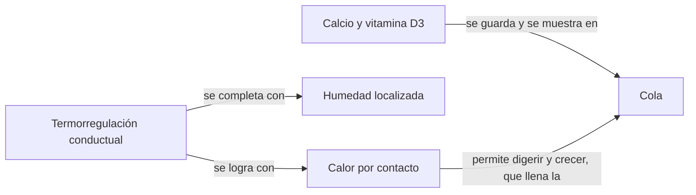

# Gecko leopardo

El gecko leopardo (*Eublepharis macularius*) es un lagarto nocturno y terrestre de zonas áridas del sur de Asia, y uno de los reptiles de terrario más criados (el tercero más popular según Valdez 2021, citado por Agarwal et al. 2022); esta base explica qué necesita, cómo se nota que está bien o mal y qué hacer.

Casi todo su cuidado sale de una sola idea: es un animal que no fabrica su propio calor y que en la naturaleza elige, a cada hora, dónde estar. El terrario le da opciones en lugar de "una temperatura": un piso caliente, un rincón fresco, un refugio húmedo en un ambiente seco. Lo que falla, en general, falla porque falta alguna de esas opciones o porque la comida no trae lo que su cuerpo no puede producir.

> [!IMPORTANT]
> Esta base resume fuentes veterinarias, estudios y práctica de criadores, y dice cuál es cuál. No reemplaza a un veterinario de exóticos.

## Por dónde entrar

- **Para entender el cuidado**: leé en orden los conceptos umbral de abajo, después [armar el terrario](armar-el-terrario.md) y [alimentar y suplementar](alimentar-y-suplementar.md).
- **Para operar el día a día**: [revisar, pesar y registrar](revisar-pesar-y-registrar.md) y [valores de referencia](valores-de-referencia-gecko.md).
- **Para decidir**: [sustrato suelto o sólido](sustrato-suelto-o-solido.md), [UVB sí o no](uvb-si-o-no.md) y [temperatura del punto caliente](temperatura-del-punto-caliente.md).
- **Si algo anda mal**: [cuándo ir al veterinario](cuando-llevar-el-gecko-al-veterinario.md) primero, después la falla que corresponda.

## Conceptos umbral

Cinco ideas que cambian cómo se ve todo lo demás. El diagrama muestra cuál hace falta para entender cuál.

- [Termorregulación conductual](termorregulacion-conductual.md) — por qué necesita un gradiente y no una temperatura fija.
- [Calor por contacto](calor-por-contacto.md) — por qué importa la temperatura del piso más que la del aire.
- [Humedad localizada](humedad-localizada.md) — por qué un animal de zonas secas necesita un refugio húmedo.
- [Calcio y vitamina D3](calcio-y-vitamina-d3.md) — de dónde saca lo que sus huesos necesitan.
- [Cola](cola-del-gecko.md) — dónde guarda reservas y cómo se lee su estado.

## Qué es

- [Gecko leopardo](eublepharis-macularius.md) — qué animal es, de dónde viene y en qué se diferencia de otros geckos.
- [Del Salt Range al terrario](del-salt-range-al-terrario.md) — cómo pasó de las zonas áridas de Pakistán a los terrarios del mundo.

## Cómo funciona

- [Actividad crepuscular](actividad-crepuscular.md) — qué significa ser activo al anochecer para la luz y el UVB.

## Su cuerpo y su vida

- [Autotomía](autotomia.md) — cómo suelta la cola y qué pasa después.
- [Muda](muda-del-gecko.md) — cada cuánto cambia la piel y qué la complica.
- [Crecimiento](crecimiento-del-gecko.md) — de cría a adulto, sexado y longevidad.
- [Brumación](brumacion.md) — el letargo de invierno: criadores lo inducen y una hoja veterinaria, sin verificar, lo lee como alarma.

## Cómo se hace

- [Armar el terrario](armar-el-terrario.md) — tamaño, gradiente, calor, refugios y sustrato.
- [Alimentar y suplementar](alimentar-y-suplementar.md) — qué insectos, cuánto, y calcio y vitaminas.
- [Revisar, pesar y registrar](revisar-pesar-y-registrar.md) — cómo manipularlo y qué anotar.

## Cómo se decide

- [Sustrato suelto o sólido](sustrato-suelto-o-solido.md) — el debate de la arena y la impactación.
- [UVB sí o no](uvb-si-o-no.md) — lo que muestran los estudios en una especie crepuscular.
- [Temperatura del punto caliente](temperatura-del-punto-caliente.md) — por qué criadores y veterinarios dan rangos distintos.

## Cómo falla

- [Cuándo ir al veterinario](cuando-llevar-el-gecko-al-veterinario.md) — las señales que no esperan.
- [Enfermedad metabólica ósea](enfermedad-metabolica-osea.md) — huesos blandos por falta de calcio, D3 o calor.
- [Impactación](impactacion.md) — el intestino bloqueado y sus causas.
- [Retención de muda](retencion-de-muda.md) — piel que no sale y corta la circulación.
- [Problemas oculares](problemas-oculares.md) — el único problema con datos de prevalencia en la especie.
- [Criptosporidiosis](criptosporidiosis.md) — un parásito con portadores sin síntomas.
- [Ideas erróneas](ideas-erroneas-sobre-el-gecko.md) — las creencias documentadas que conviene corregir.

## Ecosistema y referencia

- [Equipos](equipos-del-terrario.md) — tipos de calefacción, control, luz y medición (cambia rápido).
- [Fuentes de referencia](fuentes-sobre-gecko-leopardo.md) — qué fuentes son confiables y por qué.
- [Glosario](glosario-gecko-leopardo.md) — los términos técnicos que usan las notas.
- [Valores de referencia](valores-de-referencia-gecko.md) — temperaturas, humedad, pesos y frecuencias, cada uno con su fuente.

## Qué es evidencia y qué es práctica

La evidencia propia de la especie es escasa: casi todo sale de manuales veterinarios de reptiles en general o de práctica de criadores. Cada nota dice de dónde sale cada dato. A grandes rasgos:

| Se apoya en estudios o fuentes veterinarias | Es práctica de criadores o está en disputa |
|---|---|
| Que necesita calor y elegir entre temperaturas ([termorregulación conductual](termorregulacion-conductual.md)) | El valor exacto del punto caliente ([temperatura del punto caliente](temperatura-del-punto-caliente.md)) |
| Que sintetiza vitamina D3 con UVB y que la D3 de la dieta alcanza para crecer seis meses ([UVB sí o no](uvb-si-o-no.md)) | Si el UVB hace falta |
| La regeneración de la cola ([autotomía](autotomia.md)) | Leer el peso por el ancho de la cola ([cola](cola-del-gecko.md)) |
| El riesgo de los problemas oculares y la vitamina A ([problemas oculares](problemas-oculares.md)) | Arena o sustrato sólido ([sustrato suelto o sólido](sustrato-suelto-o-solido.md)) |
| Que la enfermedad metabólica ósea viene del manejo ([enfermedad metabólica ósea](enfermedad-metabolica-osea.md)) | Humedad ambiente y de la cueva, tamaño del terrario, frecuencias de comida, brumación |

Qué fuente pesa cuánto: [fuentes de referencia](fuentes-sobre-gecko-leopardo.md). Los términos técnicos: [glosario](glosario-gecko-leopardo.md).

## Orden de lectura

Para leerlo de punta a punta: gecko leopardo → historia → los cinco conceptos umbral → actividad crepuscular → cuerpo y vida → cómo se hace → cómo se decide → cómo falla → referencia.
