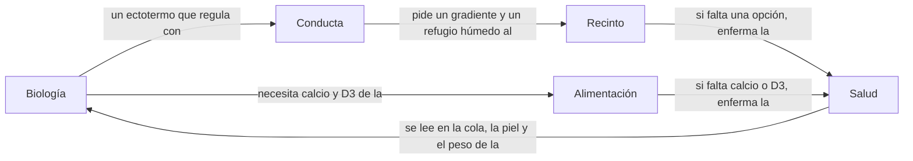
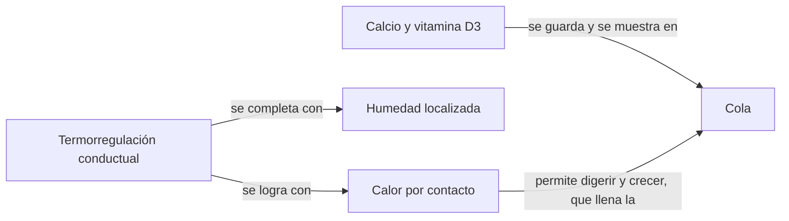

# Gecko leopardo

El gecko leopardo (*Eublepharis macularius*) es un lagarto nocturno y terrestre de zonas áridas del sur de Asia, y uno de los reptiles de terrario más criados (el tercero más popular según Valdez 2021, citado por Agarwal et al. 2022); esta base explica qué necesita, cómo se nota que está bien o mal y qué hacer.

Casi todo su cuidado sale de una sola idea: es un animal que no fabrica su propio calor y que en la naturaleza elige, a cada hora, dónde estar. El terrario le da opciones en lugar de "una temperatura": un piso caliente, un rincón fresco, un refugio húmedo en un ambiente seco. Lo que falla, en general, falla porque falta alguna de esas opciones o porque la comida no trae lo que su cuerpo no puede producir.

El tema cubre a un solo animal adulto o subadulto en un terrario. La reproducción, la cría de geckos, la genética de morfos, la cría de insectos y la electrónica del terrario quedan afuera ([alcance](ALCANCE.md)).

> [!IMPORTANT]
> Esta base resume fuentes veterinarias, estudios y práctica de criadores, y dice cuál es cuál. No reemplaza a un veterinario de exóticos.

## De qué está hecho el cuidado del gecko leopardo

Cinco partes. La biología fija qué es el animal y qué no puede hacer solo; la conducta, cómo usa el ambiente para compensarlo; el recinto y la alimentación le dan lo que necesita; y la salud muestra, en su cuerpo, cuándo alguna de las dos falló.

- [Biología](Biologia/biologia.md) — qué animal es, de dónde viene, y su cola, su piel y su crecimiento. Entrar para saber qué se está mirando.
- [Conducta](Conducta/conducta.md) — cómo regula su temperatura moviéndose, qué implica ser crepuscular y el letargo de invierno. Explica por qué el terrario es un gradiente.
- [Recinto](Recinto/recinto.md) — el terrario: calor de piso, humedad por zonas, sustrato, luz UVB, equipos y valores de referencia. Entrar para armarlo o decidir.
- [Alimentación](Alimentacion/alimentacion.md) — el calcio y la vitamina D3, y cómo se alimenta y se suplementa.
- [Salud](Salud/salud.md) — cómo se revisa y se pesa, cuándo ir al veterinario y las fallas frecuentes. Entrar primero si algo anda mal.

Aparte de las cinco partes, [Fundamentos](Fundamentos/fundamentos-del-gecko-leopardo.md) reúne lo que las cruza: la historia, las ideas erróneas, las fuentes y el glosario.

## Las cinco ideas que cambian cómo se ve todo

El diagrama muestra cuál hace falta para entender cuál.

- [Termorregulación conductual](Conducta/termorregulacion-conductual.md) — por qué necesita un gradiente y no una temperatura fija.
- [Calor por contacto](Recinto/calor-por-contacto.md) — por qué importa la temperatura del piso más que la del aire.
- [Humedad localizada](Recinto/humedad-localizada.md) — por qué un animal de zonas secas necesita un refugio húmedo.
- [Calcio y vitamina D3](Alimentacion/calcio-y-vitamina-d3.md) — de dónde saca lo que sus huesos necesitan.
- [Cola](Biologia/cola-del-gecko.md) — dónde guarda reservas y cómo se lee su estado.

## Qué es evidencia y qué es práctica

La evidencia propia de la especie es escasa: casi todo sale de manuales veterinarios de reptiles en general o de práctica de criadores. Cada nota dice de dónde sale cada dato. A grandes rasgos:

| Se apoya en estudios o fuentes veterinarias | Es práctica de criadores o está en disputa |
|---|---|
| Que necesita calor y elegir entre temperaturas ([termorregulación conductual](Conducta/termorregulacion-conductual.md)) | El valor exacto del punto caliente ([temperatura del punto caliente](Recinto/temperatura-del-punto-caliente.md)) |
| Que sintetiza vitamina D3 con UVB y que la D3 de la dieta alcanza para crecer seis meses ([UVB sí o no](Recinto/uvb-si-o-no.md)) | Si el UVB hace falta |
| La regeneración de la cola ([autotomía](Biologia/autotomia.md)) | Leer el peso por el ancho de la cola ([cola](Biologia/cola-del-gecko.md)) |
| El riesgo de los problemas oculares y la vitamina A ([problemas oculares](Salud/problemas-oculares.md)) | Arena o sustrato sólido ([sustrato suelto o sólido](Recinto/sustrato-suelto-o-solido.md)) |
| Que la enfermedad metabólica ósea viene del manejo ([enfermedad metabólica ósea](Salud/enfermedad-metabolica-osea.md)) | Humedad ambiente y de la cueva, tamaño del terrario, frecuencias de comida, [brumación](Conducta/brumacion.md) |

Qué fuente pesa cuánto: [fuentes de referencia](Fundamentos/fuentes-sobre-gecko-leopardo.md). Los términos técnicos: [glosario](Fundamentos/glosario-gecko-leopardo.md).

## Según lo que se busca

- **Para entender el cuidado**: las cinco ideas de arriba, en orden, y después [armar el terrario](Recinto/armar-el-terrario.md) y [alimentar y suplementar](Alimentacion/alimentar-y-suplementar.md).
- **Para el día a día**: [revisar, pesar y registrar](Salud/revisar-pesar-y-registrar.md) y [valores de referencia](Recinto/valores-de-referencia-gecko.md).
- **Para decidir**: [sustrato suelto o sólido](Recinto/sustrato-suelto-o-solido.md), [UVB sí o no](Recinto/uvb-si-o-no.md) y [temperatura del punto caliente](Recinto/temperatura-del-punto-caliente.md).
- **Si algo anda mal**: [cuándo ir al veterinario](Salud/cuando-llevar-el-gecko-al-veterinario.md) primero, después la falla que corresponda.

## Del animal a sus fallas

Para leerlo de punta a punta, en el orden del diagrama: [Biología](Biologia/biologia.md) (empezando por el [gecko leopardo](Biologia/eublepharis-macularius.md) y su [historia](Fundamentos/del-salt-range-al-terrario.md)), [Conducta](Conducta/conducta.md), [Recinto](Recinto/recinto.md), [Alimentación](Alimentacion/alimentacion.md) y [Salud](Salud/salud.md), con las [ideas erróneas](Fundamentos/ideas-erroneas-sobre-el-gecko.md) al final.
