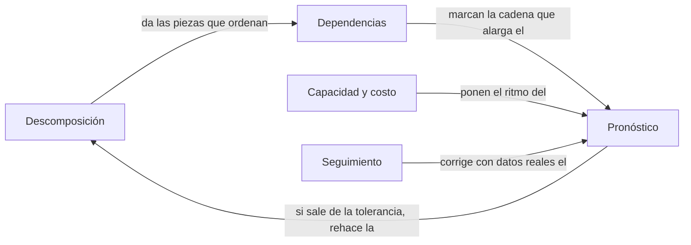

# Planificación

Planificar un proyecto es partir el trabajo en piezas comprobables, ver qué depende de qué, pronosticar cuándo termina y cuánto cuesta, y rehacer ese plan cada vez que los datos del seguimiento lo desmienten.

La vertical recibe de [Encuadre](../Encuadre/encuadre.md) el resultado y el alcance, y de [Enfoque](../Enfoque/enfoque.md) la forma del trabajo: un plan completo, entregas por partes, un flujo o una apuesta con tiempo fijo. Le entrega a [Personas y agentes](../Personas-y-agentes/personas-y-agentes.md) las piezas que alguien tiene que hacer. [Seguimiento](../Seguimiento/seguimiento.md) le devuelve lo que pasó de verdad, y con eso se corrige el pronóstico. Lo que puede salir distinto del plan, y el margen para absorberlo, está en [Incertidumbre y riesgo](../Incertidumbre-y-riesgo/incertidumbre-y-riesgo.md).

## Un plan son cuatro preguntas

Un plan contesta cuatro preguntas, y cada una tiene su componente. Qué hay que entregar, partido en piezas que se verifican una por una. En qué orden, porque unas piezas esperan a otras. Cuándo termina, como un rango con su probabilidad y no como una fecha. Y cuánto se puede hacer y a qué costo, con las personas y los agentes que hay.

Los marcos reparten estas preguntas en varios dominios. Según un resumen de la 8.ª edición del PMBOK, la descomposición cae en alcance, las dependencias en cronograma, y la capacidad y el costo entre recursos y finanzas. El pronóstico no es un dominio de ningún estándar: cruza cronograma y finanzas, y la literatura que lo estudia viene de la psicología de la decisión y de los megaproyectos.

## El plan se rehace, y planificar sigue rindiendo

Un plan es una hipótesis sobre el trabajo, y el seguimiento la pone a prueba cada semana. Se rehace cuando el pronóstico actualizado sale de la tolerancia que fijó quien gobierna el proyecto, cuando cambia el alcance o cuando falla un supuesto del que colgaba una parte. Cuándo un desvío pasa a ser decisión de otro está en [problemas y escalamiento](../Incertidumbre-y-riesgo/problemas-y-escalamiento.md).

Lo que pierde peso es el detalle anticipado, no la planificación. Según la ficha de APM sobre Serrador y Pinto (2015), la planificación inicial no difirió entre proyectos ágiles y no ágiles, y la planificación continua se asoció con mejor resultado (la ficha no afirma causalidad); el estudio y sus límites están en [elegir un enfoque](../Enfoque/elegir-un-enfoque.md). Un cronograma de barras detallado a meses vista y la estimación en horas-persona tarea por tarea son lo que [pierde peso](../Fundamentos/lo-que-pierde-peso-en-gestion-de-proyectos.md). La evidencia de que pierdan peso es débil: casi no hay estudios que lo midan.

## Cómo falla un plan

El plan falla de forma sistemática hacia el optimismo. En el estudio de la falacia de la planificación de Buehler, Griffin y Ross (1994), la gente que planificaba se concentraba en escenarios futuros y desatendía cuánto le había llevado lo parecido antes. Las cifras y el remedio están en [pronóstico](pronostico.md). La segunda falla es confundir la ruta más larga del cronograma con el plazo: varias rutas casi tan largas que convergen alargan el proyecto, como se explica en [dependencias y camino crítico](dependencias-y-camino-critico.md).

La tercera falla es descomponer por actividades en lugar de por entregables. Una lista de tareas como "relevar", "diseñar" y "probar" no dice cuándo algo está terminado; una pieza definida por lo que entrega sí. Eso está en [descomposición del trabajo](descomposicion-del-trabajo.md).

## Planificar cuando una parte la ejecutan agentes

Sin horas-persona no hay una base humana para estimar lo que hace un agente. Lo que se puede medir es el largo de tarea que los agentes completan hoy, en la ficha de [horizonte de tareas](../Personas-y-agentes/horizonte-de-tareas.md), y el rendimiento del propio sistema: cuántas piezas por semana pasan la aceptación y cuántas vuelven. La lectura de esta base, sin estudio que la pruebe, es que el plan con agentes se apoya en esos datos y no en la intuición, porque la intuición sobre cuánto rinde un agente también se equivoca ([pronóstico](pronostico.md)).

Cambian también las dos puntas del plan. Las piezas tienen que traer un criterio de aceptación que se pueda comprobar desde afuera, y la capacidad que limita suele ser la revisión de las personas y no la ejecución. Las dos cosas son inferencias de esta base, apoyadas en [la atención humana como restricción](../Personas-y-agentes/la-atencion-humana-como-restriccion.md).

## Qué hay adentro de un plan

- [Descomposición del trabajo](descomposicion-del-trabajo.md) — partir el alcance en paquetes que se entregan y se verifican uno por uno; la regla del 100 %.
- [Dependencias y camino crítico](dependencias-y-camino-critico.md) — qué espera a qué, por qué la ruta más larga subestima el plazo y qué propone la cadena crítica.
- [Pronóstico](pronostico.md) — la falacia de la planificación, la visión externa, la clase de referencia y los rangos por percentiles.
- [Capacidad y costo](capacidad-y-costo.md) — cuánto trabajo cabe y cuánto cuesta, con personas como capacidad fija y agentes como costo variable.

Para software con un cliente, cómo se estima y se arma un plan de entregas está en [estimación](../../Desarrollo/Encargo/estimacion.md) y [plan de entregas](../../Desarrollo/Encargo/plan-de-entregas.md).
