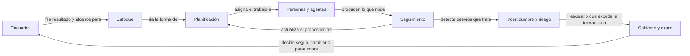

# Gestión de proyectos

Gestionar un proyecto es llevar un trabajo con incertidumbre hasta un resultado que se puede comprobar: se encuadra qué se busca, se elige cómo organizarlo, se planifica, se reparte entre personas y agentes, se sigue, se trata lo que sale distinto y se gobierna hasta cerrarlo.

El tema vale para cualquier dominio: mudar una plataforma, lanzar un servicio, armar un evento o construir software. Toma "proyecto" en sentido amplio: también cubre el trabajo que entra sin parar y se gestiona como un flujo, sin fecha de fin. Se escribe pensando en que una parte del trabajo la ejecutan agentes de IA y otra parte la hacen personas, y en que la proporción cambia de un año al otro. Por eso las notas hablan de mecanismos (resultado, incertidumbre, colas, autonomía, evidencia) y dejan los nombres de herramientas y las ediciones de los marcos en fichas fechadas.

Lo que no es este tema: el encargo de software con un cliente está en [Desarrollo](../Desarrollo/Encargo/encargo.md); qué producto construir y en qué orden, en [Producto](../Producto/Planificacion-y-entrega/planificacion-y-entrega.md); conducir personas y bajar la estrategia de una empresa a trabajo semanal, en [Liderazgo y dirección](../Liderazgo-y-direccion/Ejecucion/ejecucion.md); y cómo funciona un agente por dentro, en [IA](../IA/Agentes/agentes.md).

## De qué está hecha la gestión de un proyecto

El tema se parte en siete verticales, más una carpeta de Fundamentos que no es una vertical. Cinco cubren los siete dominios de desempeño de la 8.ª edición del PMBOK (gobernanza, alcance, cronograma, finanzas, interesados, recursos y riesgo). Enfoque y Seguimiento vienen de dos dominios de la 7.ª edición, "enfoque de desarrollo y ciclo de vida" y "medición". El corte es de esta base: los marcos sirven para comprobar que no falte nada, no como columna. Cómo divide cada marco el campo, y la tabla que lleva cada dominio a su vertical, están en [marcos de referencia](Fundamentos/marcos-de-referencia.md).

- [Encuadre](Encuadre/encuadre.md) — qué resultado se busca, por qué vale la pena, qué entra y qué no, y cómo se sabe que terminó. Se entra acá al arrancar o cuando nadie sabe decir qué es "terminado".
- [Enfoque](Enfoque/enfoque.md) — cómo se organiza el trabajo según su incertidumbre: plan completo, entregas por partes, flujo continuo o apuesta con tiempo fijo; encima de cualquiera de ellos se pueden montar tramos con una decisión de seguir o parar.
- [Planificación](Planificacion/planificacion.md) — partir el trabajo, ver qué depende de qué, pronosticar cuándo termina y cuánto cuesta, con personas y agentes.
- [Personas y agentes](Personas-y-agentes/personas-y-agentes.md) — el modelo operativo (la fábrica, en general): quién decide, quién ejecuta, quién verifica, cuánta autonomía tiene un agente y dónde la atención de las personas se vuelve el cuello de botella.
- [Seguimiento](Seguimiento/seguimiento.md) — saber cómo va sin reuniones de estado: trabajo en curso, medidas de avance, aceptación con evidencia, cambios e informes.
- [Incertidumbre y riesgo](Incertidumbre-y-riesgo/incertidumbre-y-riesgo.md) — riesgos, supuestos, márgenes, escalamiento y por qué los proyectos se desvían de forma sistemática.
- [Gobierno y cierre](Gobierno-y-cierre/gobierno-y-cierre.md) — quién manda sobre el proyecto, cuántos proyectos van en paralelo y cómo se cierra o se cancela, aprendiendo algo.
- [Fundamentos](Fundamentos/fundamentos-de-gestion-de-proyectos.md) — escuelas, marcos, lo que pierde peso, mitos, bibliografía y glosario.

## Elegir el enfoque por la incertidumbre, con poca evidencia a favor

La escuela de este tema es la adaptativa: el enfoque se elige según cuánto se sabe del resultado y del camino, y se mezcla cuando conviene. Es la postura de las dos últimas ediciones del PMBOK. El estudio cuantitativo más citado la complica: en Serrador y Pinto (2015) el efecto de ágil no dependía de la complejidad del proyecto. La base sostiene la escuela como criterio razonable, no como resultado probado; el detalle y las cifras están en [elegir un enfoque](Enfoque/elegir-un-enfoque.md).

Como lente principal, el tema mira el trabajo como un flujo con colas y una restricción que manda (Reinertsen, Goldratt). La matemática de colas es firme. Lo que falta son estudios controlados de que limitar el trabajo en curso mejore los proyectos: hay estudios de caso de una sola empresa con resultados mixtos. Está en [flujo continuo](Enfoque/flujo-continuo.md) y en [trabajo en curso y colas](Seguimiento/trabajo-en-curso-y-colas.md).

## Lo que cambia cuando ejecutan agentes

Cuando una parte del trabajo la ejecuta un agente, el esfuerzo se corre hacia los dos extremos del ciclo. Arriba, el encargo tiene que decir qué es terminado de un modo que se pueda comprobar. Abajo, alguien tiene que aceptar con evidencia lo que el agente dice haber hecho. Esa lectura es de esta base. Las fuentes que la apoyan miden cosas parciales:

- En un experimento con consultores (Dell'Acqua y otros), la IA mejoró las tareas dentro de su "frontera" y empeoró los aciertos en una que quedaba afuera, sin que se supiera de antemano cuál era cuál. METR midió a desarrolladores en 2025 (19 % más lentos con IA) y en 2026 (estimaciones de aceleración, pero METR las llama "an unreliable signal" y sus intervalos cruzan cero). Las cifras están en [frontera irregular](Personas-y-agentes/frontera-irregular.md): rendir más con agentes no se da por supuesto, se mide.
- Parasuraman y Manzey (2010) muestran que quien supervisa automatización confía de más, también los expertos. Poner a una persona "en el bucle" no garantiza el control; está en [niveles de autonomía](Personas-y-agentes/niveles-de-autonomia.md).

De ahí salen tres apuestas del tema, que son criterio de esta base y no hallazgos. La responsabilidad por el resultado queda en una persona con nombre, aunque ejecute un agente ([quién hace qué](Personas-y-agentes/quien-hace-que.md)). Un agente trabaja con autonomía acotada y presupuesto, y sube a una persona solo lo que excede la tolerancia ([problemas y escalamiento](Incertidumbre-y-riesgo/problemas-y-escalamiento.md)). La atención de las personas que revisan se gestiona como la restricción del sistema ([la atención humana como restricción](Personas-y-agentes/la-atencion-humana-como-restriccion.md)). Lo que pierde peso con este cambio está reunido en [lo que pierde peso](Fundamentos/lo-que-pierde-peso-en-gestion-de-proyectos.md).

## Los proyectos se desvían de forma sistemática

Flyvbjerg sostiene, con datos de grandes proyectos de infraestructura, que los grandes proyectos se pasan de costo y plazo una y otra vez, y que el desvío tiene cola gruesa: unos pocos se desvían muchísimo. Para él la causa es el sesgo de optimismo y la tergiversación estratégica, y el remedio es pronosticar mirando proyectos parecidos ya terminados. La frecuencia del desvío está bien respaldada. La causa y la eficacia del remedio están en disputa (Love y Ahiaga-Dagbui, 2018), y la muestra es de infraestructura y tecnología grandes. Está en [por qué fallan los proyectos](Incertidumbre-y-riesgo/por-que-fallan-los-proyectos.md) y en [pronóstico](Planificacion/pronostico.md). Los números más repetidos del campo, como los del informe CHAOS, no resisten la revisión: están en [mitos](Fundamentos/mitos-de-gestion-de-proyectos.md).

## Qué leer según lo que estés haciendo

- Si arrancás un trabajo nuevo y tenés que decidir cómo encararlo: [encuadre](Encuadre/encuadre.md), [resultado y terminado](Encuadre/resultado-y-terminado.md) y [elegir un enfoque](Enfoque/elegir-un-enfoque.md).
- Si tenés que decidir qué parte le das a un agente y con cuánta autonomía: [frontera irregular](Personas-y-agentes/frontera-irregular.md), [delegar a un agente](Personas-y-agentes/delegar-a-un-agente.md) y [niveles de autonomía](Personas-y-agentes/niveles-de-autonomia.md); cómo se reparten los papeles y se encadenan agentes y personas, en [quién hace qué](Personas-y-agentes/quien-hace-que.md) y [patrones de trabajo](Personas-y-agentes/patrones-de-trabajo.md); el largo de tarea que hoy completan los agentes está en la ficha de [horizonte de tareas](Personas-y-agentes/horizonte-de-tareas.md).
- Si tenés que armar el plan de un trabajo: [descomposición del trabajo](Planificacion/descomposicion-del-trabajo.md), [dependencias y camino crítico](Planificacion/dependencias-y-camino-critico.md), [supuestos](Incertidumbre-y-riesgo/supuestos.md), [riesgo](Incertidumbre-y-riesgo/riesgo.md), [interesados](Encuadre/interesados.md) y [quién hace qué](Personas-y-agentes/quien-hace-que.md).
- Si te piden una fecha o un presupuesto: [pronóstico](Planificacion/pronostico.md), [capacidad y costo](Planificacion/capacidad-y-costo.md) y [márgenes](Incertidumbre-y-riesgo/margenes.md).
- Si querés saber cómo va sin reuniones de estado: [medir el avance](Seguimiento/medir-el-avance.md), [informar el estado](Seguimiento/informar-el-estado.md) y [aceptar con evidencia](Seguimiento/aceptar-con-evidencia.md); cuándo meterte lo dice [problemas y escalamiento](Incertidumbre-y-riesgo/problemas-y-escalamiento.md).
- Si la revisión se te acumula o tenés varios trabajos en paralelo: [la atención humana como restricción](Personas-y-agentes/la-atencion-humana-como-restriccion.md), [trabajo en curso y colas](Seguimiento/trabajo-en-curso-y-colas.md) y [portafolio](Gobierno-y-cierre/portafolio.md).
- Si cambia lo pedido a mitad de camino: [control de cambios](Seguimiento/control-de-cambios.md) y [alcance](Encuadre/alcance.md).
- Si algo se desvía y no sabés si te toca decidir: [problemas y escalamiento](Incertidumbre-y-riesgo/problemas-y-escalamiento.md) y [gobierno del proyecto](Gobierno-y-cierre/gobierno-del-proyecto.md).
- Si dudás de seguir con un trabajo que no rinde: [justificación](Encuadre/justificacion.md) y [cerrar o cancelar](Gobierno-y-cierre/cerrar-o-cancelar.md).
- Si venís del PMBOK o de Scrum y querés saber qué sigue sirviendo: [lo que pierde peso](Fundamentos/lo-que-pierde-peso-en-gestion-de-proyectos.md), [escuelas](Fundamentos/escuelas-de-gestion-de-proyectos.md), [marcos de referencia](Fundamentos/marcos-de-referencia.md) (los dominios del PMBOK como lista de control) y, para la reunión diaria y las demás ceremonias, [enfoque iterativo](Enfoque/enfoque-iterativo.md).
- Si el trabajo es software para un cliente: el ciclo con el cliente está en [encargo](../Desarrollo/Encargo/encargo.md), y cómo preparar tareas para un agente de código, en [descomposición en tareas](../Desarrollo/Definicion/descomposicion-en-tareas.md).

## Orden de lectura

Para aprender el tema, de arriba hacia abajo: Encuadre y Enfoque primero, porque fijan qué se busca y cómo se organiza; después Planificación y Personas y agentes; después Seguimiento e Incertidumbre y riesgo; Gobierno y cierre al final. [Fundamentos](Fundamentos/fundamentos-de-gestion-de-proyectos.md) se consulta en cualquier momento.
