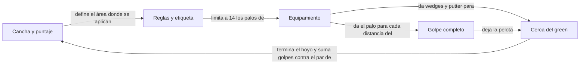

# Golf

El golf es un juego en el que se lleva una pelota desde el área de salida hasta el agujero de
cada hoyo con la menor cantidad de golpes, con hasta 14 palos y bajo Reglas que son las mismas en
todo el mundo.

Una vuelta tiene 18 hoyos (o 9), y cada uno se cuenta contra su par, pensado para un jugador
experto; el hándicap ajusta la diferencia para que jugadores de distinto nivel compitan parejo. El
tema está escrito para quien empieza desde cero, con un juego de palos usado: cómo se juega un
hoyo, con qué palos, cómo se pega y cómo se comporta uno en la cancha.

## De qué está hecho el golf

Cinco partes. La cancha fija dónde se juega y cómo se cuenta; las Reglas dicen qué se puede hacer
en cada área; el equipamiento da un palo para cada distancia; el golpe completo lleva la pelota
hasta cerca del green, y el juego corto y el putt terminan el hoyo.

- [Cancha y puntaje](Cancha-y-puntaje/cancha-y-puntaje.md) — las áreas de un hoyo, el par y el
  hándicap. Se lee primero, porque todo lo demás se ubica en un área del hoyo.
- [Reglas y etiqueta](Reglas-y-etiqueta/reglas-y-etiqueta.md) — qué hacer con una pelota perdida,
  fuera de límites o en el agua, y cómo comportarse en la cancha. Antes de la primera vuelta.
- [Equipamiento](Equipamiento/equipamiento.md) — los cinco tipos de palo y las características que
  los distinguen: loft, perdón, flex, bounce y forma del putter.
- [Golpe completo](Golpe-completo/golpe-completo.md) — grip, setup, swing y cómo leer el vuelo de
  la pelota.
- [Cerca del green](Cerca-del-green/cerca-del-green.md) — chip, pitch, golpe de bunker y putt.

## La cara del palo manda la dirección

La misma idea aparece en el golpe completo y en el green: hacia dónde mira la cara del palo en el
impacto decide hacia dónde sale la pelota. Con un hierro, las fuentes le atribuyen a la cara entre
el 75 % y el 85 % de la dirección inicial ([Vuelo de la pelota](Golpe-completo/vuelo-de-la-pelota.md));
en el putt, según Dave Pelz, pesa seis veces más que la trayectoria ([Putt](Cerca-del-green/putt.md)).
Por eso el [grip](Golpe-completo/grip-de-golf.md), que orienta la cara, es lo primero que se
corrige ante un slice.

## El peso lejos del centro perdona

El otro principio que cruza el equipamiento: una cabeza con el peso repartido hacia los bordes gira
menos en un golpe descentrado. Separa a un hierro cavity back de un blade
([Perdón del palo](Equipamiento/perdon-del-palo.md)) y a un putter mallet de uno blade
([Tipos de putter](Equipamiento/tipos-de-putter.md)), y es lo que más importa al elegir palos para
empezar.

## Del hoyo al green

Para aprender, el orden es el del diagrama con una excepción: las reglas y la etiqueta se leen al
final, justo antes de salir a la cancha. El orden paso a paso, con el porqué de cada nota, está en
[Fundamentos](Fundamentos/fundamentos-de-golf.md).
