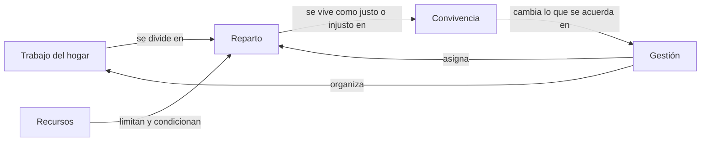

# Hogar

Un hogar es una unidad que produce lo que la vida diaria necesita (comida, orden, cuidado, papeles), reparte ese trabajo entre quienes conviven y lo administra con tiempo, plata y espacio limitados. Esta base explica cómo funciona esa dinámica con lo que estudian la sociología, la economía, la administración de recursos familiares y la psicología.

Mirar la casa así sirve para separar tres preguntas que en la vida diaria vienen mezcladas: cuánto trabajo hay, quién lo hace y por qué, y cómo se siente cada uno con eso. Cada una tiene su literatura y sus respuestas, y a veces se contradicen. La base describe las opciones y su evidencia; no dice cómo tiene que organizarse una casa en particular.

Quedan afuera las finanzas del hogar (presupuesto, ahorro, inversión), la pareja en general y la crianza, que tienen o van a tener su propio tema ([alcance](ALCANCE.md)). Lo que ya está en la base se enlaza: la [pareja](../Desarrollo-personal/Relaciones/pareja.md), el choque entre [trabajo y familia](../Desarrollo-personal/Relaciones/trabajo-y-familia.md), la [gestión de tareas](../Desarrollo-personal/Efectividad-personal/gestion-de-tareas.md) de una persona, [planificar y cocinar](../Nutricion/Planificar-y-cocinar/planificar-y-cocinar.md) y las [rutinas de los chicos](../Crianza/Salud-y-rutinas/salud-y-rutinas.md).

## De qué está hecha la vida de una casa

La base tiene cinco partes. El trabajo del hogar es lo que hay que hacer, incluida la parte que no se ve. El reparto dice quién lo hace y por qué. La gestión es cómo se organiza y se decide. La convivencia es lo que todo eso le hace al vínculo entre quienes viven juntos. Los recursos son lo que se administra y lo que limita: el tiempo, la plata y el espacio.

- [Trabajo del hogar](Trabajo-del-hogar/trabajo-del-hogar.md) — las tareas domésticas, el cuidado, la carga mental y el mantenimiento y los trámites: qué cuenta como trabajo y cuánto pesa.
- [Reparto](Reparto/reparto.md) — por qué una persona termina haciendo más, la especialización contra el reparto parejo, la equidad percibida y qué cambia con un hijo, un desempleo o la jubilación.
- [Gestión](Gestion/gestion-del-hogar.md) — el ciclo de administrar una casa, ser dueño de una tarea, rutinas y sistemas, la reunión de la casa y qué conviene tercerizar.
- [Convivencia](Convivencia/convivencia.md) — la casa vista como sistema, el conflicto que nace de las tareas y los estándares distintos de orden y limpieza.
- [Recursos](Recursos/recursos-del-hogar.md) — el tiempo, la plata en la pareja y el espacio de la vivienda.

Aparte de las partes, [Fundamentos](Fundamentos/fundamentos-del-hogar.md) reúne lo que las cruza: qué disciplina estudia qué, cómo se mide el trabajo de la casa, los mitos más repetidos, las fuentes y el glosario.

## Qué tan firme es lo que se sabe

Casi todo lo que se sabe del hogar sale de encuestas y entrevistas, no de experimentos. Las encuestas de uso del tiempo miden horas con diarios de actividad, y las entrevistas captan lo que las horas no ven, como la carga mental. Las dos muestran asociaciones: que repartir más parejo vaya junto con una pareja más satisfecha no prueba que lo cause. Cómo se mide y qué sesgos tiene cada método está en [cómo se mide el trabajo del hogar](Fundamentos/como-se-mide.md).

La mayoría de los estudios son de Estados Unidos y Europa. Para Argentina, la fuente principal es la Encuesta Nacional de Uso del Tiempo 2021 del INDEC, con sus cifras en la [ficha de la ENUT 2021](Fundamentos/enut-2021.md). Los marcos de divulgación, como *Fair Play*, se citan como lo que dicen sus autores y no como evidencia.

## Qué leer según lo que estés pensando

- Si sentís que hay trabajo que nadie ve: [carga mental](Trabajo-del-hogar/carga-mental.md) y [trabajo del hogar](Trabajo-del-hogar/trabajo-del-hogar.md).
- Si querés entender por qué el reparto quedó como quedó: [teorías del reparto](Reparto/teorias-del-reparto.md) y [especialización o reparto parejo](Reparto/especializacion-o-reparto-parejo.md).
- Si el reparto genera discusiones: [equidad percibida](Reparto/equidad-percibida.md), [conflicto por la casa](Convivencia/conflicto-por-la-casa.md) y [estándares distintos](Convivencia/estandares-distintos.md).
- Si está por llegar un hijo, o cambió el trabajo de alguien: [transiciones](Reparto/transiciones.md).
- Si querés cambiar cómo se organiza la casa: [dueño de la tarea](Gestion/dueno-de-la-tarea.md), [rutinas y sistemas](Gestion/rutinas-y-sistemas.md) y [reunión de la casa](Gestion/reunion-de-la-casa.md).
- Si estás pensando en contratar ayuda o pagar por un servicio: [hacer o tercerizar](Gestion/hacer-o-tercerizar.md) y la ficha del [servicio doméstico en Argentina](Gestion/servicio-domestico-en-argentina.md).
- Si la discusión es por la plata: [plata en la pareja](Recursos/plata-en-la-pareja.md).
- Si un término no se entiende (carga cognitiva, gatekeeping, doing gender): [glosario del hogar](Fundamentos/glosario-del-hogar.md).

## Por dónde empezar

Para leer de corrido: [trabajo del hogar](Trabajo-del-hogar/trabajo-del-hogar.md), [carga mental](Trabajo-del-hogar/carga-mental.md), [reparto](Reparto/reparto.md), [equidad percibida](Reparto/equidad-percibida.md) y [gestión](Gestion/gestion-del-hogar.md). Después, lo que pida la pregunta de cada uno.
