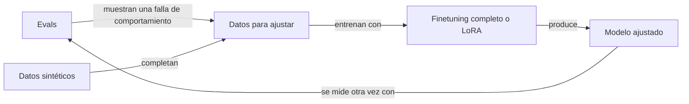

# Ajuste

El ajuste es la parte de un sistema con un modelo adentro que cambia los pesos del modelo
entrenándolo con ejemplos propios, en lugar de cambiar lo que entra en su ventana; es la forma
más cara de adaptar un modelo, y lo caro está en los datos más que en el entrenamiento.

La vertical se llama Ajuste y la técnica, finetuning: "ajustar" es el verbo y un modelo "ajustado"
es el que salió de un finetuning. El modelo sobre el que se ajusta es el **modelo de partida**, sea
un modelo base o uno que ya pasó por otro finetuning.

De las tres formas de adaptar un [modelo base](../Modelos/modelo-base.md) que ordena el tema, el
ajuste es la última: [Contexto](../Contexto/contexto.md) cambia lo que el modelo lee y
[Agentes](../Agentes/agentes.md) le da herramientas, sin tocarlo. Quién decide si hace falta es
[Evaluación](../Evaluacion/evaluacion.md), y la decisión entre prompt, RAG y ajuste está en
[Prompt, RAG o finetuning](../prompt-rag-o-finetuning.md). El modelo que sale del ajuste se sirve
como cualquier otro, con lo que explica [Producción](../Produccion/produccion.md).

## Dónde termina el ajuste que hace un equipo de producto

El ajuste de esta vertical es el que hace quien construye un producto sobre un modelo ya entrenado:
tomar un modelo de partida y enseñarle una tarea, un formato o un estilo con relativamente pocos
ejemplos. Cuántos alcanzan depende de la tarea; el caso más citado, LIMA, ajustó un modelo grande con
1.000 ejemplos curados (ver [Datos para ajustar](datos-para-ajustar.md#cuántos-ejemplos-hacen-falta)). El [preentrenamiento](../Modelos/preentrenamiento.md)
desde cero queda afuera, y el ajuste supervisado y por preferencias que hacen los laboratorios para
convertir un modelo preentrenado en un asistente (RLHF, DPO) está en
[Post-entrenamiento](../Modelos/post-entrenamiento.md). La técnica es la misma familia; lo que
cambia es quién la usa, con cuántos datos y para qué.

En el libro de Huyen el ajuste ocupa dos capítulos: el 7, sobre cuándo ajustar, cuánta memoria pide
y con qué técnicas, y el 8, sobre los datos (según el índice del libro). La división de esta
vertical sigue esas dos mitades.

## Por qué el ajuste mueve el problema al dato

El resumen del cap. 7 del libro de Huyen lo pone en boca de otros, como "A comment I often hear
from practitioners": "finetuning is easy, but getting data for finetuning is hard". Husain lo
cuantifica a su manera: "99% of the labor involved with fine-tuning is assembling
high-quality data that covers your AI product's surface area". Las técnicas eficientes bajaron el
costo de entrenar; el de juntar, limpiar y verificar ejemplos sigue igual. Por eso dos de los cinco
componentes de esta vertical tratan de datos, y la destilación por datos es a medias un tercero
(lectura de esta base).

El ajuste sirve para comportamiento (formato, tono, criterio estable) más que para meter hechos
nuevos: Husain dice que "is best for learning syntax, style, and rules", y Ovadia et al. (EMNLP
2024; esta base lo leyó solo en un resumen secundario) encontraron que RAG supera al ajuste para inyectar conocimiento.
El detalle y la disputa sobre si todavía hace falta están en [Finetuning](finetuning.md).

## Cómo se paga: memoria, técnica y olvido

Entrenar pide mucha más memoria que inferir, porque además de los pesos hay que guardar gradientes
y estados del optimizador: según la documentación de Transformers, entrenar un modelo de 4.000
millones de parámetros pide "roughly 85GB of GPU memory". Esa cuenta es la que empuja a las técnicas
que entrenan pocos parámetros ([PEFT y LoRA](peft-y-lora.md)) y a guardar el modelo congelado en 4
bits (QLoRA). Lo barato tiene precio: según un resumen secundario de Biderman et al. (2024), LoRA
aprende menos y olvida menos que el finetuning completo. Olvidar lo que el modelo ya sabía (el olvido
catastrófico) es la falla propia del ajuste.

## Cómo se arma un ajuste, de punta a punta

El orden lo pone la evaluación: sin un conjunto de [evals](../Evaluacion/evals.md) separado antes de
armar los datos, no se sabe si el modelo ajustado mejoró ni si los datos se contaminaron con los
casos de prueba. Después del ajuste, el modelo es un modelo propio: hay que versionarlo, servirlo y
volver a ajustarlo cuando sale un modelo de partida mejor, una decisión que conviene registrar en un
[ADR](../../Arquitectura/Decisiones/adr.md) (lectura de esta base).

## Qué hay adentro del ajuste

Leer en este orden: la cuenta de memoria de finetuning explica por qué existen LoRA y QLoRA.

- [Finetuning](finetuning.md) — qué es entrenar los pesos de un modelo ya entrenado, cuándo sí y
  cuándo no, cuánta memoria pide y cómo olvida.
- [PEFT y LoRA](peft-y-lora.md) — ajustar pocos parámetros: adapters, soft prompts, LoRA, QLoRA,
  servir muchos adaptadores y fusionar modelos.
- [Destilación](destilacion.md) — un modelo chico que imita a uno grande, en sus dos sentidos
  (probabilidades del maestro o textos generados) y sus límites de licencia.
- [Datos para ajustar](datos-para-ajustar.md) — calidad, cobertura y cantidad; inspección,
  deduplicación y contaminación con los casos de evaluación.
- [Datos sintéticos](datos-sinteticos.md) — ejemplos generados con modelos, cómo se verifican y la
  disputa sobre el colapso de modelos.

El estado de los servicios de ajuste de cada proveedor cambia rápido y vive en la ficha
[Plataformas de IA](../Produccion/plataformas-de-ia.md).
