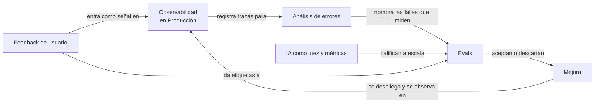

# Evaluación

La evaluación es la parte de un sistema con un modelo que mide si hace lo que tiene que hacer: lee
lo que pasa con el uso, nombra las fallas, las convierte en casos que se corren de nuevo y decide
con eso qué cambio se queda y qué modelo se usa.

Dentro del tema es la vertical que decide. [Contexto](../Contexto/contexto.md),
[Agentes](../Agentes/agentes.md) y [Ajuste](../Ajuste/ajuste.md) son formas de cambiar lo que emite
el [modelo](../Modelos/modelos.md); la evaluación dice cuál hace falta y si funcionó. La elección
entre dar contexto y ajustar los pesos está en [Prompt, RAG o finetuning](../prompt-rag-o-finetuning.md);
cuándo un workflow no alcanza y hace falta un agente, en [Agentes](../Agentes/agentes.md). Cada capa que se suma en
[Producción](../Produccion/produccion.md) entra cuando una medición la pide, que es la regla de
[empezar simple](../../Arquitectura/Decisiones/empezar-simple.md). Según Huyen en su post sobre la
arquitectura de una plataforma de IA generativa, "Evaluation is necessary at every step of the
development process".

## Por qué medir cambia cuando hay un modelo adentro

Con un modelo, la misma entrada puede dar salidas distintas, y "correcto" muchas veces es un juicio
(si la respuesta es fiel al documento, si resolvió lo que se pedía) y no una cadena exacta. Por eso
"anda" deja de ser un sí o un no y pasa a ser una proporción sobre un conjunto de casos, los
[evals](evals.md). Huyen resume el cambio de oficio así: cuando se adapta un modelo ajeno en lugar de
entrenar uno propio, la evaluación se vuelve "a much bigger problem" (*AI Engineering*, cap. 1).

La evaluación tampoco termina en el modelo. Huyen cuenta el caso de una amiga cuyo equipo
discutía el largo de los resúmenes de reuniones, cuando a sus usuarios "didn't care about the actual
summary": solo querían las tareas que les tocaban. En otro pasaje, sobre dos equipos que habían
descartado la IA porque sus usuarios odiaban el producto, concluye que "the issue wasn't with AI, but
with product". Lo que se mide son las [características](../../Arquitectura/Caracteristicas/caracteristicas.md)
que el producto necesita, con la calidad de la salida, el
[costo y la latencia](../../Arquitectura/Caracteristicas/costo-y-latencia.md) al frente. Las
métricas de velocidad están definidas en [costo y latencia](../../Arquitectura/Caracteristicas/costo-y-latencia.md);
del lado del servidor, en [inferencia](../Produccion/inferencia.md).

## El bucle que va de la traza a la mejora

Las piezas forman un ciclo. La [observabilidad](../Produccion/observabilidad-de-modelos.md), que es
una pieza de Producción, deja una traza de cada consulta con sus pasos intermedios. El
[análisis de errores](analisis-de-errores.md) lee esas trazas a mano y nombra las fallas. Los
[evals](evals.md) convierten cada falla en un caso que se puede correr de nuevo, calificado con
código, con una [métrica](metricas-de-evaluacion.md), con un [juez](ia-como-juez.md) o con una
persona. La mejora (un prompt, más contexto, otro modelo) se acepta o se descarta según esos evals,
y el [feedback de usuario](feedback-de-usuario.md) vuelve a entrar como traza y como etiqueta.

El ciclo es una síntesis de esta base, no de una sola fuente. Huyen ordena el libro con la
evaluación primero (capítulos 3 y 4, antes de prompting, RAG y finetuning) y la observabilidad y el
feedback al final (capítulo 10), según su índice. Husain describe un ciclo equivalente desde la
práctica: mirar trazas, anotar fallas, contarlas, escribir pruebas y volver a mirar. La evaluación
de un [agente](../Agentes/agente.md), que agrega trayectorias y herramientas, está en
[fallas de agentes](../Agentes/fallas-de-agentes.md).

## Qué modelo usar es una decisión de evaluación

Antes de construir hay que elegir un modelo, y la elección es la primera evaluación. Según los
resúmenes de capítulo del libro, Huyen sostiene que los benchmarks públicos sirven para descartar
modelos malos pero no para elegir el mejor para una aplicación, y que para eso se arma un
"private leaderboard" propio. Cómo se leen los rankings, qué miden mal y cuándo conviene una API o
un modelo propio está en [benchmarks y elección de modelo](benchmarks-y-eleccion-de-modelo.md). El
resultado de esa comparación es la evidencia que queda en un
[ADR](../../Arquitectura/Decisiones/adr.md).

## Si la evaluación va primero

Las voces de referencia del oficio dicen que sin evaluación no hay producto, y la entrada del tema
lo marca como disputado. La disputa es sobre el orden y la causa, no sobre si medir sirve.

> [!IMPORTANT]
> **A favor.** Husain: "unsuccessful products almost always share a common root cause: a failure to
> create robust evaluation systems", y "Rigorous and systematic evaluation is the most important
> part of the whole system". Huyen cuenta entre los errores comunes "Forgo human evaluation". El
> argumento de fondo: sin una medida no se sabe si un cambio mejoró el sistema o lo empeoró.
>
> **En contra o matiz.** Una búsqueda dirigida no encontró ningún estudio controlado que compare
> equipos que evalúan desde el principio con equipos que iteran a ojo. Lo más cercano son 19
> entrevistas a practicantes (van der Maden et al., preprint de 2026, leído en su abstract): diez
> prácticas que van "from informal 'vibe checks' to organizational meta-work", y un
> "results-actionability gap", la brecha entre juntar datos de evaluación y convertirlos en
> mejoras. Sus autores leen las prácticas informales como "reasonable adaptations to LLM
> characteristics, not simply methodological failures". La frase de Husain es retrospectiva: no
> dice cuántos productos que fallaron sí evaluaban ni compara con un grupo que no lo hizo. Y Huyen
> misma advierte contra "Start too complex" y "Over-index on early success": una evaluación pesada
> antes de saber qué se construye también es un riesgo.
>
> **Lectura de esta base.** Evaluar primero es un criterio razonado, no un hecho medido. Lo que
> sí se sostiene es más chico: un cambio que no se mide no se puede defender, y unos pocos casos
> mirados a mano alcanzan para empezar. Las fuentes de las dos posiciones son una misma comunidad
> que se cita entre sí, con su sesgo pro-evaluación.

## Cómo falla la evaluación

- **Se mide antes de mirar.** Se eligen métricas genéricas sin haber leído trazas, y miden cosas que
  no fallan; lo corrige el [análisis de errores](analisis-de-errores.md) y lo explica
  [métricas de evaluación](metricas-de-evaluacion.md).
- **Se confía en el juez sin validarlo.** Un modelo que califica a otro tiene sesgos propios; ver
  [IA como juez](ia-como-juez.md).
- **Se elige el modelo por el ranking.** Un benchmark público mide su tarea, no la del producto, y
  puede estar contaminado; ver [benchmarks y elección de modelo](benchmarks-y-eleccion-de-modelo.md).
- **No se registra lo intermedio.** Sin la traza de cada paso, una falla del final no se puede
  atribuir a la recuperación, al prompt o al modelo; ver
  [observabilidad](../Produccion/observabilidad-de-modelos.md).
- **Se pide feedback que nadie da.** Las señales explícitas son escasas y sesgadas; ver
  [feedback de usuario](feedback-de-usuario.md).
- **Se juntan datos que no cambian nada.** El "results-actionability gap" de van der Maden et al.:
  un tablero lleno que no decide ninguna mejora.

Lo que la salida del modelo no puede emitir, por seguridad o por forma, no se evalúa después: se
bloquea antes con [guardrails](../Produccion/guardrails.md). Las dos cosas se complementan.

## Qué hay adentro de la evaluación

- [Evals](evals.md) — los conjuntos de casos y sus niveles: por qué la prueba unitaria sola no
  alcanza cuando la salida cambia.
- [Análisis de errores](analisis-de-errores.md) — leer trazas a mano para saber qué medir; el paso que
  más se saltea.
- [Métricas de evaluación](metricas-de-evaluacion.md) — corrección funcional, similitud con una
  referencia y perplejidad: qué mide cada una y por qué lo genérico engaña.
- [IA como juez](ia-como-juez.md) — un modelo que califica las salidas de otro, sus sesgos y cómo se
  valida.
- [Benchmarks y elección de modelo](benchmarks-y-eleccion-de-modelo.md) — qué dicen los rankings
  públicos, qué miden mal, cómo se elige un modelo y cuándo comprar o alojar uno.
- [Benchmarks vigentes](benchmarks-vigentes.md) — ficha fechada con los rankings y agregadores vivos.
- [Feedback de usuario](feedback-de-usuario.md) — las señales explícitas e implícitas del uso y sus
  límites como dato.

Fuera de la vertical pero parte del bucle: la [observabilidad](../Produccion/observabilidad-de-modelos.md),
en Producción. Antes de todo esto, si el caso de uso vale la pena se decide en
[planificar una aplicación](../planificar-una-aplicacion.md).
