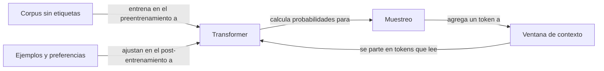

# Modelos

Modelos es la parte del tema que explica qué es un modelo base, cómo se entrena y cómo genera
texto token a token; de ese mecanismo salen los límites (lo probable no es lo verdadero, la
ventana es finita, la salida varía, el saber tiene fecha) que el resto del sistema compensa.

Se lee primero porque cada vertical del tema existe para tapar uno de esos límites.
[Contexto](../Contexto/contexto.md) le da al modelo lo que no sabe, [Agentes](../Agentes/agentes.md)
lo deja actuar, [Ajuste](../Ajuste/ajuste.md) cambia lo que hace por defecto,
[Evaluación](../Evaluacion/evaluacion.md) mide cuánto se acercó lo probable a lo correcto y
[Producción](../Produccion/produccion.md) paga y controla cada llamada. Quien construye productos no
entrena modelos, pero sin entender el mecanismo no sabe qué esperar ni qué compensar. Cómo se llegó a
estos modelos está en [Historia de la IA generativa](../Fundamentos/historia-de-la-ia-generativa.md).

## Cómo se hace un modelo y cómo genera

Un modelo base se hace en dos etapas y se usa en un bucle:

1. **Preentrenamiento.** Un [transformer](transformer.md) aprende a predecir el próximo
   [token](token-y-embedding.md) sobre un corpus enorme sin etiquetas. Ahí adquiere casi todo lo que
   sabe y ahí se gasta la mayor parte del cómputo ([Preentrenamiento](preentrenamiento.md)).
2. **Post-entrenamiento.** Con ejemplos escritos por personas y con comparaciones entre respuestas, el
   modelo preentrenado aprende a seguir instrucciones y a conversar
   ([Post-entrenamiento](post-entrenamiento.md)). InstructGPT mostró en 2022 que un modelo de 1.300
   millones de parámetros así ajustado era preferido a GPT-3, de 175 mil millones.
3. **Generación.** En cada paso, el modelo calcula una probabilidad para cada token posible y el
   [muestreo](muestreo.md) elige uno, que se agrega a la entrada para el paso siguiente. Los modelos de
   [razonamiento](razonamiento.md) generan además pasos intermedios antes de responder.

El bucle explica casi todo lo que sigue: el modelo solo ve lo que está en la ventana, solo puede
emitir tokens, y cada token se elige por probabilidad, no por verdad.

## Los límites que el resto del sistema compensa

Huyen, según el resumen del capítulo 2, saca de la naturaleza probabilística del modelo la
consecuencia que ordena el oficio: permite salidas creativas, pero también inconsistencia y
alucinación, y hay que diseñar alrededor de eso empezando por la evaluación. La tabla reparte cada
límite con la nota que lo explica y la vertical que lo compensa; la correspondencia es de esta base.

| Límite | De dónde viene | Qué lo compensa |
|---|---|---|
| Emite falso con forma de verdadero | Optimiza lo probable; los datos, el post-entrenamiento y la evaluación premian responder antes que admitir que no sabe ([Alucinación](alucinacion.md)) | Darle los hechos ([Contexto y RAG](../Contexto/contexto-y-rag.md)), verificar la salida ([Guardrails](../Produccion/guardrails.md)) y medirla ([Evaluación](../Evaluacion/evaluacion.md)) |
| Lo que sabe tiene fecha y huecos | Solo sabe lo que vio en el [preentrenamiento](preentrenamiento.md), hasta su corte | [Contexto](../Contexto/contexto.md) y [recuperación](../Contexto/recuperacion.md); no el finetuning, que enseña mal hechos nuevos |
| Solo ve lo que entra en la ventana, y la paga | La [ventana de contexto](transformer.md#la-ventana-de-contexto) es finita y se cobra por [token](token-y-embedding.md) | [Ingeniería de contexto](../Contexto/ingenieria-de-contexto.md), [memoria](../Contexto/memoria.md), [cache](../Produccion/cache-de-modelos.md) |
| La misma entrada da salidas distintas | El [muestreo](muestreo.md) elige por probabilidad | [Evals](../Evaluacion/evals.md) que miden proporciones, salidas estructuradas, [aislar lo no determinista](../../Arquitectura/Modularidad/aislar-lo-no-determinista.md) |
| Solo emite texto, no actúa | Su única salida es el próximo token | [Uso de herramientas](../Agentes/uso-de-herramientas.md) y [agentes](../Agentes/agente.md) |
| Hace lo general, no lo de tu producto | El [post-entrenamiento](post-entrenamiento.md) lo ajustó para un asistente genérico | [Prompt](../Contexto/prompt.md) primero, [finetuning](../Ajuste/finetuning.md) si no alcanza ([Prompt, RAG o finetuning](../prompt-rag-o-finetuning.md)) |
| Pensar más cuesta y tarda | El [razonamiento](razonamiento.md) gasta tokens en la inferencia | [Inferencia](../Produccion/inferencia.md), [router](../Produccion/router-y-gateway-de-modelos.md) |
| Sus defectos pasan a todo lo que se construye encima | Muchas aplicaciones comparten el mismo [modelo base](modelo-base.md) | Medir en la tarea propia ([Benchmarks y elección de modelo](../Evaluacion/benchmarks-y-eleccion-de-modelo.md)) |

El último límite es la homogeneización de Bommasani y otros (2021): como muchos productos se
construyen sobre el mismo modelo, sus defectos llegan a todos.

## Lo que la vertical no tiene resuelto

Tres discusiones atraviesan estas notas y se presentan con cada posición:

- **Si los modelos razonan.** Un trabajo de Apple (2025) reportó un colapso de los modelos de
  razonamiento en puzzles difíciles; dos réplicas encontraron defectos en el experimento, y una parte
  del colapso persiste ([Razonamiento](razonamiento.md#si-los-modelos-razonan-o-colapsan)).
- **Cuánto modelo y cuántos datos.** Las leyes de escala de Kaplan (2020) y de Chinchilla (2022) dan
  recetas distintas para el mismo presupuesto ([Preentrenamiento](preentrenamiento.md#leyes-de-escala-cuánto-modelo-y-cuántos-datos)).
- **Por qué alucina.** Incentivos de la evaluación, calibración dañada por el ajuste y bola de nieve
  autorregresiva son explicaciones distintas que no se excluyen ([Alucinación](alucinacion.md#si-el-modelo-sabe-lo-que-no-sabe)).

## Qué hay adentro de Modelos

En orden de lectura:

- [Modelo base](modelo-base.md) — qué es un modelo base, de modelo de lenguaje a LLM y a multimodal; por dónde empezar.
- [Token y embedding](token-y-embedding.md) — la unidad con que el modelo lee, escribe y cobra, y cómo representa cada token.
- [Transformer](transformer.md) — la atención, la ventana de contexto, la KV cache y mixture of experts.
- [Preentrenamiento](preentrenamiento.md) — de dónde sale lo que el modelo sabe, y las leyes de escala.
- [Post-entrenamiento](post-entrenamiento.md) — cómo aprende a seguir instrucciones: ajuste supervisado, RLHF, DPO e IA constitucional.
- [Muestreo](muestreo.md) — cómo se elige cada token, por qué la salida varía y cómo se fuerza un esquema.
- [Razonamiento](razonamiento.md) — modelos que piensan antes de responder, qué cuesta y qué se discute.
- [Alucinación](alucinacion.md) — por qué emite falso con forma correcta y qué se hace en cada capa; cierra la vertical.
- [Modelos disponibles](modelos-disponibles.md) — ficha con los modelos, ventanas, cortes y precios al 2026-11-27.

Para el panorama de libro de texto, Jurafsky y Martin, [*Speech and Language Processing*](https://web.stanford.edu/~jurafsky/slp3/)
(3.ª ed., borrador de 2026), parte la materia casi igual: tokens (cap. 2), embeddings (cap. 5),
transformers y preentrenamiento (cap. 7) y post-entrenamiento (cap. 8); se leyó solo su índice.
