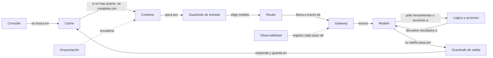

# Sistemas con modelos

Un sistema con modelos es una aplicación que tiene un modelo de IA como una pieza más, y su
arquitectura son las capas que se le suman alrededor (contexto, guardrails, router y gateway,
cache, lógica y acciones, observabilidad, orquestación), de a una y solo cuando la medición la pide.

La versión más simple es una consulta que va al modelo y una respuesta que vuelve. Chip Huyen
(*AI Engineering*, cap. 10, y su post "Building A Generative AI Platform", 2024) parte de ahí y
suma una capa por vez, cada una para un problema que la anterior deja: el modelo no sabe lo que
necesita, puede decir algo dañino, cuesta caro, tarda, tiene que actuar sobre el mundo. Su regla
para todas es la misma: "a component can be skipped if your system works well without it". Lo que
decide si una capa entra es la [evaluación](../Evaluacion/evals.md), y el
criterio general está en [Empezar simple](../../Arquitectura/Decisiones/empezar-simple.md).

Cómo funciona el modelo por dentro está en [Modelo base](../Modelos/modelo-base.md). Esta nota trata lo que lo
rodea: el modelo queda detrás de una interfaz propia, como pide
[aislar lo no determinista](../../Arquitectura/Modularidad/aislar-lo-no-determinista.md), y las capas se montan
sobre esa interfaz.

## Las capas de runtime, en el orden en que se suman

Huyen numera cinco pasos y agrega dos piezas transversales. El orden importa: es el orden en que,
según ella, un sistema típico las va necesitando, no el orden en que una consulta las atraviesa.

| Paso | Capa | Qué problema resuelve | Dónde se explica |
|---|---|---|---|
| 1 | Contexto | El modelo no tiene la información para responder | [Contexto y RAG](../Contexto/contexto-y-rag.md) |
| 2 | Guardrails | La entrada o la salida pueden ser dañinas o incorrectas | [Guardrails](guardrails.md) |
| 3 | Router y gateway | Cada consulta pide un modelo distinto; el acceso, las claves y el costo hay que centralizarlos | [Router y gateway de modelos](router-y-gateway-de-modelos.md) |
| 4 | Cache | Consultas repetidas cuestan y tardan | [Cache de modelos](cache-de-modelos.md) |
| 5 | Lógica compleja y acciones de escritura | La tarea pide varios pasos, herramientas o cambiar algo afuera | [Agente](../Agentes/agente.md) |
| — | Observabilidad | Saber qué pasó en cada consulta: métricas, logs y trazas | [Observabilidad](observabilidad-de-modelos.md) |
| — | Orquestación | Encadenar las capas en un flujo | en esta nota, abajo |

El diagrama es un flujo posible que arma esta base con esas capas; no es la figura de Huyen.

Los guardrails se tratan como capa pero no se duplican acá: tienen su nota,
[Guardrails](guardrails.md), y para ubicar la capa alcanza con saber que van en
dos puntos, antes del modelo (lo que entra, incluida información privada) y después (lo que sale).
La observabilidad tiene la suya, [Observabilidad](observabilidad-de-modelos.md), y alimenta el mismo
bucle que la [evaluación](../Evaluacion/evaluacion.md), junto
con el [feedback de usuario](../Evaluacion/feedback-de-usuario.md), que Huyen pone
al final del mismo capítulo.

## La orquestación, la última pieza y la que menos falta hace al principio

La orquestación es el código que define el flujo de una consulta entre las capas: qué se consulta
primero, qué pasa si un paso falla, cuándo se vuelve al modelo. Huyen la trata como pieza aparte
(cap. 10, "AI Pipeline Orchestration", p. 472) y recomienda empezar sin una herramienta de
orquestación externa, porque "any external tool brings added complexity". En el mismo sentido
cuenta entre los errores comunes "use an agentic framework when direct API calls work": un flujo de
tres capas se escribe en el lenguaje de la aplicación, con llamadas directas (lectura de esta base).

Cuando el flujo crece (varios modelos, pasos en paralelo, reintentos), un framework de orquestación
puede ahorrar código (lectura de esta base); cuáles hay está en [Plataformas de IA](plataformas-de-ia.md). Que el campo
desconfía de los frameworks pesados de agentes, y con qué evidencia, se cuenta en
[Agente](../Agentes/agente.md) y en [Lo que pierde peso](../../Arquitectura/Fundamentos/lo-que-pierde-peso.md).

## Lo que no es una capa: adaptar el modelo

Elegir entre mejorar el prompt, sumar RAG o hacer finetuning es una decisión de desarrollo, no
una capa de runtime: se toma antes de servir, cambia qué modelo o qué prompt hay detrás del
gateway, y no agrega un paso al flujo de la consulta. Por eso tiene su propia nota,
[Prompt, RAG o finetuning](../prompt-rag-o-finetuning.md), que comparte RAG con
[Contexto y RAG](../Contexto/contexto-y-rag.md): esa explica el mecanismo; la de la decisión, cuándo subir de
escalón.

## Cómo se conecta con el resto de la arquitectura

Las capas nuevas repiten patrones viejos con otro nombre, y conviene reconocerlos. El gateway de
modelos es un [API gateway](../../Arquitectura/Sistemas-distribuidos/api-gateway-y-bff.md) delante de proveedores;
su fallback entre modelos es [degradación controlada](../../Arquitectura/Sistemas-distribuidos/degradacion-controlada.md),
y un proveedor que falla seguido pide un [circuit breaker](../../Arquitectura/Sistemas-distribuidos/circuit-breaker.md).
Una acción de escritura que un agente puede reintentar necesita una
[clave de idempotencia](../../Arquitectura/Sistemas-distribuidos/clave-de-idempotencia.md). Lo que cambia es que
cada capa mueve dos números que con un modelo pasan al frente, el
[costo y la latencia](../../Arquitectura/Caracteristicas/costo-y-latencia.md), y que la calidad deja de ser binaria.
Esta lectura cruzada es de esta base: Huyen no la hace.

## Dónde sigue cada capa

- [Contexto y RAG](../Contexto/contexto-y-rag.md): cómo se le da al modelo la información que no tiene: la
  escalera de recuperación, contexto largo frente a RAG y context engineering.
- [Router y gateway de modelos](router-y-gateway-de-modelos.md): qué modelo atiende cada consulta
  y cómo se centraliza el acceso, el costo y el fallback.
- [Cache de modelos](cache-de-modelos.md): las tres caches (del prompt, exacta y semántica) y por
  qué la semántica puede devolver una respuesta equivocada.
- [Agente](../Agentes/agente.md): el modelo que planifica y usa herramientas: sus fallas, workflows frente a
  agentes, MCP y harness engineering.
- [Guardrails](guardrails.md): los controles sobre la entrada, la salida y las acciones.
- [Observabilidad](observabilidad-de-modelos.md): métricas, logs y trazas de cada consulta.
- [Prompt, RAG o finetuning](../prompt-rag-o-finetuning.md): la decisión de cómo adaptar el modelo,
  y por qué el finetuning mueve el problema al dato.
- [Plataformas de IA](plataformas-de-ia.md): ficha fechada con ejemplos de gateways, vector
  stores, orquestación y evals, el prompt cache por proveedor y el estado del finetuning.

El recurso canónico de todas las capas es la parte de arquitectura del cap. 10 de *AI Engineering* (pp. 449-473), o su
versión libre, el post ["Building A Generative AI Platform"](https://huyenchip.com/2024/07/25/genai-platform.html).
Conviene leerlo por el diagrama que crece paso a paso y fijarse en qué problema justifica cada
pieza: es lo que permite decidir que una no hace falta.
