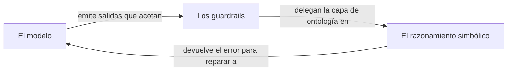

# IA

La IA de este tema es la de los modelos de lenguaje grandes: cómo una red que predice el
siguiente token produce respuestas, y cómo se acota lo que emite para que un sistema pueda
confiar en ella.

Es para quien diseña sistemas con un LLM adentro. La idea que ordena todo el tema: un LLM optimiza
que el texto sea probable, no que sea verdadero, así que lo que emite tiene que verificarse
afuera. Los guardrails de seguridad (filtrar contenido dañino, resistir jailbreaks) quedan fuera:
acá se trata de salidas incorrectas en usos legítimos.

## Del modelo que emite al reasoner que verifica

Tres partes: el modelo produce la salida, los guardrails la acotan en capas y el razonamiento
simbólico pone la última capa, la que chequea una afirmación contra lo que el dominio permite.

### El modelo

Un LLM encadena predicciones del siguiente token, sobre una arquitectura Transformer. Puede
alucinar: producir afirmaciones falsas con forma correcta. Mixture of experts es una forma de
hacerlo más grande sin que crezca el cómputo por token.

- [LLM](llm.md) — qué es un modelo de lenguaje grande y por qué su salida no viene garantizada; se
  lee primero.
- [Mixture of experts](mixture-of-experts.md) — cómo MoE suma parámetros sin sumar cómputo por token.

### Los guardrails

Cada tipo de error necesita un control distinto, y los controles se apilan: el prompt orienta, el
esquema asegura la forma, la validación revisa los valores y la ontología rechaza lo imposible en
el dominio.

- [Guardrails de LLM](guardrails.md) — las cuatro capas (prompt, esquema, validación, ontología) y qué atrapa cada
  una.
- [El LLM emite, el reasoner verifica](llm-emite-reasoner-verifica.md) — la capa de ontología: el LLM afirma, un reasoner marca,
  rechaza o repara.

### El razonamiento simbólico

Un reasoner es un programa genérico de deducción lógica: a partir de una ontología escrita en RDFS
u OWL deriva hechos implícitos y detecta inconsistencias. El mundo abierto de OWL limita lo que
puede chequear: un dato ausente no cuenta como error.

- [Inferencia en RDFS y OWL](inferencia-rdfs-y-owl.md) — qué deduce un reasoner RDFS u OWL y por qué el mundo abierto
  limita lo que chequea.

## Del token a la verificación

Para entender el tema, leé en el orden del diagrama: [LLM](llm.md), [Guardrails de LLM](guardrails.md),
[Inferencia en RDFS y OWL](inferencia-rdfs-y-owl.md) y [El LLM emite, el reasoner verifica](llm-emite-reasoner-verifica.md), que junta las dos
anteriores. [Mixture of experts](mixture-of-experts.md) se lee cuando interesa cómo se construye el modelo por dentro.
