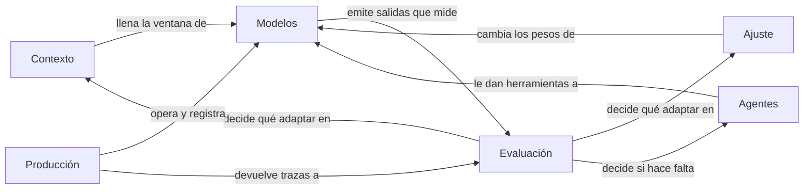

# IA

AI engineering es el oficio de construir productos con un modelo de IA ya entrenado adentro:
elegir el modelo, darle el contexto y las herramientas que necesita, ajustarlo solo si hace falta,
medir si el sistema hace lo que tiene que hacer y operarlo en producción.

Hasta hace pocos años, poner IA en un producto empezaba por juntar datos y entrenar un modelo
propio. Con los modelos base (modelos grandes, entrenados por otros, que sirven para muchas
tareas) el orden se invierte: se arranca por el producto y se adapta un modelo que ya existe.
Chip Huyen (*AI Engineering*, 2025, cap. 1) lo resume así: "AI engineering focuses less on
modeling and training, and more on model adaptation", y agrega: "This makes evaluation a much bigger
problem in AI engineering".
El tema toma esa mirada como perspectiva, no como índice: el árbol sigue las partes de un sistema
con un modelo adentro.

La idea que ordena todo el tema: un modelo de lenguaje genera texto probable, no texto verdadero.
Todo lo demás (el contexto, las herramientas, el ajuste, los guardrails, la evaluación) existe
para acercar lo probable a lo que el producto necesita, y para saber cuánto se acercó.

Dónde termina: cómo se entrena un modelo desde cero se explica solo lo necesario para entender por
qué emite lo que emite. La arquitectura general de software sobre la que se monta todo esto
(características, estilos, sistemas distribuidos) está en [Arquitectura](../Arquitectura/arquitectura.md);
las herramientas para programar con agentes, en [Desarrollo](../Desarrollo/desarrollo.md), y el
mercado laboral del oficio, en [Presentación profesional](../Presentacion-profesional/presentacion-profesional.md).

## De qué está hecho un sistema con un modelo adentro

En el centro está el modelo, que recibe una ventana de texto y emite la continuación más probable.
Hay tres formas de adaptarlo a una tarea: cambiar lo que entra en su ventana (contexto), dejarlo
actuar sobre el mundo (herramientas y agentes) o cambiar sus pesos (ajuste). Las dos primeras no
tocan el modelo y se prueban antes; el ajuste es la más cara (lectura de esta base, que sigue la
escalera de [Prompt, RAG o finetuning](prompt-rag-o-finetuning.md)). La evaluación mide el resultado y decide cuál de las tres hace falta, y producción lo
opera y devuelve lo que pasa con usuarios reales como dato para la próxima evaluación.

- [Modelos](Modelos/modelos.md) — qué es un modelo base, cómo se entrena, cómo genera y por qué
  alucina; se lee primero, porque explica los límites que el resto compensa.
- [Contexto](Contexto/contexto.md) — todo lo que entra en la ventana del modelo: el prompt, la
  información recuperada (RAG), la memoria, y el contexto como superficie de ataque.
- [Agentes](Agentes/agentes.md) — el modelo que usa herramientas y encadena pasos: cuándo conviene
  un workflow, cuándo un agente y cómo fallan.
- [Ajuste](Ajuste/ajuste.md) — cambiar los pesos con finetuning, [LoRA](Ajuste/peft-y-lora.md) o
  destilación, y los datos que eso pide.
- [Evaluación](Evaluacion/evaluacion.md) — cómo se mide algo cuya salida cambia en cada corrida, y
  cómo se elige un modelo; es la vertical que decide.
- [Producción](Produccion/produccion.md) — las capas que se suman alrededor del modelo (guardrails,
  router, cache), la inferencia y la observabilidad.
- [Fundamentos](Fundamentos/fundamentos-de-ia.md) — de dónde viene el campo, en qué se diferencia de
  ML engineering y qué leer.

Dos notas cruzan las verticales y viven acá arriba:

- [Planificar una aplicación](planificar-una-aplicacion.md) — si el caso de uso vale la pena, qué
  esperar del primer hito y por qué el último tramo es el más caro.
- [Prompt, RAG o finetuning](prompt-rag-o-finetuning.md) — la decisión entre dar contexto y ajustar
  el modelo, según la falla que muestra la evaluación.

## Las tres capas de la pila, según Huyen

Huyen divide la pila del oficio en tres capas (distintas de las capas que se suman alrededor del
modelo en [Sistemas con modelos](Produccion/sistemas-con-modelos.md)): el desarrollo de la aplicación ("providing a model with good
prompts and necessary context"), el desarrollo de modelos (herramientas para ajustar y preparar
datos) y la infraestructura ("model serving, managing data and compute, and monitoring"). En este
tema, la primera corresponde a [Contexto](Contexto/contexto.md), [Agentes](Agentes/agentes.md) y
[Evaluación](Evaluacion/evaluacion.md); la segunda, a [Ajuste](Ajuste/ajuste.md), y la tercera, a
[Producción](Produccion/produccion.md). La correspondencia entre las capas de Huyen y las
verticales es de esta base, y también la lectura de que quien construye productos pasa la mayor
parte del tiempo en la primera. La comparación con ML engineering está en
[AI engineering y ML engineering](Fundamentos/ai-engineering-y-ml-engineering.md).

## Lo que el campo afirma con más seguridad que evidencia

Las voces de referencia del oficio (Huyen, Hamel Husain, Eugene Yan y sus coautores) forman una
comunidad que se cita entre sí, y el tema hereda su sesgo: pro-evaluación y pro-producto. Dos
afirmaciones centrales se sostienen como criterio razonado, no como hecho medido:

> [!IMPORTANT]
> **Que la evaluación va primero.** Una búsqueda dirigida de esta base no encontró ningún estudio
> controlado que compare equipos que evalúan desde el principio con equipos que iteran a ojo. Una serie de 19 entrevistas a practicantes (van der Maden
> et al., preprint de 2026) encontró desde "informal 'vibe checks'" hasta procesos formales, y una
> brecha entre juntar datos de evaluación y convertirlos en mejoras. El argumento a favor sigue en
> pie: sin una medida no se sabe si un cambio mejoró el sistema. Se desarrolla en
> [Evaluación](Evaluacion/evaluacion.md).
>
> **Que los agentes y la IA para programar aceleran el trabajo.** Un ensayo controlado con
> desarrolladores experimentados en sus propios proyectos (METR, 2025, 16 personas y 246 tareas)
> midió que permitir la IA "increased task completion time by 19%", aunque ellos creían haber
> ahorrado 20 %. La repetición de 2026 dio un signo a favor con intervalos que incluyen cero; METR
> cree que la ganancia de 2026 probablemente es mayor, pero llama a esa evidencia "very weak". En
> otra población (empresas, con más juniors) y midiendo tareas completadas en lugar de tiempo, tres
> experimentos de campo encontraron más tareas terminadas (Cui et al., según un resumen secundario).
> Lo firme es la brecha entre lo que la gente cree y lo que se mide. Se desarrolla en
> [Agentes](Agentes/agentes.md).

## Qué leer según lo que estés construyendo

- Si vas a meter un modelo en un producto y no sabés si vale la pena:
  [Planificar una aplicación](planificar-una-aplicacion.md) y
  [Sistemas con modelos](Produccion/sistemas-con-modelos.md).
- Si tenés que saber si tu sistema anda: [Evaluación](Evaluacion/evaluacion.md),
  [Análisis de errores](Evaluacion/analisis-de-errores.md), [Evals](Evaluacion/evals.md) e
  [IA como juez](Evaluacion/ia-como-juez.md).
- Si tenés que elegir un modelo: [Benchmarks y elección de modelo](Evaluacion/benchmarks-y-eleccion-de-modelo.md)
  y la ficha de [Modelos disponibles](Modelos/modelos-disponibles.md).
- Si el modelo no sabe lo que necesita para responder: [Prompt, RAG o finetuning](prompt-rag-o-finetuning.md),
  [Contexto y RAG](Contexto/contexto-y-rag.md) y [Recuperación](Contexto/recuperacion.md).
- Si el modelo inventa: [Alucinación](Modelos/alucinacion.md) y [Guardrails](Produccion/guardrails.md).
- Si el sistema tiene que actuar (abrir un ticket, mandar un mail, cobrar):
  [Agente](Agentes/agente.md), [Patrones de flujo](Agentes/patrones-de-flujo.md) y
  [Uso de herramientas](Agentes/uso-de-herramientas.md).
- Si el sistema lee contenido que no controlás (mails, páginas, documentos de terceros):
  [Inyección de prompt](Contexto/inyeccion-de-prompt.md).
- Si cuesta caro o tarda: [Inferencia](Produccion/inferencia.md),
  [Cache de modelos](Produccion/cache-de-modelos.md),
  [Router y gateway de modelos](Produccion/router-y-gateway-de-modelos.md) y, para pasar a un
  modelo más chico, [Destilación](Ajuste/destilacion.md).
- Si pensás en ajustar un modelo: [Finetuning](Ajuste/finetuning.md) y
  [Datos para ajustar](Ajuste/datos-para-ajustar.md).

## Del modelo al producto

Para aprender el tema (por ejemplo, para prepararse para un puesto de AI engineer), leé en este
orden:

1. [Modelos](Modelos/modelos.md): [modelo base](Modelos/modelo-base.md),
   [token y embedding](Modelos/token-y-embedding.md), [muestreo](Modelos/muestreo.md) y
   [alucinación](Modelos/alucinacion.md). Con eso se entiende por qué la salida no viene garantizada.
2. [Evaluación](Evaluacion/evaluacion.md), antes que las técnicas, porque es lo que dice si una
   técnica sirvió.
3. [Contexto](Contexto/contexto.md) y [Agentes](Agentes/agentes.md), que es donde se pasa la mayor
   parte del trabajo.
4. [Prompt, RAG o finetuning](prompt-rag-o-finetuning.md) y, si hace falta, [Ajuste](Ajuste/ajuste.md).
5. [Producción](Produccion/produccion.md), para operar lo que se construyó.
6. [Fundamentos](Fundamentos/fundamentos-de-ia.md), para la historia y la bibliografía.
