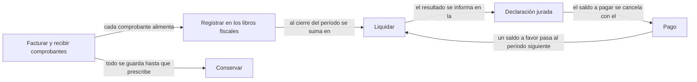

# Cumplimiento

El cumplimiento tributario es lo que una empresa hace cada período para estar al día con el fisco: emitir y recibir comprobantes, registrarlos, liquidar cada impuesto, presentar la declaración, pagar el saldo y conservar todo hasta que el fisco ya no pueda revisarlo.

Esta vertical junta a las demás del tema [Impuestos](../impuestos.md). La [obligación tributaria](../Obligacion-tributaria/obligacion-tributaria.md) dice qué se debe y quién lo debe; los [impuestos al consumo](../Impuestos-al-consumo/impuestos-al-consumo.md) y los [impuestos a la renta](../Impuestos-a-la-renta/impuestos-a-la-renta.md) dicen cómo se calcula cada uno; la [recaudación en la fuente](../Recaudacion-en-la-fuente/recaudacion-en-la-fuente.md) adelanta una parte. Cumplimiento convierte todo eso, cada mes, en una declaración presentada y un saldo pagado.

## El ciclo de cada período

El ciclo se repite en cada período fiscal, que para el IVA suele ser mensual. La Directiva europea del IVA fija el período «en uno, dos o tres meses», con períodos más largos que «en ningún caso, podrán exceder de un año», y da hasta dos meses después del cierre para declarar (art. 252). El impuesto a la renta tiene un período anual, con anticipos en el medio.

| Paso | Qué se hace | Dónde se explica |
|---|---|---|
| Facturar | Emitir un comprobante por cada venta y exigirlo en cada compra | [comprobante fiscal](comprobante-fiscal.md) |
| Registrar | Anotar cada comprobante en los libros de IVA ventas y compras, y en la contabilidad | [registros fiscales](registros-fiscales.md) |
| Liquidar | Sumar el débito y el crédito fiscal, restar retenciones, percepciones y anticipos, y llegar al saldo | [IVA](../Impuestos-al-consumo/iva.md), [pagos a cuenta](../Recaudacion-en-la-fuente/pagos-a-cuenta.md) |
| Declarar | Presentar la declaración jurada del período antes del vencimiento | [declaración y pago](declaracion-y-pago.md) |
| Pagar | Cancelar el saldo, o arrastrar el saldo a favor | [declaración y pago](declaracion-y-pago.md) |
| Conservar | Guardar comprobantes, libros y declaraciones mientras el fisco pueda revisarlos | [registros fiscales](registros-fiscales.md) |

Si además retiene o percibe impuestos de terceros, la empresa tiene un ciclo más: presentar y depositar lo que recaudó como [agente de recaudación](../Recaudacion-en-la-fuente/agente-de-recaudacion.md), con su propio vencimiento.

Cuando el ciclo se rompe, el fisco cruza información, inspecciona, cobra intereses y multas: ver [fiscalización y sanciones](fiscalizacion-y-sanciones.md).

## Quién hace qué en una empresa chica

En una empresa chica el cumplimiento se reparte entre la empresa y un contador externo. La empresa produce los datos: emite las facturas, junta las de compras, guarda los certificados de retención y paga. El contador liquida, arma la declaración, la presenta con la clave de la empresa y avisa el monto y el vencimiento.

> [!NOTE] Sin fuente todavía: ninguna fuente leída describe esta división de tareas. Es la práctica habitual, contada como inferencia de la base.

La división funciona si el corte es limpio: unos días antes del vencimiento, el contador necesita todos los comprobantes del período, completos y sin duplicados. Suele fallar lo que la empresa no le pasa: una factura de compra que llegó tarde, una nota de crédito que nadie registró, una retención sufrida cuyo certificado no se bajó. Cada uno cambia el saldo de la declaración.

Un sistema de gestión tiene que poder entregar al contador, por período, el detalle de ventas y compras con su impuesto, las retenciones y percepciones sufridas, y los comprobantes anulados o corregidos (inferencia de la base; ver [registros fiscales](registros-fiscales.md)).

El calendario de cierre (quién entrega qué, en qué día del mes, para que la contabilidad y los impuestos cierren juntos) es el recorrido [del registro al balance](../../Procesos-de-negocio/del-registro-al-balance.md#quién-entrega-qué-y-en-qué-día), en Procesos de negocio. Acá queda qué se presenta y cuándo vence.

## Cuánto cuesta cumplir

El costo de cumplir se mide en horas y en cantidad de pagos. El estudio de referencia, *Paying Taxes* (Banco Mundial y PwC), en su edición 2020 (datos de 2018) midió en 190 economías el tiempo que una empresa de estudio, «a small to medium-size manufacturer and retailer», necesita para cumplir con los impuestos a la renta, al trabajo y al consumo.

| Medida (datos de 2018) | Promedio mundial | América del Sur |
|---|---|---|
| Horas por año para cumplir | 234 | 519 |
| Pagos por año | 23,1 | 24,7 |

Fuente: Paying Taxes 2020, fact sheet de América del Sur. En la región, Brasil llegaba a 1.501 horas y Bolivia a 1.025, y el informe dice que es la región con más tiempo de cumplimiento, a más del doble del promedio mundial de 234 horas.

Tres hallazgos del informe muestran de qué depende ese costo:

- La tecnología lo baja. Desde 2012, el promedio mundial de pagos cayó 10 % y el de horas 16 %, «both driven by technology». Las economías con declaración y pago electrónicos pasaron de 43 de 174 en 2004 a 106 de 190 en 2018.
- La frecuencia lo sube. Venezuela sumó 128 horas, hasta 920, cuando pasó de declarar el IVA por mes a declararlo por semana sin sistemas en línea.
- Lo que viene después de declarar también cuesta. Según el mismo fact sheet, obtener una devolución de IVA lleva 27,3 semanas y 18,2 horas de trabajo (promedios mundiales, según el fact sheet: «On average around the world»), y en América del Sur la devolución estaba disponible para la empresa del caso solo en dos economías. Ver [declaración y pago](declaracion-y-pago.md).

El indicador mide una sola empresa tipo y no compara tamaños. Que el costo de cumplir pese más, en proporción, en una empresa chica que en una grande es una idea extendida en la literatura de costos de cumplimiento, pero no se leyó un estudio que la mida.

> [!NOTE] Sin fuente todavía: un estudio de costos de cumplimiento por tamaño de empresa (OCDE, «Taxation of SMEs in OECD and G20 Countries», 2015; Comisión Europea, estudio sobre costos de cumplimiento de pymes, 2018). Tampoco se leyó la serie *Tax Administration* de la OCDE.

## Cómo falla el cumplimiento

- El dato no llega a tiempo. Una compra sin registrar pierde su crédito fiscal en el período; una venta sin registrar aparece después en un cruce del fisco.
- El comprobante se corrige mal. Una factura borrada o editada en lugar de corregida con una nota de crédito deja un hueco en la numeración que el fisco lee como venta oculta. Ver [comprobante fiscal](comprobante-fiscal.md).
- El saldo a favor se olvida. Las retenciones y percepciones sufridas que no se computan son impuesto pagado dos veces.
- Se declara sin pagar o se paga sin declarar. Son dos obligaciones distintas, con sanciones distintas. Ver [declaración y pago](declaracion-y-pago.md).
- Se paga tarde. Corren intereses desde el vencimiento, aunque después se arregle. Ver [fiscalización y sanciones](fiscalizacion-y-sanciones.md).

Estas fallas son inferencia de la base a partir de los componentes; ninguna fuente leída las enumera así.

## Qué hay adentro del cumplimiento

- [Comprobante fiscal](comprobante-fiscal.md): qué lleva una factura, la numeración sin huecos, la nota de crédito y de débito, y los modelos de factura electrónica. Leelo primero: todo el ciclo sale de acá.
- [Registros fiscales](registros-fiscales.md): los libros de IVA, su relación con la contabilidad, cuánto tiempo se guarda y cómo se le entregan los datos al fisco.
- [Declaración y pago](declaracion-y-pago.md): autoliquidación, declaración jurada, vencimientos, anticipos, saldo a favor, compensación, devolución y rectificativa.
- [Fiscalización y sanciones](fiscalizacion-y-sanciones.md): cómo controla el fisco, intereses, multas, prescripción, planes de pago y el agente que no ingresó lo retenido.

Lo argentino (ARCA, la clave fiscal y el calendario de vencimientos) empieza en [impuestos en Argentina](../impuestos-en-argentina.md); la factura electrónica argentina está en [factura electrónica de ARCA](../../Comercio-electronico/Normativa/factura-electronica-de-arca.md), y los saldos de IVA, en [IVA en Argentina](../Impuestos-al-consumo/iva-en-argentina.md). Cómo se registra el impuesto en la contabilidad es de [Contabilidad](../../Contabilidad/contabilidad.md), y pagar y tener la caja para hacerlo, de [Tesorería](../../Tesoreria/tesoreria.md).

Para leer más: *Paying Taxes 2020*, sección «The advantage of automation» (pp. 20-23), que ordena en cuatro niveles cómo la tecnología cambia el cumplimiento del IVA, de poca tecnología a la declaración y la factura electrónica en tiempo real.
