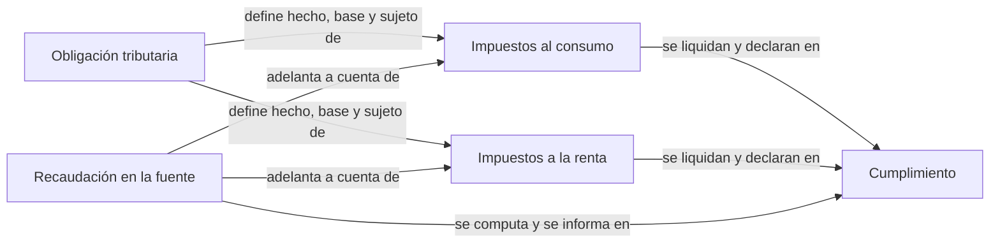

# Impuestos

Los impuestos, como dominio de negocio, son lo que una empresa que ya opera le debe al Estado por lo que vende, por lo que gana y por lo que cobra o paga a otros: cómo nace cada obligación, cómo se calcula, quién la cobra y qué tiene que hacer la empresa cada período para cumplir.

Una empresa toca los impuestos de tres maneras. Paga los suyos, como el impuesto a la renta sobre su ganancia. Cobra los de otros: el cliente paga el IVA que se agrega a la factura, y la empresa lo junta y lo entrega. Y retiene o percibe por cuenta del fisco: le descuenta una parte a un proveedor o le suma un recargo a un cliente, a cuenta de un impuesto de ese tercero. Por eso una empresa maneja más plata de impuestos que la que le corresponde, y un error en el sistema que factura se vuelve una deuda propia.

El tema es dueño de qué se debe, sobre qué base, cuándo y cómo se declara. El registro contable es de [Contabilidad](../Contabilidad/contabilidad.md); pagarlo y tener la caja para hacerlo, del tema Tesorería y finanzas de la empresa en marcha (todavía no escrito); y las decisiones iniciales (forma legal, régimen), de [Legal e impuestos](../Emprender/Legal-e-impuestos/legal-e-impuestos.md) en Emprender.

## Las cinco partes del tema

El tema tiene cinco partes: la obligación, los impuestos sobre lo que se vende y sobre lo que se gana, el cobro por adelantado de un tercero y el ciclo de cumplimiento mensual.

- [Obligación tributaria](Obligacion-tributaria/obligacion-tributaria.md): el hecho que hace nacer un impuesto, la base, la alícuota y el período; quién es contribuyente, quién responsable y quién agente; qué fisco cobra; y el régimen simplificado para pequeños contribuyentes. Se lee primero: las demás suponen este vocabulario.
- [Impuestos al consumo](Impuestos-al-consumo/impuestos-al-consumo.md): el IVA, el impuesto a la venta final, los impuestos en cascada y dónde se considera hecha una operación; define qué lleva cada renglón de una factura.
- [Impuestos a la renta](Impuestos-a-la-renta/impuestos-a-la-renta.md): el impuesto sobre la ganancia y el paso del resultado contable al impositivo, con el cierre del ejercicio y los anticipos.
- [Recaudación en la fuente](Recaudacion-en-la-fuente/recaudacion-en-la-fuente.md): retenciones y percepciones, vistas desde quien las practica y desde quien las sufre.
- [Cumplimiento](Cumplimiento/cumplimiento.md): el comprobante fiscal, los registros, la declaración y el pago, y lo que pasa cuando el fisco controla. Define qué hace falta cada mes y qué tiene que emitir un sistema.

Lo propio de la Argentina empieza en [Impuestos en Argentina](impuestos-en-argentina.md): impuestos de cada nivel de gobierno, ARCA y calendario de vencimientos. Cada vertical tiene su nota argentina, y el comercio exterior también: [comercio exterior en Argentina](comercio-exterior-en-argentina.md).

## Tres ideas que cruzan todo el tema

- El impuesto sigue al documento. Casi todo impuesto de una empresa se calcula sobre un comprobante (una factura, un recibo, una nota de crédito) y en el período de ese comprobante. Por eso el [comprobante fiscal](Cumplimiento/comprobante-fiscal.md) es el centro del cumplimiento, y una factura mal emitida se corrige con otra en lugar de borrarse.
- La alícuota cambia con el tiempo y con la contraparte. El mismo producto puede pagar distinto según la fecha, el lugar, quién compra y en qué régimen está quien vende. El impuesto de un renglón sale de una combinación de datos del producto, de las dos partes y de la operación (ver [hecho imponible y base](Obligacion-tributaria/hecho-imponible-y-base.md) y [sujetos del impuesto](Obligacion-tributaria/sujetos-del-impuesto.md)).
- Lo devengado y lo pagado difieren. El impuesto se debe cuando pasa el hecho, aunque la plata llegue después, igual que el [devengado](../Contabilidad/Registro/devengado.md) contable. Entre lo que se debe y lo que ya se adelantó por retenciones, percepciones y anticipos aparece el saldo a favor, que en un país con inflación pierde valor mientras espera.

## Dónde termina el tema

Cada dominio es dueño de un objeto y un verbo, y los demás lo enlazan. La tabla completa está en el [alcance del tema](ALCANCE.md). Los límites que más se confunden:

- Con la contabilidad: acá se decide cuánto IVA lleva una factura; el asiento que lo registra es de [Contabilidad](../Contabilidad/contabilidad.md), que ya trata las [operaciones](../Contabilidad/Operaciones/operaciones.md) habituales.
- Con Emprender: elegir el monotributo o la forma legal se decide una vez y está en [Legal e impuestos](../Emprender/Legal-e-impuestos/legal-e-impuestos.md); recategorizarse cada seis meses es recurrente y está en [monotributo en marcha](Obligacion-tributaria/monotributo-en-marcha.md).
- Con el comercio electrónico: la [factura electrónica de ARCA](../Comercio-electronico/Normativa/factura-electronica-de-arca.md) y el cobro de Ingresos Brutos sobre los pagos de una tienda ya están en [Normativa](../Comercio-electronico/Normativa/normativa.md) de Comercio electrónico; acá se explican como régimen general.
- Con los sueldos: los aportes, las contribuciones y la liquidación del recibo van al tema Administración de personal y nómina, todavía no escrito; acá queda el empleador como [agente de retención](Recaudacion-en-la-fuente/agente-de-recaudacion.md).
- Con el software: la alícuota con vigencia, el motor que calcula el impuesto de cada renglón y la conexión con el fisco son del tema Software de gestión, todavía no escrito.

## Qué leer según lo que estés haciendo

- Si tenés que construir el módulo de impuestos de un sistema de gestión, en este orden: [obligación tributaria](Obligacion-tributaria/obligacion-tributaria.md) y [hecho imponible y base](Obligacion-tributaria/hecho-imponible-y-base.md); [IVA](Impuestos-al-consumo/iva.md) y [lugar de la operación](Impuestos-al-consumo/lugar-de-la-operacion.md); [comprobante fiscal](Cumplimiento/comprobante-fiscal.md); [agente de recaudación](Recaudacion-en-la-fuente/agente-de-recaudacion.md) y [pagos a cuenta](Recaudacion-en-la-fuente/pagos-a-cuenta.md); [registros fiscales](Cumplimiento/registros-fiscales.md) y [declaración y pago](Cumplimiento/declaracion-y-pago.md). Para la Argentina, después: [IVA en Argentina](Impuestos-al-consumo/iva-en-argentina.md), [Ingresos Brutos](Impuestos-al-consumo/ingresos-brutos.md), [retenciones y percepciones en Argentina](Recaudacion-en-la-fuente/retenciones-y-percepciones-en-argentina.md) y la [factura electrónica de ARCA](../Comercio-electronico/Normativa/factura-electronica-de-arca.md). La alícuota con vigencia y el motor de cálculo como piezas de software van a estar en el tema Software de gestión (todavía no escrito).
- Si diseñás cómo un sistema calcula los impuestos de una factura: [hecho imponible y base](Obligacion-tributaria/hecho-imponible-y-base.md), [IVA](Impuestos-al-consumo/iva.md), [lugar de la operación](Impuestos-al-consumo/lugar-de-la-operacion.md), [comprobante fiscal](Cumplimiento/comprobante-fiscal.md) y [agente de recaudación](Recaudacion-en-la-fuente/agente-de-recaudacion.md); para la Argentina, [IVA en Argentina](Impuestos-al-consumo/iva-en-argentina.md), [Ingresos Brutos](Impuestos-al-consumo/ingresos-brutos.md) y la [factura electrónica de ARCA](../Comercio-electronico/Normativa/factura-electronica-de-arca.md).
- Si querés entender por qué una empresa tiene saldo a favor de IVA y no lo puede usar: [IVA](Impuestos-al-consumo/iva.md), [pagos a cuenta](Recaudacion-en-la-fuente/pagos-a-cuenta.md) y [declaración y pago](Cumplimiento/declaracion-y-pago.md).
- Si un cliente te retuvo parte de una factura o un proveedor te sumó una percepción: [recaudación en la fuente](Recaudacion-en-la-fuente/recaudacion-en-la-fuente.md) y [pagos a cuenta](Recaudacion-en-la-fuente/pagos-a-cuenta.md); en la Argentina, [retenciones y percepciones en Argentina](Recaudacion-en-la-fuente/retenciones-y-percepciones-en-argentina.md).
- Si armás el calendario fiscal de una empresa o querés saber qué se presenta cada mes: [cumplimiento](Cumplimiento/cumplimiento.md), [declaración y pago](Cumplimiento/declaracion-y-pago.md) e [impuestos en Argentina](impuestos-en-argentina.md).
- Si preparás información para una inspección o respondés un requerimiento: [registros fiscales](Cumplimiento/registros-fiscales.md) y [fiscalización y sanciones](Cumplimiento/fiscalizacion-y-sanciones.md).
- Si calculás el impuesto a la renta del ejercicio o sus anticipos: [resultado impositivo](Impuestos-a-la-renta/resultado-impositivo.md) y [Ganancias en Argentina](Impuestos-a-la-renta/ganancias-en-argentina.md).
- Si estás en el monotributo y cambió tu facturación: [régimen simplificado](Obligacion-tributaria/regimen-simplificado.md) y [monotributo en marcha](Obligacion-tributaria/monotributo-en-marcha.md).
- Si vendés a clientes de varias provincias: [Ingresos Brutos](Impuestos-al-consumo/ingresos-brutos.md).
- Si importás, exportás o vendés servicios al exterior: [lugar de la operación](Impuestos-al-consumo/lugar-de-la-operacion.md) y [comercio exterior en Argentina](comercio-exterior-en-argentina.md); para una persona que cobra servicios del exterior, [cobrar servicios del exterior](../Emprender/Legal-e-impuestos/cobrar-servicios-del-exterior.md).
- Si registrás un impuesto en la contabilidad: está en [Contabilidad](../Contabilidad/contabilidad.md).
- Si liquidás sueldos y sus cargas: no hay nota; lo más cercano es [agente de recaudación](Recaudacion-en-la-fuente/agente-de-recaudacion.md) y la sección de sueldos de [operaciones](../Contabilidad/Operaciones/operaciones.md) de Contabilidad.

## Orden de lectura

Quien no es contador puede leer esta entrada, [obligación tributaria](Obligacion-tributaria/obligacion-tributaria.md) y [IVA](Impuestos-al-consumo/iva.md), que es el impuesto que más toca a un sistema de gestión; después [recaudación en la fuente](Recaudacion-en-la-fuente/recaudacion-en-la-fuente.md) y [cumplimiento](Cumplimiento/cumplimiento.md), y al final lo del país.

- [Fundamentos](Fundamentos/fundamentos-de-impuestos.md): de dónde viene el IVA, qué hace bueno o malo a un impuesto, las posiciones que se discuten y los mitos de quien no es contador.
- [Glosario de impuestos](Fundamentos/glosario-de-impuestos.md): cada término del tema en una línea, con su nombre en inglés y la nota que lo explica.
- [Fuentes de impuestos](Fundamentos/fuentes-de-impuestos.md): dónde se produce el saber tributario y qué leer para cada parte.
