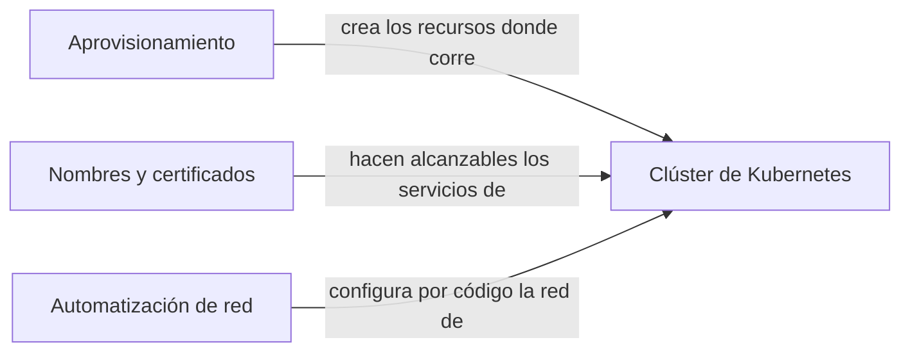

# Infraestructura

La infraestructura es lo que hay debajo de las aplicaciones: los recursos que se aprovisionan con
código, el clúster de Kubernetes y su red, los nombres y certificados que lo hacen alcanzable y la
red que lo conecta.

La idea que cruza todo el tema es tratar la
[infraestructura como código](Aprovisionamiento/infraestructura-como-codigo.md): la configuración vive en
Git, pasa por un PR con pruebas y se aplica por un pipeline, no a mano. Terraform lo hace con los
recursos de la nube, GitOps con el clúster y NetDevOps con la red. El tema guarda el concepto
general; cómo está armado y operado un sistema concreto vive en su repo.

## De qué está hecha la infraestructura

Cuatro partes. El aprovisionamiento crea los recursos; sobre ellos corre el clúster; los nombres y
certificados lo hacen alcanzable; y la automatización de red lleva la misma disciplina a los
equipos de red. Los secretos que usan el aprovisionamiento y el clúster se tratan en la
[gestión de secretos](../DevOps/DevSecOps/gestion-de-secretos.md) de DevSecOps.

- [Aprovisionamiento](Aprovisionamiento/aprovisionamiento.md) — la infraestructura como código y
  su implementación con Terraform: módulos, estado remoto, entornos, pipeline, secretos y cómo lo
  adopta un equipo.
- [Clúster de Kubernetes](Cluster-de-kubernetes/cluster-de-kubernetes.md) — la red del clúster con
  Cilium, el default-deny y el despliegue con Kubespray.
- [Nombres y certificados](Nombres-y-certificados/nombres-y-certificados.md) — split-horizon DNS y
  el desafío ACME HTTP-01, y cuándo conviene DNS-01.
- [Automatización de red](Automatizacion-de-red/automatizacion-de-red.md) — NetDevOps y sus
  herramientas.

## Homelab

El clúster `home-k8` de Matías se documenta en su repo, no en esta base: runbooks, lessons, ADRs
y la capability matrix están en [github.com/mtsdlf/home-k8](https://github.com/mtsdlf/home-k8)
(carpeta `docs/`). La base guarda el concepto general; el repo, cómo está armado y operado ese
sistema. Algunas notas (default-deny, split-horizon, SOPS) lo usan como ejemplo.

## Otros temas

- [Observabilidad](../DevOps/Operacion/observabilidad.md) — monitoreo, logs y alertas viven en DevOps.
- [GitOps](../DevOps/Despliegue/gitops.md) — GitOps, la base de SOPS y de NetDevOps, vive en DevOps.
- [Gestión de secretos](../DevOps/DevSecOps/gestion-de-secretos.md) y [SOPS](../DevOps/DevSecOps/sops.md) — dónde viven los secretos y cómo se cifran en Git, en DevSecOps.
