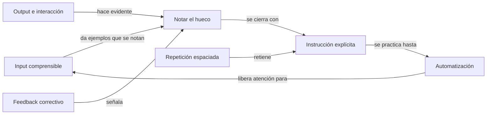

# Adquisición

La adquisición es el proceso por el que un adulto pasa de conocer el inglés a usarlo: entender
mucho, producir, recibir corrección, estudiar la forma y practicarla hasta que salga sola, con la
memoria y la edad como condiciones.

Es la vertical que se lee primero en [Inglés](../ingles.md), porque explica cómo se afina cada
sistema del idioma. Las mismas piezas valen para una vocal de
[Pronunciación](../Pronunciacion/pronunciacion.md), un tiempo verbal de
[Gramática](../Gramatica/gramatica.md), una colocación de [Léxico](../Lexico/lexico.md) o un
conector de [Discurso](../Discurso/discurso.md). Y justifican cada técnica de
[Práctica](../Practica/practica.md): una técnica sirve si activa alguno de estos mecanismos.

## Seis mecanismos, una condición y un diagnóstico

El campo de la adquisición de segundas lenguas (SLA, por su sigla en inglés) reconoce varios
motores que se suman. Ninguno alcanza solo; la discusión es cuánto pesa cada uno.

| Pieza | Qué hace | Ejemplo para un B2 |
|---|---|---|
| [Input comprensible](input-comprensible.md) | Entender mucho da el material del que sale el idioma | Una serie sin subtítulos en la que se entiende casi todo |
| [Output e interacción](output-e-interaccion.md) | Producir obliga a notar lo que falta | Querer decir «me di cuenta de que» y descubrir que no sale |
| [Feedback correctivo](feedback-correctivo.md) | La corrección muestra el error que el oyente no marca | Un tutor que responde «She...?» a «She don't like it» |
| [Instrucción explícita](instruccion-explicita.md) | Estudiar la regla acelera y apunta la atención | Aprender que *since 2019* pide present perfect |
| [Automatización](automatizacion.md) | La práctica pasa la regla al uso sin pensar | Decir *I've lived here since 2019* sin frenar |
| [Repetición espaciada](repeticion-espaciada.md) | Recuperar de memoria, espaciado, fija lo estudiado | Repasar *meet a deadline* a los dos días, a la semana, al mes |
| [Edad y diferencias individuales](edad-y-diferencias-individuales.md) | Condición: cuándo se empezó y con qué aptitud | Llegar a C1 de adulto es posible; sonar nativo, raro |
| [Meseta intermedia](meseta-intermedia.md) | Diagnóstico: por qué el B2 deja de mejorar | Hace años que se dice *I have 30 years* y nadie lo corrige |

## Del input al uso automático

Los mecanismos encadenan un ciclo. El input da los ejemplos; producir y recibir corrección hace
notar el hueco entre lo que se dice y lo que se debería decir; la instrucción explícita da la
regla para cerrarlo; la práctica la automatiza, y el repaso espaciado evita que se pierda.

El ciclo explica por qué un B2 puede pasar años expuesto al inglés sin mejorar en algo puntual:
si el error no rompe la comprensión, nadie lo marca y el ciclo no arranca. Richards (2008) lo
dice así: los errores fosilizados «tend not to affect our understanding of the speaker», y por eso
el alumno puede no notarlos nunca. Es el núcleo de la [meseta intermedia](meseta-intermedia.md).

## Dónde se pelea el campo: la interfaz

La pregunta que divide a las escuelas es si lo que se estudia conscientemente se convierte en
conocimiento que se usa sin pensar.

> [!IMPORTANT]
> **El debate de la interfaz.** Krashen (1982) sostiene que lo aprendido no se convierte en
> adquirido («learning does not 'turn into' acquisition») y que la regla consciente solo sirve para
> corregirse después. Roehr-Brackin (2024) llama a esa posición minoritaria hoy. La interfaz fuerte
> (DeKeyser) dice que el conocimiento explícito tiene un papel causal en el implícito. La interfaz
> débil (N. Ellis, R. Ellis) dice que la conciencia misma es la interfaz: lo explícito ayuda a notar
> y eso alimenta lo implícito. El consenso, según Roehr-Brackin, es que aprender un idioma
> adicional involucra procesos explícitos e implícitos. El detalle está en
> [Instrucción explícita](instruccion-explicita.md).

Para quien estudia solo, la consecuencia práctica es la misma en las dos interfaces: estudiar la
regla sirve si después se practica en el modo en que se va a usar.

## Cuánto respalda la evidencia a cada pieza

La evidencia es despareja. Lo mejor respaldado son la instrucción explícita, el feedback
correctivo y el espaciado del vocabulario, cada uno con varios metaanálisis. La meseta no tiene
ningún estudio que pruebe qué la destraba.

| Pieza | Evidencia | Límite |
|---|---|---|
| Instrucción explícita | Tres metaanálisis a favor (Norris y Ortega 2000; Spada y Tomita 2010; Goo et al. 2015) | Las medidas pueden favorecer lo explícito |
| Feedback correctivo | Metaanálisis de Li (2010) y de Lyster y Saito (2010) | Discrepan sobre qué tipo de corrección rinde más |
| Repetición espaciada | Kim y Webb (2022): 48 experimentos, efecto «medium-to-large» | Casi todo es vocabulario suelto |
| Input comprensible | Lectura extensiva con efecto medio, que Hamada (2020) corrige a la baja | Ningún estudio prueba que alcance solo |
| Automatización | DeKeyser (1997), en laboratorio | Lengua artificial, no inglés |
| Meseta intermedia | Ninguna sobre qué la destraba | Es un diagnóstico de práctica docente |

Los tamaños de efecto de esta vertical se leen con cuidado. Plonsky y Oswald (2014), sobre 346
estudios primarios y 91 metaanálisis, muestran que los umbrales habituales de Cohen subestiman los
efectos típicos en segundas lenguas, así que un «d = 0.8 es grande» no se puede leer directo. Y
casi ningún estudio se hizo con adultos B2 que estudian solos: son universitarios, aulas o
laboratorios.

## Qué hay adentro de Adquisición

- [Input comprensible](input-comprensible.md) — la hipótesis de Krashen, la lectura extensiva y por
  qué entender no alcanza.
- [Output e interacción](output-e-interaccion.md) — producir para notar el hueco, negociar el
  significado (Swain, Long, Schmidt).
- [Feedback correctivo](feedback-correctivo.md) — recasts contra prompts, oral y escrito, y qué
  pedirle a un tutor.
- [Instrucción explícita](instruccion-explicita.md) — por qué estudiar la forma suma y el debate de
  la interfaz.
- [Automatización](automatizacion.md) — del conocimiento declarativo al uso sin pensar, y por qué
  se automatiza lo que se practica.
- [Repetición espaciada](repeticion-espaciada.md) — el efecto de espaciado y la práctica de
  recuperación, con su límite en el vocabulario.
- [Edad y diferencias individuales](edad-y-diferencias-individuales.md) — período crítico, aptitud
  y motivación, y qué techo pone empezar de adulto.
- [Meseta intermedia](meseta-intermedia.md) — diagnóstico de por qué el B2 se estanca, con la
  fosilización en disputa y el hueco de evidencia a la vista.
