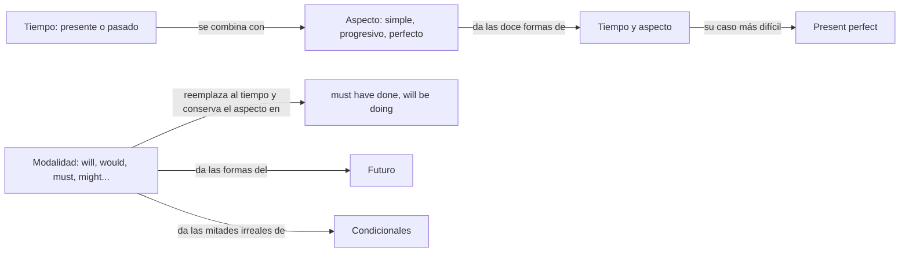

# Gramática

La gramática de B2 a C1/C2 es sobre todo más control y precisión sobre formas que ya se conocen: elegir bien el tiempo, el aspecto y el modal, el artículo y el orden de la oración en tiempo real, y sumar unas pocas construcciones para dar énfasis y registro.

Es una de las cuatro partes del idioma que se afinan en el [tema](../ingles.md). Recibe de [Léxico](../Lexico/lexico.md) las palabras y los bloques hechos, y arma las oraciones que [Discurso](../Discurso/discurso.md) encadena en un argumento. Las preposiciones, que la hoja de errores de Cambridge pone como el error número uno del hispanohablante, no van acá: se aprenden pegadas a su palabra, como [colocaciones y chunks](../Lexico/colocaciones-y-chunks.md).

## Qué cambia en la gramática de B2 a C1/C2

Según los descriptores, lo que cambia de B2 a C2 es cuánto control se tiene. Los descriptores de exactitud gramatical del MCER lo dicen en esa clave, sin listar estructuras nuevas:

| Nivel | Descriptor de *Grammatical accuracy* (Companion Volume) |
|---|---|
| B2 | "relatively high degree of grammatical control. Does not make mistakes which lead to misunderstanding." |
| C1 | "consistently maintains a high degree of grammatical accuracy; errors are rare and difficult to spot" |
| C2 | "maintains consistent grammatical control of complex language, even while attention is otherwise engaged" |

La frase del C2, "while attention is otherwise engaged", es la clave: el control tiene que sostenerse mientras la atención está en lo que se dice. Eso es [automatización](../Adquisicion/automatizacion.md). Los [niveles del MCER](../Fundamentos/niveles-mcer.md) dan las otras escalas.

Las construcciones nuevas que estas notas desarrollan son la [inversión y las cleft](estructuras-avanzadas.md) para dar énfasis, los [modales en perfecto](modales.md) para juzgar el pasado, los [condicionales mixtos](condicionales-e-hipotesis.md), la [pasiva impersonal](pasiva-y-causativa.md) del registro formal.

## El English Grammar Profile como mapa y su límite

El English Grammar Profile (EGP) es un inventario de más de 1.200 estructuras, cada una asignada a un nivel del MCER a partir de redacciones de examen del Cambridge Learner Corpus. Según la descripción de Verratti-Souto, Sagirov y Chen (2025), O'Keeffe y Mark daban una estructura por adquirida en un nivel con cuatro criterios: frecuencia mayor que en el British National Corpus, 60 % de usos correctos, uso por hablantes de distintas lenguas maternas y aparición en varias tareas.

> [!IMPORTANT]
> **Qué tan confiable es el nivel que el EGP le da a cada estructura.** Verratti-Souto et al. (2025) rehicieron la asignación con estadística sobre otro corpus de aprendices (EFCAMDAT). Solo 124 de las estructuras informativas (32,80 %) aparecieron significativamente más en su nivel EGP que en el anterior, y el acuerdo fue kappa = 0,193 ("slight agreement"). El acuerdo fue mejor en niveles bajos, y "this was not the case for the CEFR B and C levels". Los autores reconocen que su corpus es distinto (textos de curso, no de examen) y que su método no mide corrección. El EGP, por su parte, se armó con análisis en gran parte manual de los corpus de aprendices.

En la práctica, el EGP sirve de mapa orientativo de qué estructuras aparecen más en B2, C1 y C2. No se pudo leer su sitio en línea, así que estas notas no citan ningún enunciado suyo. No sirve como lista cerrada de "esto es C1", y menos como criterio para decidir qué estudiar primero: para eso pesa más qué errores comete cada uno.

## Tiempo, aspecto y modalidad como un solo sistema

El verbo inglés combina tres ejes. El **tiempo** ubica en presente o pasado (*works / worked*). El **aspecto** dice cómo se mira la acción: en curso (progresivo, *is working*) o como algo que llega hasta un punto de referencia (perfecto, *has worked*). La **modalidad** agrega la actitud del hablante: probabilidad, obligación, posibilidad (*must work*, *might have worked*). Leech trata los tres juntos como el sistema del sintagma verbal.

Verlos como sistema ahorra memoria. El present perfect es "presente + aspecto perfecto"; *will* es un modal más, por eso el futuro tiene varias formas; *would have done* es modal + perfecto, y aparece igual en condicionales, en deducciones y en reproches.

El castellano tiene los mismos ejes con otro reparto. Usa subjuntivo donde el inglés usa pasado (*si tuviera* / *if I had*), presente donde el inglés pide progresivo o *going to*, y en el Río de la Plata casi no usa el pretérito perfecto compuesto. De ahí salen varios errores de verbo.

## Del saber la regla a usarla al hablar

La [instrucción explícita](../Adquisicion/instruccion-explicita.md) suma: según el resumen de Spada y Tomita (2010), en 41 estudios rindió más que la implícita tanto con rasgos simples como complejos. Saber la regla no alcanza para usarla al hablar. Las notas de Adquisición proponen practicar la forma con atención, en contextos con significado, hasta que salga sin pensar ([automatización](../Adquisicion/automatizacion.md)), con [corrección](../Adquisicion/feedback-correctivo.md) sobre los errores que se repiten.

Una secuencia que sigue esa lógica:

1. Elegí un error propio que se repite (por ejemplo, pasado simple donde va present perfect).
2. Leé el contraste en una gramática de referencia y armá diez oraciones propias sobre tu vida.
3. Contá lo mismo en voz alta varias veces, cada vez más rápido ([fluidez](../Practica/fluidez.md)).
4. Grabate y buscá el error, o pedí que te lo marquen ([grabarse y medirse](../Practica/grabarse-y-medirse.md)).

Las gramáticas de referencia que usan estas notas son Swan (*Practical English Usage*) para el uso, Leech para el significado del verbo, Biber et al. para la frecuencia por registro y Hewings (*Advanced Grammar in Use*, C1-C2) para practicar. Están en la [bibliografía](../Fundamentos/bibliografia-de-ingles.md).

## Qué hay adentro de la gramática

- [Tiempo y aspecto](tiempo-y-aspecto.md) — el modelo mental del sistema verbal: simple, progresivo, perfecto y los verbos de estado. Se lee primero.
- [Present perfect](present-perfect.md) — cuándo va y cuándo el pasado simple, y por qué al rioplatense le cuesta.
- [Futuro](futuro.md) — *will*, *going to*, presente continuo, presente simple y las formas de C1.
- [Condicionales e hipótesis](condicionales-e-hipotesis.md) — los condicionales, los mixtos, *wish*, *if only* y otras formas de lo irreal.
- [Modales](modales.md) — deducción, obligación y modales en perfecto (*should have*, *must have*).
- [Pasiva y causativa](pasiva-y-causativa.md) — la pasiva frente al *se* castellano y *have/get something done*.
- [Artículos](articulos.md) — sobre todo los genéricos, donde el castellano pone *el/la* y el inglés nada.
- [Estructura de la oración](estructura-de-la-oracion.md) — sujeto obligatorio, orden de palabras, adjetivos y adverbios, preguntas indirectas.
- [Estructuras avanzadas](estructuras-avanzadas.md) — inversión, cleft sentences y relativos, para énfasis y registro.
