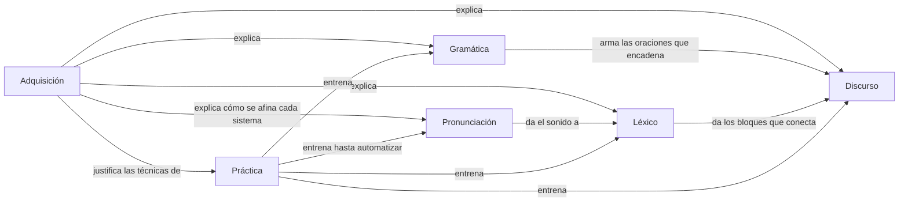

# Inglés

Pasar del inglés intermedio-alto (B2) al avanzado (C1/C2) es, para un hispanohablante adulto,
sobre todo pasar de saber el idioma a usarlo rápido y con precisión: afinar el sonido, la
gramática, el vocabulario y el discurso donde el castellano interfiere, con práctica que tenga
evidencia.

El tema está escrito para quien ya entiende casi todo y se hace entender, pero siente que le falta
una vuelta: suena traducido, se traba eligiendo el tiempo verbal, conecta ideas con pocos recursos
o lo entienden con esfuerzo. No cubre el inglés desde cero ni la didáctica para docentes. Lo
propio de cada persona (su nivel, sus errores, su plan) no va acá: se arma aparte con estas notas
como mapa.

## De qué está hecho pasar al avanzado

Seis partes. Una explica cómo aprende un adulto; cuatro son los sistemas del idioma que hay que
afinar, ordenados del sonido al texto, y la última es cómo se entrena. El
[MCER](Fundamentos/niveles-mcer.md) separa las mismas piezas: control fonológico, competencia
gramatical, competencia léxica y competencia discursiva y pragmática.

- [Adquisición](Adquisicion/adquisicion.md) — cómo aprende un idioma un adulto: input, output,
  corrección, instrucción explícita, automatización, memoria y edad, y por qué el B2 se estanca.
  Se lee primero, porque decide cómo usar todo lo demás.
- [Pronunciación](Pronunciacion/pronunciacion.md) — vocales, consonantes, acento de palabra, ritmo,
  habla conectada y entonación, con la inteligibilidad como meta y General American como modelo.
- [Gramática](Gramatica/gramatica.md) — el sistema verbal (tiempo, aspecto, modalidad), los
  artículos, la estructura de la oración y las construcciones avanzadas, vistos desde lo que el
  castellano hace distinto.
- [Léxico](Lexico/lexico.md) — colocaciones y chunks, phrasal verbs, cognados y falsos amigos, y
  cuánto vocabulario hace falta.
- [Discurso](Discurso/discurso.md) — conectar ideas: conectores y cohesión, cómo se ordena un
  argumento, registro y cortesía, la conversación y la escritura de trabajo.
- [Práctica](Practica/practica.md) — cómo se entrena, con las cuatro ramas de Nation como esqueleto
  de una rutina, cada técnica con su evidencia y fichas fechadas de exámenes, herramientas y
  tutores.
- [Fundamentos](Fundamentos/fundamentos-de-ingles.md) — los niveles del MCER, el alfabeto fonético,
  la bibliografía y una ruta paso a paso.

## Saber la regla no alcanza

Lo que separa un B2 de un C1 casi nunca es una regla que falta. Es la distancia entre conocer algo
y poder usarlo sin pensar, en tiempo real, mientras se atiende a lo que se dice. La
[automatización](Adquisicion/automatizacion.md) explica esa distancia, y la
[meseta intermedia](Adquisicion/meseta-intermedia.md) explica por qué se estanca quien ya se hace
entender: el idioma le alcanza para comunicarse y deja de empujarlo a mejorar. Por eso las cuatro
partes del idioma se entrenan con la misma lógica: notar el hueco, estudiar la forma, practicarla
con atención y recibir [corrección](Adquisicion/feedback-correctivo.md) hasta que salga sola.

## El castellano como filtro

Cada sistema tiene sus errores típicos del hispanohablante, y casi todos vienen de trasladar el
castellano: cinco vocales donde el inglés usa muchas más ([Vocales](Pronunciacion/vocales.md)),
un ritmo que da a cada sílaba su peso ([Ritmo y habla conectada](Pronunciacion/ritmo-y-habla-conectada.md)),
un pasado compuesto que en el Río de la Plata casi no se usa ([Present perfect](Gramatica/present-perfect.md)),
el artículo con los genéricos ([Artículos](Gramatica/articulos.md)), palabras parecidas que
significan otra cosa ([Cognados y falsos amigos](Lexico/cognados-y-falsos-amigos.md)) y pedidos
más directos de lo que el inglés espera ([Registro y cortesía](Discurso/registro-y-cortesia.md)).
Cada nota da el error junto a la forma inglesa, así que el castellano sirve de mapa de lo que hay
que mirar.

## Que te entiendan, no sonar nativo

La meta de pronunciación de este tema es la inteligibilidad. Munro y Derwing (1995) mostraron que
el acento fuerte y la dificultad para entender son cosas distintas: se puede tener acento y que te
entiendan sin esfuerzo. Eso ordena las prioridades: primero lo que rompe la comprensión, después el
resto. La discusión, con quienes quieren un acento nativo por otras razones, está en
[Pronunciación](Pronunciacion/pronunciacion.md). Algo parecido pasa con la edad: llegar a un C1/C2
de adulto es posible, aunque sonar indistinguible de un nativo es raro
([Edad y diferencias individuales](Adquisicion/edad-y-diferencias-individuales.md)).

## Cuánta evidencia hay

La investigación en adquisición de segundas lenguas respalda bien algunas cosas: que la
instrucción explícita suma, que la corrección ayuda, que la instrucción de pronunciación funciona,
que espaciar el repaso retiene mejor el vocabulario y que el entrenamiento perceptivo mejora la
percepción de sonidos. Otras son prácticas difundidas con poca evidencia agrupada, como el
shadowing o los programas de solo input. Cada nota dice de qué lado está lo que afirma, y casi
ningún estudio se hizo con adultos B2 que estudian solos: eso queda dicho donde importa.

## Qué leer según lo que tengas que hacer

- Si tenés una entrevista de trabajo en inglés en pocas semanas: [Fluidez](Practica/fluidez.md)
  (repetir la misma respuesta hasta que salga fluida), [Estructura del argumento](Discurso/estructura-del-argumento.md),
  [Interacción](Discurso/interaccion.md) (ganar tiempo y reparar) y [Grabarse y medirse](Practica/grabarse-y-medirse.md).
- Si tenés reuniones en inglés y te cuesta meterte o sonás brusco: [Interacción](Discurso/interaccion.md)
  y [Registro y cortesía](Discurso/registro-y-cortesia.md).
- Si tenés que escribir mails o documentos de trabajo: [Escritura](Discurso/escritura.md),
  [Conectores y cohesión](Discurso/conectores-y-cohesion.md) y [Colocaciones y chunks](Lexico/colocaciones-y-chunks.md).
- Si te entienden con esfuerzo: [Pronunciación](Pronunciacion/pronunciacion.md), empezando por las
  [vocales](Pronunciacion/vocales.md), y [Entrenamiento perceptivo](Practica/entrenamiento-perceptivo.md).
- Si te cuesta entender a nativos que hablan rápido: [Ritmo y habla conectada](Pronunciacion/ritmo-y-habla-conectada.md)
  y [Escucha y lectura extensiva](Practica/escucha-y-lectura-extensiva.md).
- Si dudás entre tiempos verbales al hablar: [Tiempo y aspecto](Gramatica/tiempo-y-aspecto.md),
  [Present perfect](Gramatica/present-perfect.md) y [Automatización](Adquisicion/automatizacion.md).
- Si tenés que rendir un examen internacional: [Exámenes de inglés](Practica/examenes-de-ingles.md)
  y [Niveles del MCER](Fundamentos/niveles-mcer.md).
- Si querés armar una rutina semanal: [Práctica](Practica/practica.md) y la
  [ruta](Fundamentos/ruta-de-ingles.md).

## Del cómo se aprende al cómo se entrena

El orden de lectura es el del diagrama: primero [Adquisición](Adquisicion/adquisicion.md), que
explica por qué funciona lo que funciona; después los cuatro sistemas, en el orden que más rinda
según lo que falle (para la mayoría, pronunciación y gramática del verbo primero), y al final
[Práctica](Practica/practica.md), que convierte todo en una rutina. Los
[niveles del MCER](Fundamentos/niveles-mcer.md) sirven antes de empezar, para saber dónde se está y
qué cambia en C1. La [ruta](Fundamentos/ruta-de-ingles.md) da el mismo camino en pasos con
ejercicios.
