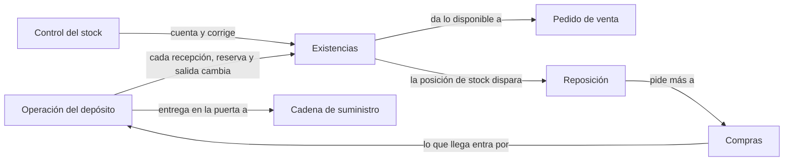

# Inventario y depósitos

Inventario y depósitos, como dominio de negocio, es lo que una empresa registra y hace con la mercadería que guarda: qué artículos tiene, cuántos, en qué lugar y en qué estado, cuánto puede prometer, cómo entra, cómo se aparta y se prepara para salir, cómo se controla que el número sea cierto y cuándo se repone. Es lo que lleva el módulo de stock de un ERP y un sistema de gestión de depósitos, pero existe antes del software: una ficha por artículo, estanterías numeradas y un conteo periódico hacen lo mismo.

El tema mira lo que pasa adentro del depósito y la cantidad que resulta. Lo de los costados es de otros dominios. Antes de la puerta de entrada está Compras y abastecimiento, que elige al proveedor y controla que llegó lo pedido. Después de la puerta de salida está Cadena de suministro y logística, que despacha, transporta y planifica la red. Cuánto vale lo guardado lo dice [Contabilidad](../Contabilidad/contabilidad.md), en [costo de lo vendido](../Contabilidad/Operaciones/costo-de-lo-vendido.md). La fecha que se le promete a un cliente es de [Relación con clientes](../Relacion-con-clientes/relacion-con-clientes.md), en [fecha prometida](../Relacion-con-clientes/Pedido-de-venta/fecha-prometida.md); el cálculo de lo disponible en que se apoya esa fecha es de acá. Compras, Cadena de suministro y Producción todavía no están armados en la base.

Las fuentes no separan así el dominio. APQC 7.4 pone el depósito dentro de «Manage logistics and warehousing» (4.4), junto con el transporte. A juicio de la base, los cuerpos de certificación de operaciones ponen el inventario con la planificación (ninguna fuente leída lo sostiene). El corte es de la base, que le da a cada dominio un objeto y un verbo. Este tema es dueño de **la cantidad de cada artículo, en qué lugar y en qué estado**, y de recibir, ubicar, reservar, preparar, contar, ajustar y reponer.

## Las cuatro partes del dominio

El tema se divide en lo que se tiene, lo que se hace con ello adentro, el control de que el número sea cierto y la decisión de cuándo traer más.

- [Existencias](Existencias/existencias.md): qué se tiene. El artículo con su unidad de medida, el lote y el número de serie, los estados en que se reparte una cantidad (físico, disponible, comprometido, en cuarentena) y el cálculo de cuánto se puede prometer.
- [Operación del depósito](Operacion-del-deposito/operacion-del-deposito.md): lo que pasa entre la puerta de entrada y la de salida. Cómo se nombran los lugares, cómo se recibe y se ubica lo que llega, cómo se aparta stock para un pedido y cómo se prepara el pedido.
- [Control del stock](Control-del-stock/control-del-stock.md): que el número del registro sea el del estante. Cuándo se actualiza la cantidad, cómo se cuenta sin cerrar el depósito y cómo se registra una diferencia, una rotura o un robo.
- [Reposición](Reposicion/reposicion.md): cuándo y cuánto reponer. Para qué se tiene stock y qué cuesta tenerlo o no tenerlo, el punto de pedido, el lote económico, el stock de seguridad, la clasificación ABC y los indicadores con que se juzga el inventario.

Lo propio de la Argentina (el remito que acompaña a la mercadería, el código de operación de traslado de algunas provincias, la trazabilidad obligatoria de ciertos productos) está en [Inventario y depósitos en la Argentina](inventario-y-depositos-en-argentina.md).

## Ideas que cruzan todo el tema

- **Todo cambio de cantidad es un movimiento.** Una recepción, una venta, una transferencia o un ajuste se registran como un hecho nuevo, y la cantidad sale de sumarlos; un error se corrige con otro movimiento, no pisando el número. Es la misma regla que sigue la contabilidad. Cómo se guarda en una base está en [registro de movimientos](../Bases-de-datos/Modelos-de-datos/registro-de-movimientos.md), y en una planilla, en [planilla de stock](../Planillas-de-calculo/Diseno-de-planillas/planilla-de-stock.md).
- **Una cantidad sola no alcanza.** Hace falta saber dónde está y en qué estado: 100 unidades en el sistema pueden ser 25 prometibles si 60 están apartadas y 15 esperan inspección. Los estados están en [estados del stock](Existencias/estados-del-stock.md), y su versión en una tienda online, en [catálogo y stock](../Comercio-electronico/Operaciones-del-comercio/catalogo-y-stock.md).
- **El registro suele estar mal.** DeHoratius y Raman (2008) encontraron que el 65 % de los registros de stock de 37 tiendas de un minorista no coincidía con lo que había en el estante (según el resumen del artículo; es un solo minorista). Todo lo que se calcula encima (lo disponible, el punto de pedido, la reserva) hereda ese error. Por eso el control del stock no es un trámite de fin de año, y por eso [disponible para prometer](Existencias/disponible-para-prometer.md) y [punto de pedido](Reposicion/punto-de-pedido.md) dan números falsos si nadie cuenta.
- **Tener stock es una decisión con dos escuelas.** La teoría clásica lo ve como un colchón contra la incertidumbre y calcula cuánto conviene; lean lo ve como un desperdicio que esconde problemas. La discusión, y por qué no es tan opuesta como parece, está en [Fundamentos](Fundamentos/fundamentos-de-inventario-y-depositos.md).

## Qué leer según lo que estés haciendo

- Si tenés que diseñar la ficha del artículo de un sistema: [artículo](Existencias/articulo.md) y, si se vende por lote, con vencimiento o por unidad identificada, [lote y serie](Existencias/lote-y-serie.md).
- Si tenés que decidir qué cantidades muestra el sistema y cuál se puede vender: [estados del stock](Existencias/estados-del-stock.md) y [disponible para prometer](Existencias/disponible-para-prometer.md); para la fecha que se le dice al cliente, [fecha prometida](../Relacion-con-clientes/Pedido-de-venta/fecha-prometida.md).
- Si tenés que modelar el depósito con sus lugares: [ubicaciones](Operacion-del-deposito/ubicaciones.md).
- Si tenés que diseñar el ingreso de mercadería: [recepción](Operacion-del-deposito/recepcion.md); el control contra la orden de compra es de Compras y abastecimiento, todavía no armado.
- Si tenés que diseñar qué pasa con el stock cuando se confirma un pedido: [reserva](Operacion-del-deposito/reserva.md) y [preparación de pedidos](Operacion-del-deposito/preparacion-de-pedidos.md).
- Si el sistema y el estante no coinciden: [control del stock](Control-del-stock/control-del-stock.md), [conteo cíclico](Control-del-stock/conteo-ciclico.md) y [ajustes y mermas](Control-del-stock/ajustes-y-mermas.md).
- Si tenés que fijar cuándo y cuánto reponer: [punto de pedido](Reposicion/punto-de-pedido.md), [stock de seguridad](Reposicion/stock-de-seguridad.md) y [lote económico](Reposicion/lote-economico.md); para decidir a qué artículos mirar más, [clasificación ABC](Reposicion/clasificacion-abc.md).
- Si te piden un tablero del inventario: [indicadores de inventario](Reposicion/indicadores-de-inventario.md).
- Si tenés que valuar el stock o calcular el costo de lo vendido: no es de acá; está en [costo de lo vendido](../Contabilidad/Operaciones/costo-de-lo-vendido.md), de Contabilidad.
- Si tenés que despachar y enviar lo preparado: es de Cadena de suministro y logística, todavía no armado; para una tienda online, lo más cercano es [envíos y logística](../Comercio-electronico/Operaciones-del-comercio/Envios-y-logistica/envios-y-logistica.md).
- Si el sistema es para la Argentina y mueve mercadería: [Inventario y depósitos en la Argentina](inventario-y-depositos-en-argentina.md).

Los términos con su nombre en inglés están en el [glosario de inventario y depósitos](Fundamentos/glosario-de-inventario-y-depositos.md).

## Orden de lectura

Para quien construye software de gestión y no conoce el dominio: esta entrada, después [Existencias](Existencias/existencias.md), que fija el vocabulario, y [Control del stock](Control-del-stock/control-del-stock.md), que explica por qué el número miente. [Operación del depósito](Operacion-del-deposito/operacion-del-deposito.md) importa cuando hay un depósito con más de un pasillo, y [Reposición](Reposicion/reposicion.md), cuando hay que decidir compras sin mirar estante por estante.

- [Fundamentos](Fundamentos/fundamentos-de-inventario-y-depositos.md): de dónde viene el campo, las escuelas que discuten si conviene tener stock, la evidencia contra las fórmulas clásicas, las fuentes y el glosario.
