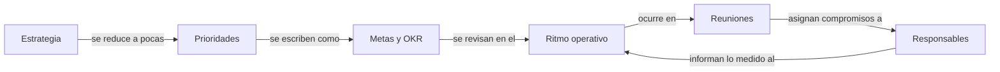

# Ejecución

La ejecución es cómo una estrategia se vuelve trabajo hecho cada semana: pocas prioridades, metas medibles, revisiones regulares, reuniones que sirven y un responsable por cada compromiso. Que gestionar así rinde tiene un experimento aleatorio a favor; casi todas las herramientas concretas son de practicantes.

Es la parte de dirigir del tema (fijar rumbo, organizar, hacer cumplir), más que la de liderar. Recibe de [Decidir](../Decidir/decidir.md) las prioridades y devuelve lo que se midió para corregirlas. Ordenar el trabajo propio, y no el de un equipo, es [Efectividad personal](../../Desarrollo-personal/Efectividad-personal/efectividad-personal.md), en Desarrollo personal. El [Rol del CEO](../Rol-del-CEO/rol-del-ceo.md) marca su ritmo, y [Gestión de personas](../Gestion-de-personas/gestion-de-personas.md) pone a las personas que ejecutan, con sus [uno a uno](../Gestion-de-personas/reuniones-uno-a-uno.md) y su evaluación. Qué estrategia elegir antes de ejecutarla es de [estrategia competitiva](../../Estrategia-competitiva/estrategia-competitiva.md).

## La cadena de la estrategia a la semana

La vertical sigue una cadena de lo más amplio a lo más concreto:

Una estrategia que se puede ejecutar tiene diagnóstico, política y acciones coordinadas (el núcleo de Rumelt, un libro de autor). Las prioridades se escriben como metas, muchas veces con OKR. Las metas se miran en revisiones con una cadencia fija, que se hacen en reuniones. De cada reunión salen compromisos con una persona que responde. Cuando lo que se ejecuta es una forma nueva de trabajar, se suma la gestión del cambio.

En una empresa de producto, la misma cadena aparece como la distinción entre [resultados y entregables](../../Producto/Estrategia/resultados-y-entregables.md) y como el [roadmap](../../Producto/Planificacion-y-entrega/roadmap.md).

## Lo que la evidencia sostiene y lo que no

El respaldo más firme está arriba de la cadena. En la encuesta de Bloom y Van Reenen, según un resumen, las prácticas de gestión (monitorear el desempeño, fijar metas, incentivar) se asocian con productividad. El experimento en plantas textiles de la India, que dio consultoría en esas prácticas a plantas elegidas al azar, según su abstract publicado «raised average productivity by 11%».

Bajando, la evidencia se adelgaza:

| Pieza | Qué se sostiene | Qué falta |
|---|---|---|
| Prácticas de gestión | Asociación en muestras grandes y un experimento aleatorio | Datos de empresas chicas |
| Metas y OKR | Teoría de metas (según resúmenes); dirección por objetivos (metaanálisis de 1991) | Cualquier estudio de los OKR como sistema |
| Ritmo operativo | Indirecto: monitorear se asocia con productividad | Literatura propia; comparación de cadencias |
| Reuniones | Lo que se dice adentro predice los resultados; lo malo pesa más | Agenda, tamaño y frecuencia |
| Rendición de cuentas | Efectos buenos y malos según cómo se arme | El responsable con nombre como práctica |
| Gestión del cambio | Casi nada a favor de los modelos | Prueba de cualquier modelo completo |

Tres cifras que circulan no se sostienen o cambian según la fuente. El 70 % de cambios que fracasan no tiene fuente válida (Hughes 2011). El experimento de la India circula también con un 17 % sin fuente encontrada; el working paper y el abstract publicado dicen 11 %. La encuesta de Sull y colegas sobre por qué falla la ejecución aparece con dos tamaños de muestra distintos según la reseña.

## Cómo falla la ejecución

Los modos de falla que tienen algo de respaldo son tres. Las metas mal diseñadas estrechan el foco y empujan a hacer trampa, según Ordóñez y colegas (2009), una crítica con casos que está en disputa con los autores de la teoría de metas. Las reuniones sin estructura, o con muchas quejas, se asocian con peores resultados del equipo. Y pedir cuentas de la forma equivocada puede empeorar el juicio en lugar de corregirlo.

El resto de las fallas que se cuentan (estrategias que no se entienden, planes que no se adaptan, ejecución dirigida solo desde arriba) viene de la encuesta de Sull y colegas a gerentes, sin réplica conocida.

## De dónde viene la evidencia

Casi todo viene de plantas manufactureras medianas y grandes, de laboratorio con estudiantes o de corporaciones. Los OKR son práctica de Intel y Google, y las cadencias, de practicantes. Para una empresa de 2 a 50 personas no hay estudios: se puede tomar la dirección que muestran los estudios grandes (medir, fijar metas y revisar se asocia con más productividad) y elegir las herramientas por criterio, sabiendo que no están probadas. Esa lectura es de esta base.

## Lo que hay en Ejecución

- [De la estrategia al trabajo](de-la-estrategia-al-trabajo.md): de un rumbo a pocas prioridades, el núcleo de Rumelt y la evidencia de las prácticas de gestión. Leer primero.
- [OKR](okr.md): objetivos y resultados clave, su origen en Intel y Google, el metaanálisis de la dirección por objetivos y la falta de estudios propios.
- [Ritmo operativo](ritmo-operativo.md): la cadencia de revisiones y tableros, sin literatura propia y apoyada en el monitoreo.
- [Reuniones](reuniones.md): la ciencia de las reuniones, cuánto tiempo se llevan y las de pie.
- [Rendición de cuentas](rendicion-de-cuentas.md): cuándo pedir cuentas corrige o amplifica los sesgos, y el responsable con nombre como práctica.
- [Gestión del cambio](gestion-del-cambio.md): Kotter, Lewin y ADKAR, y por qué el 70 % de cambios que fracasan es un mito.

Los términos de esta parte están en el [glosario del tema](../Fundamentos/glosario-de-liderazgo-y-direccion.md), y cómo se lee una cifra de un estudio, en [cómo leer un estudio](../../Psicologia/Fundamentos/como-leer-un-estudio.md).
