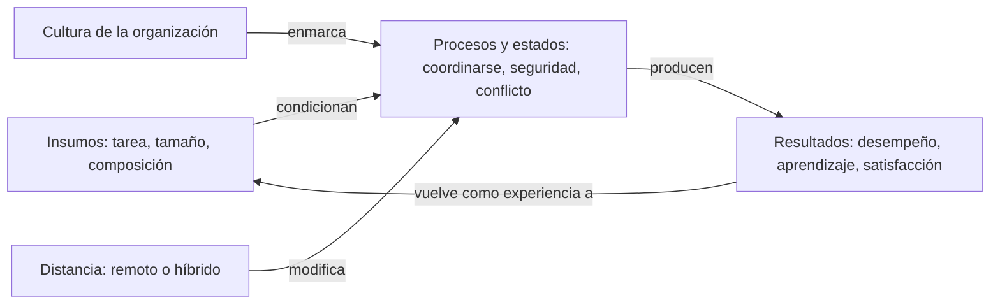

# Equipos y cultura

Equipos y cultura es la parte de dirigir que trata qué hace que un grupo trabaje como equipo y qué normas comparte una organización. Su marco es el del campo: los insumos de un equipo (tarea, tamaño, composición) pasan por procesos y estados compartidos (coordinarse, sentirse seguro, discutir) y dan resultados.

Dentro de [Liderazgo y dirección](../liderazgo-y-direccion.md), esta vertical recibe de [Liderar personas](../Liderar-personas/liderar-personas.md) la confianza en el jefe, y de [Gestión de personas](../Gestion-de-personas/gestion-de-personas.md) a quienes forman el equipo. Lo que el equipo discute termina en [Decidir](../Decidir/decidir.md), y lo que decide se vuelve trabajo en [Ejecución](../Ejecucion/ejecucion.md). El mecanismo psicológico de los grupos (el pensamiento de grupo, la polarización, el favoritismo por los propios) está en [sesgos de grupo](../../Psicologia/Cognicion-social/sesgos-de-grupo.md) y no se repite acá.

## Insumos, procesos y resultados: cómo el campo ordena el estudio de equipos

La investigación sobre equipos se organiza como insumos, procesos y estados emergentes, y resultados. Lo usa, según un resumen, la revisión de referencia de Kozlowski e Ilgen (2006); Mathieu y colegas (2017) repasan con él un siglo de estudios de equipos, aunque de ese trabajo se leyeron solo los metadatos. Los componentes de esta vertical caen en distintas cajas del esquema, y por eso no son hermanos del mismo nivel.

| Componente | Lugar en el esquema |
|---|---|
| [Equipos efectivos](equipos-efectivos.md) | El marco entero: qué condiciones de diseño y qué procesos predicen el rendimiento |
| [Tamaño y composición](tamano-y-composicion.md) | Insumo |
| [Seguridad psicológica](seguridad-psicologica.md) | Estado emergente |
| [Conflicto en equipos](conflicto-en-equipos.md) | Proceso y estado emergente |
| [Cultura organizacional](cultura-organizacional.md) | Otro nivel de análisis: la organización, no el equipo |
| [Trabajo remoto e híbrido](trabajo-remoto-e-hibrido.md) | Contexto que cambia los procesos (colaboración, feedback, mentoría) |

La flecha de vuelta es una inferencia de esta base: un equipo que rindió bien entra al ciclo siguiente con otra experiencia, y el esquema del campo admite ese ciclo, aunque las fuentes leídas no lo describen.

## La idea central: el diseño pesa antes que la marcha

La idea que atraviesa la vertical es de Hackman (1998), que es teoría con investigación de campo del propio autor y sin metaanálisis que la pruebe: un equipo rinde cuando está bien armado, y el coaching sirve poco si la base está mal. Hackman dice que es «nearly impossible to coach a team» con una estructura y un contexto malos. Los procesos de equipo (planificar, coordinar, monitorear, apoyarse) se asocian con desempeño y satisfacción en el metaanálisis de LePine y colegas (2008), según su abstract. Una lectura de esta base para quien dirige: primero la tarea, quiénes y cuántos, después el clima y las discusiones.

La seguridad psicológica es el concepto más citado de la vertical y tiene respaldo en un metaanálisis de 136 muestras, del que esta base leyó el abstract y no los coeficientes. Su fama vino de Google, y el estudio de Google no publicó su método: lo cuenta [seguridad psicológica](seguridad-psicologica.md). El mito de que es «lo único que importa» está en [mitos de liderazgo](../Fundamentos/mitos-de-liderazgo.md).

## Dónde falla la evidencia para una empresa chica

Casi nada de lo que sigue se estudió en empresas de 2 a 50 personas. La evidencia viene de corporaciones (Google, Microsoft, Ctrip, empresas del S&P 500 y de Fortune 500), de una planta manufacturera y de experimentos de laboratorio. Cada componente dice de dónde salen sus números.

Hay dos cosas que se mezclan seguido. Una es el rendimiento de un equipo, que estudian los metaanálisis de equipos. Otra es la rentabilidad de una empresa según quién está en su dirección, que estudian correlaciones entre empresas como las de McKinsey. La segunda no prueba nada sobre la primera: lo detalla [tamaño y composición](tamano-y-composicion.md).

En una empresa chica el equipo y la organización casi coinciden. El equipo directivo es a la vez el primer equipo y quien fija la cultura, y por eso [cultura organizacional](cultura-organizacional.md) se lee junto con [equipo directivo](../Rol-del-CEO/equipo-directivo.md). Esto también es una inferencia de esta base, sin estudio que la mida.

## Qué hay adentro de Equipos y cultura

- [Equipos efectivos](equipos-efectivos.md): las condiciones de Hackman, el Proyecto Aristóteles de Google, los procesos con evidencia y la disputa por la inteligencia colectiva. Leelo primero.
- [Seguridad psicológica](seguridad-psicologica.md): el concepto de Edmondson, qué predice según el metaanálisis y qué no está probado.
- [Conflicto en equipos](conflicto-en-equipos.md): conflicto de tarea, de relación y de proceso, y la disputa entre los dos metaanálisis.
- [Tamaño y composición](tamano-y-composicion.md): por qué sumar gente cuesta más de lo que se calcula, qué hace la diversidad y la polémica sobre diversidad y rentabilidad.
- [Cultura organizacional](cultura-organizacional.md): los tres niveles de Schein, los valores en competencia y si la cultura se puede diseñar.
- [Trabajo remoto e híbrido](trabajo-remoto-e-hibrido.md): los experimentos de Bloom contra los costos de colaboración y mentoría que miden otros estudios.

La organización de equipos de software (tipos de equipo, límites, modos de interacción) está en [Organización de equipos](../../Platform-Engineering/Organizacion-de-equipos/organizacion-de-equipos.md), en Platform Engineering.

Los términos de esta parte están en el [glosario del tema](../Fundamentos/glosario-de-liderazgo-y-direccion.md), y cómo se lee una cifra de un estudio, en [cómo leer un estudio](../../Psicologia/Fundamentos/como-leer-un-estudio.md).
