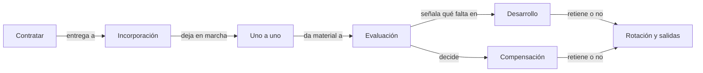

# Gestión de personas

La gestión de personas es el ciclo de una persona en la empresa, desde que se la busca hasta que se va: contratarla, incorporarla, conversar con ella, evaluarla, pagarle, hacerla crecer y cerrar su salida. Su evidencia viene casi toda de muestras grandes y no se separa por tamaño de empresa.

En el lenguaje de [Liderazgo y dirección](../liderazgo-y-direccion.md), esta vertical es sobre todo dirigir: organizar quién entra, qué se espera de cada uno y cómo se paga. Elige y hace crecer a las personas que forman [Equipos y cultura](../Equipos-y-cultura/equipos-y-cultura.md). Se apoya en [Liderar personas](../Liderar-personas/liderar-personas.md) para la parte de influir (motivar, ganar confianza), y en [Decidir](../Decidir/decidir.md) para cuánto se le delega a cada uno. En una empresa chica no hay un área de recursos humanos: el ciclo entero suele llevarlo el fundador o el jefe directo, y el [Rol del CEO](../Rol-del-CEO/rol-del-ceo.md) incluye armar ese primer equipo.

## El ciclo, etapa por etapa

El campo de los recursos humanos ordena su materia por el ciclo de vida del empleado («employee life cycle»), y las notas siguen ese orden. Cada etapa alimenta a la siguiente: lo que se pidió al contratar es lo que se evalúa después, y la evaluación decide el pago.

## Evaluar y pagar son una sola pieza en el campo

El campo trata muchas veces la evaluación del desempeño y la compensación juntas, bajo el nombre de gestión del desempeño («performance management»). La revisión de DeNisi y Murphy (2017) cubre 100 años de ambas y, según su abstract, pide más investigación sobre la gestión del desempeño. En la práctica el pago depende de la evaluación, y por eso [evaluación del desempeño](evaluacion-del-desempeno.md) y [compensación e incentivos](compensacion-e-incentivos.md) se leen juntas: los defectos de la primera pasan a la segunda.

## La justicia percibida atraviesa todas las etapas

La percepción de justicia puede aparecer en cada etapa: en cómo se evalúa, en cuánto se paga y en cómo se despide (inferencia de esta base). El metaanálisis de Colquitt y colegas (2001), con 183 estudios, separa cuatro dimensiones de justicia: distributiva (el resultado), procedimental (el proceso), interpersonal (el trato) e informacional (las explicaciones). Según el abstract, las cuatro están relacionadas pero cada una aporta algo propio, y se asocian con satisfacción, compromiso, ciudadanía, retiro y desempeño. Las notas de evaluación, compensación y salidas la usan donde viene a cuento.

## Cuánto se sabe y de dónde viene

La solidez de la evidencia cambia mucho de una etapa a otra. Contratar tiene la mejor: metaanálisis grandes, revisados en 2022. El uno a uno casi no tiene investigación propia y vive de lo que dicen los practicantes.

| Etapa | Lo mejor que hay | Estado |
|---|---|---|
| Contratar | Sackett y colegas (2022), revisión de metaanálisis | Se sostuvo el orden de los métodos; las cifras se achicaron; el lugar de la capacidad cognitiva está en disputa |
| Incorporación | Bauer y colegas (2007), metaanálisis | Se sostuvo el modelo; no hay evaluación de programas concretos |
| Uno a uno | Un estudio de 2026 con dos encuestas (N = 303) | Casi sin literatura; frecuencia y duración sin evidencia |
| Evaluación | Kluger y DeNisi (1996); Scullen y colegas (2000) | Se sostuvo que la calificación refleja mucho al evaluador; las alternativas al ciclo anual, en disputa |
| Compensación | Jenkins y colegas (1998), metaanálisis | Se sostuvo que el incentivo sube la cantidad y no la calidad |
| Desarrollo | Metaanálisis de entrenamiento, coaching y mentoría | Efectos medios; cayó la regla 70-20-10 como hecho |
| Rotación y salidas | Metaanálisis de antecedentes; Colquitt (2001) | Muchas causas que dependen del contexto; «la gente se va de los jefes», en disputa |

Ningún estudio de estas notas separa los resultados por tamaño de empresa. Las cifras vienen de muestras grandes, de bases de gerentes, de laboratorios con niños y estudiantes y de encuestas comerciales. Para una empresa de 2 a 50 personas son una extrapolación, y cada nota lo dice. Cómo se da feedback o se conduce una conversación difícil (una evaluación, un despido) es del tema Comunicación, todavía sin escribir.

## Las siete etapas

- [Contratar](contratar.md): qué métodos de selección predicen el desempeño, con la tabla de Sackett 2022 y la disputa sobre la capacidad cognitiva. Leerla antes de abrir una búsqueda.
- [Incorporación](incorporacion.md): los primeros meses y los tres ajustes (rol, autoeficacia, aceptación) que explican si alguien se queda.
- [Reuniones uno a uno](reuniones-uno-a-uno.md): para qué sirven según los practicantes y lo poco que mide la investigación. Para quien empieza a tener gente a cargo.
- [Evaluación del desempeño](evaluacion-del-desempeno.md): qué mide una calificación, cuándo el feedback empeora el desempeño y qué se sabe de abandonar el ciclo anual.
- [Compensación e incentivos](compensacion-e-incentivos.md): qué hace el pago atado a resultados, cuándo un premio daña y qué cambia la transparencia salarial.
- [Desarrollo de personas](desarrollo-de-personas.md): delegar para que alguien crezca, mentoría, coaching y entrenamiento, y por qué el 70-20-10 tiene poca base.
- [Rotación y salidas](rotacion-y-salidas.md): por qué se va la gente, cómo se despide y el límite con el derecho laboral argentino.
