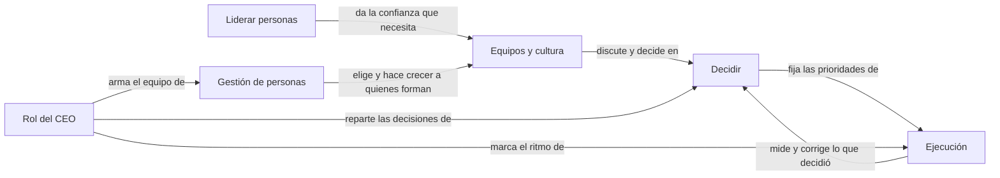

# Liderazgo y dirección

Liderazgo y dirección es cómo se conduce a otras personas hacia un trabajo compartido: liderar es influir en ellas, y dirigir es fijar el rumbo, organizar el trabajo y hacer que se cumpla. En esta base cubre los tres niveles en que se ejerce, una persona, un equipo y la empresa entera, con la evidencia de cada práctica.

La separación entre las dos palabras viene de Kotter (1990): «Management is about coping with complexity» y «Leadership, by contrast, is about coping with change». Para él, dirigir es planificar y presupuestar, organizar y asignar personas, y controlar; liderar es marcar una dirección, alinear a la gente y motivarla. Mintzberg rechaza la separación, según resúmenes de entrevistas, y en su estudio de 1971 el liderazgo es uno de los diez roles de quien dirige, no una actividad aparte. En una empresa chica la misma persona suele hacer las dos cosas en la misma semana (lectura de esta base), y por eso el tema las trata juntas. Cada nota dice de cuál habla.

El tema se apoya en otros dos. [Psicología](../Psicologia/psicologia.md) explica el mecanismo: por qué una meta difícil rinde más ([establecimiento de metas](../Psicologia/Motivacion-y-emocion/establecimiento-de-metas.md)), por qué un premio puede bajar las ganas ([autodeterminación](../Psicologia/Motivacion-y-emocion/autodeterminacion.md)) y por qué un grupo decide peor que sus miembros ([sesgos de grupo](../Psicologia/Cognicion-social/sesgos-de-grupo.md)). Acá se dice qué hacer con eso al dirigir. Dar feedback y sostener una conversación difícil son habilidades del tema Comunicación, que todavía no está escrito; las notas de acá las nombran donde se usan. El reparto de la propiedad entre socios queda en [Fundadores y equipo](../Emprender/Fundadores-y-equipo/fundadores-y-equipo.md), en Emprender.

## De qué está hecho dirigir

Los libros de texto del campo se ordenan por teorías: Yukl y Gardner, en *Leadership in Organizations*, pasan por la conducta, la situación, el cambio, el poder, los rasgos y el carisma. Este tema se ordena por lo que hace quien dirige, de lo más cercano a lo más amplio. El corte es de esta base, no del campo. Tres partes coinciden con capítulos de los textos (liderar personas, equipos, decidir), dos vienen sobre todo del management y de los practicantes (gestión de personas y ejecución), y el rol del CEO coincide en parte, con el capítulo de liderazgo estratégico.

- [Liderar personas](Liderar-personas/liderar-personas.md): cómo una persona influye en otras. Entrá acá para saber qué conductas de un jefe tienen evidencia, qué se sabe del liderazgo transformacional, cómo se gana la confianza y qué cambia al pasar de hacer el trabajo a dirigirlo.
- [Equipos y cultura](Equipos-y-cultura/equipos-y-cultura.md): qué hace que un grupo trabaje como equipo, qué es la seguridad psicológica, cuánto pesa el conflicto y qué se sabe de la cultura y del trabajo remoto.
- [Gestión de personas](Gestion-de-personas/gestion-de-personas.md): el ciclo de una persona en la empresa, desde contratarla hasta su salida, con uno a uno, evaluación, pago y desarrollo.
- [Decidir](Decidir/decidir.md): quién decide qué, cuánto se delega, qué tan rápido se decide según el costo de equivocarse y cómo se decide en grupo.
- [Ejecución](Ejecucion/ejecucion.md): cómo una estrategia se vuelve trabajo de cada semana, con prioridades, OKR, el ritmo de revisiones, las reuniones y quién responde por cada cosa.
- [Rol del CEO](Rol-del-CEO/rol-del-ceo.md): lo que le toca a quien dirige la empresa entera: su tiempo, la disputa entre fundador y CEO externo, el crecimiento, el equipo directivo y el directorio.

## La evidencia es más fina de lo que se vende

La investigación en liderazgo tiene un problema de método que atraviesa todas las notas. Una parte grande de los estudios pide a los empleados que califiquen a su jefe y su propio desempeño en el mismo cuestionario, y de ahí no sale causa. Antonakis y colegas (2010) revisaron 110 artículos y, según un resumen, los investigadores no atendían al menos el 66 % y hasta el 90 % de las condiciones para afirmar una causa. Según un resumen de Banks y colegas (2018), varios estilos con nombre propio se solapan entre sí y con lo que deberían predecir, como la confianza: lo cuenta [teorías del liderazgo](Liderar-personas/teorias-del-liderazgo.md).

Los estudios de campo y los experimentos quedan fuera de esa crítica. En un experimento con plantas textiles de la India, Bloom y colegas (2013) dieron consultoría gratuita en prácticas de gestión a plantas elegidas al azar. Según el abstract publicado, la productividad subió un 11 %, se delegaron más decisiones y se usaron más computadoras. Bandiera y colegas (2020) midieron la agenda de 1.114 CEOs y encontraron que los que pasan el tiempo en reuniones amplias de alto nivel rinden mejor en promedio, pero por ajuste con su empresa y no porque ese estilo sirva a todas.

Casi ningún estudio es de empresas de 2 a 50 personas. Las cifras vienen de corporaciones, de laboratorios con estudiantes o de empresas con capital de riesgo, y cada nota dice de dónde salió su evidencia. Las cifras (r, ρ, d, g) son tamaños de efecto y se leen como explica [cómo leer un estudio](../Psicologia/Fundamentos/como-leer-un-estudio.md); los términos del tema están en el [glosario](Fundamentos/glosario-de-liderazgo-y-direccion.md). Lo que dicen los practicantes (Grove, Horowitz, Graham) entra marcado como práctica, y donde hay estudios se compara con ellos. Lo que circula sin sostén (el 70 % de cambios que fracasan) o exagerado (el líder nato) está en [mitos de liderazgo](Fundamentos/mitos-de-liderazgo.md).

## Qué leer según lo que estés haciendo

- Si pasás de hacer el trabajo a dirigir a otros: [pasar a liderar](Liderar-personas/pasar-a-liderar.md), [teorías del liderazgo](Liderar-personas/teorias-del-liderazgo.md) y [reuniones uno a uno](Gestion-de-personas/reuniones-uno-a-uno.md).
- Si tenés que contratar: [contratar](Gestion-de-personas/contratar.md), [incorporación](Gestion-de-personas/incorporacion.md) y, para los tests, [tests de personalidad](../Psicologia/Personalidad/tests-de-personalidad.md).
- Si un equipo no rinde o discute mal: [equipos efectivos](Equipos-y-cultura/equipos-efectivos.md), [seguridad psicológica](Equipos-y-cultura/seguridad-psicologica.md), [conflicto en equipos](Equipos-y-cultura/conflicto-en-equipos.md) y, si el problema es quiénes o cuántos son, [tamaño y composición](Equipos-y-cultura/tamano-y-composicion.md).
- Si no sabés qué decidir vos y qué delegar: [derechos de decisión](Decidir/derechos-de-decision.md), [delegación](Decidir/delegacion.md) y [decisiones reversibles](Decidir/decisiones-reversibles.md). Para equivocarte menos: [decidir en grupo](Decidir/decidir-en-grupo.md) y [calidad de decisión](Decidir/calidad-de-decision.md).
- Si tenés que armar el primer sistema de gestión (una reunión semanal, uno a uno, una evaluación): [ritmo operativo](Ejecucion/ritmo-operativo.md), [reuniones](Ejecucion/reuniones.md) (también si se comen la semana), [reuniones uno a uno](Gestion-de-personas/reuniones-uno-a-uno.md), [evaluación del desempeño](Gestion-de-personas/evaluacion-del-desempeno.md) y [rendición de cuentas](Ejecucion/rendicion-de-cuentas.md).
- Si tenés que bajar una estrategia a la semana de cada uno: [de la estrategia al trabajo](Ejecucion/de-la-estrategia-al-trabajo.md), [OKR](Ejecucion/okr.md) y [ritmo operativo](Ejecucion/ritmo-operativo.md).
- Si la empresa crece y no sabés si seguir dirigiendo como fundador: [founder mode](Rol-del-CEO/founder-mode.md), [escalar la organización](Rol-del-CEO/escalar-la-organizacion.md) y [equipo directivo](Rol-del-CEO/equipo-directivo.md).
- Si tenés que fijar sueldos o bonos: [compensación e incentivos](Gestion-de-personas/compensacion-e-incentivos.md).
- Si tenés que despedir a alguien o alguien clave se va: [rotación y salidas](Gestion-de-personas/rotacion-y-salidas.md). Lo legal está en [Legal e impuestos](../Emprender/Legal-e-impuestos/legal-e-impuestos.md).
- Si tenés que organizar equipos de software o de producto: lo más cercano es [Organización de equipos](../Platform-Engineering/Organizacion-de-equipos/organizacion-de-equipos.md) en Platform Engineering y el [equipo empoderado](../Producto/Organizacion/equipo-empoderado.md) en Producto.
- Si un libro o una charla te vende una receta de liderazgo: [mitos de liderazgo](Fundamentos/mitos-de-liderazgo.md) y [escuelas](Fundamentos/escuelas-de-liderazgo-y-direccion.md).

## Por dónde empezar a leer

1. [Liderar personas](Liderar-personas/liderar-personas.md), que da el vocabulario y las conductas con más evidencia.
2. [Equipos y cultura](Equipos-y-cultura/equipos-y-cultura.md) y [Gestión de personas](Gestion-de-personas/gestion-de-personas.md), para el día a día con un equipo.
3. [Decidir](Decidir/decidir.md) y [Ejecución](Ejecucion/ejecucion.md), para que el equipo avance hacia algo.
4. [Rol del CEO](Rol-del-CEO/rol-del-ceo.md), cuando se dirige la empresa entera.

[Fundamentos](Fundamentos/fundamentos-de-liderazgo-y-direccion.md) reúne las escuelas, los mitos, el glosario y la bibliografía.
