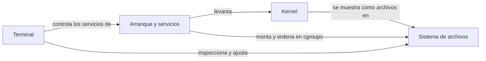

# Linux

Linux es un sistema operativo hecho en capas, del hardware y el kernel al espacio de usuario con
bibliotecas, servicios, shells y aplicaciones, que se levantan en orden al arrancar y se
administran desde la terminal.

El tema está escrito para quien estudia administración de sistemas y ya sabe usar la terminal. La
idea que lo ordena es la frontera entre el espacio del kernel, con privilegios completos, y el
espacio de usuario, que pide cada servicio por una llamada al sistema: saber en qué capa vive cada
cosa dice dónde buscar un problema. Lo explica [Arquitectura de Linux](arquitectura-de-linux.md),
la puerta de entrada al tema. Una distribución (Debian, Fedora, Arch) comparte el kernel y cambia
el espacio de usuario.

## De qué está hecho un sistema Linux

Cuatro partes. El kernel atiende al espacio de usuario por llamadas al sistema y se muestra como
archivos; el arranque levanta las capas en orden y deja a systemd vigilando los servicios; el
sistema de archivos dice dónde vive cada cosa; y la terminal combina las herramientas para
inspeccionar y ajustar todo lo anterior.

### Kernel

La frontera entre el espacio de usuario y el kernel, y cómo un programa le pide algo.

- [Llamada al sistema](llamada-al-sistema.md) — el punto de entrada controlado al kernel, casi
  siempre a través de la biblioteca C. Leerla después de la arquitectura.

### Arranque y servicios

Qué pasa desde que se prende la máquina hasta el login, y quién arranca y vigila los procesos de
fondo.

- [Arranque de Linux](arranque-de-linux.md) — firmware, gestor de arranque, kernel con initramfs,
  PID 1, servicios y login.
- [Daemon](daemon.md) — los procesos de fondo y qué servicio del sistema presta cada uno.
- [systemd](systemd.md) — el init que arranca, supervisa y registra los servicios con unidades y
  journald.

### Sistema de archivos

Qué va en cada directorio, y los que no guardan nada en disco.

- [Pseudo-sistema de archivos](pseudo-sistema-de-archivos.md) — cómo `/proc`, `/sys` y `/dev`
  exponen el kernel como archivos y cómo se ajusta el kernel en vivo.
- [FHS](fhs.md) — ficha con qué va en cada directorio y dónde están los logs y los archivos de
  usuarios.

### Terminal

Cómo se combinan comandos chicos y cuáles hay.

- [Pipe y redirección](pipe-y-redireccion.md) — cómo se conectan los flujos de entrada y salida
  de los comandos.
- [Recetas de pipes](recetas-de-pipes.md) — ficha con combinaciones listas para copiar.
- [Comandos de Linux](comandos-de-linux.md) — ficha con los comandos de administración agrupados
  por función y por familia de distro.

## Lo que falta

Namespaces, cgroups, seguridad (SELinux, AppArmor), almacenamiento (LVM) y contenedores: el plan
de estudio los nombra, pero se escriben cuando se estudie ese mes.

## De las capas a la terminal

Para aprender, el orden va de la arquitectura a la terminal, y el plan de seis meses suma la
práctica de cada mes. Los dos están en [Fundamentos](Fundamentos/fundamentos-de-linux.md).
