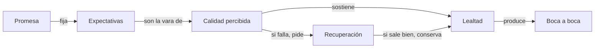

# Servicio y relación

Servicio y relación es la parte del marketing que sigue a la venta: si lo que se entrega alcanza lo que el cliente esperaba, qué se hace cuando falla y si conviene invertir en que el cliente se quede.

En un producto, la venta cierra la mayor parte del trabajo de marketing. En un servicio, sobre todo uno que se paga todos los meses, el cliente vuelve a decidir cada mes, y lo que decide depende de lo que vivió. Esta parte recibe de [Propuesta](../Propuesta/propuesta.md) lo que se prometió y el [plano de servicio](../Propuesta/plano-de-servicio.md) con que se diseñó la entrega. Alimenta a [Canales](../Canales/canales.md), porque un cliente conforme es el origen del [boca a boca](../Canales/boca-a-boca-y-referidos.md). Y le pasa a [Medición](../Medicion/medicion.md) y a [retención y churn](../../Datos/Analitica-de-producto/Retencion-y-churn/retencion-y-churn.md) la pregunta de si los clientes siguen.

## De la promesa a la lealtad

El cliente juzga el servicio contra lo que esperaba, y una parte de lo que espera la fijó la propia empresa al vender. Entre lo que desea y lo mínimo que acepta hay una [zona de tolerancia](expectativas-y-zona-de-tolerancia.md); debajo del mínimo, el cliente se disconforma. El [modelo de las brechas](modelo-de-las-brechas.md) explica por qué lo percibido queda debajo de lo esperado: la empresa no sabe qué espera el cliente, no lo diseña, no lo entrega como lo diseñó o promete otra cosa. La cuarta, entre lo que se vende y lo que se entrega, es la de [gestión de las promesas](gestion-de-las-promesas.md).

Cuando algo falla, la [recuperación del servicio](recuperacion-del-servicio.md) decide si el cliente se queda: la juzga por lo que recibe, por cómo se resolvió y por cómo lo trataron. Lo que se acumula es la relación, y si conviene invertir en ella lo discute [marketing de relaciones y lealtad](marketing-de-relaciones-y-lealtad.md).

## Dónde la evidencia es firme y dónde no

El marco de las brechas y la zona de tolerancia se discuten poco como forma de pensar; el cuestionario SERVQUAL, mucho. La paradoja de la recuperación (que un cliente al que le resolvieron bien una falla queda más satisfecho que si no hubiera fallado) aparece en la satisfacción pero no en la recompra, y es rara. La lealtad rinde más en servicios y entre empresas según un metaanálisis, pero la asociación entre antigüedad y ganancia es débil a moderada, y las dos cifras más citadas a su favor no se sostienen como se citan.

Casi toda la evidencia es de consumo, de empresas grandes o de laboratorio. Para servicios entre empresas hay poco, y para pymes, servicios de software o Argentina no se encontró nada. Varias primarias clásicas no se pudieron leer y cada nota dice cuáles.

## Qué hay en servicio y relación

- [Expectativas y zona de tolerancia](expectativas-y-zona-de-tolerancia.md) — el servicio deseado, el adecuado y la franja entre los dos, y qué los mueve. Para entender contra qué te mide el cliente.
- [Modelo de las brechas](modelo-de-las-brechas.md) — las cuatro brechas del proveedor, las cinco dimensiones de SERVQUAL y su crítica. Para diagnosticar a un cliente disconforme.
- [Gestión de las promesas](gestion-de-las-promesas.md) — la brecha entre lo que se vende y lo que se entrega, y las garantías de servicio. Para escribir una propuesta o un alcance que se pueda cumplir.
- [Recuperación del servicio](recuperacion-del-servicio.md) — las tres justicias del reclamo y lo que se sabe de la paradoja de la recuperación. Para cuando algo salió mal.
- [Marketing de relaciones y lealtad](marketing-de-relaciones-y-lealtad.md) — cuándo rinde la relación, por qué el cliente leal no es siempre rentable y dónde choca con Ehrenberg-Bass. Para decidir cuánto invertir en retener.

El [plano de servicio](../Propuesta/plano-de-servicio.md), que dibuja cómo se presta el servicio y dónde puede fallar, vive en Propuesta y es la herramienta para cerrar la brecha de diseño.
