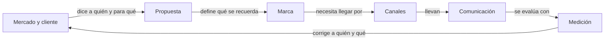
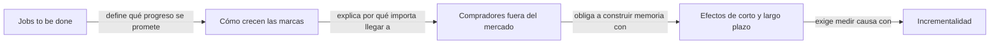

# Marketing

El marketing es el trabajo de decidir a quién se le vende, qué se le promete, cómo se lo recuerda, por dónde se llega y cómo se sabe si funcionó.

Termina donde empiezan la venta (cerrar con un comprador concreto) y el producto (qué se construye), aunque los toca a los dos. El precio y el modelo de negocio también son decisiones de marketing; en esta base el precio vive en [Producto](../Producto/Monetizacion/monetizacion.md) y el modelo de negocio en [Emprender](../Emprender/Modelo-de-negocio/modelo-de-negocio.md). Las definiciones de referencia (AMA, Kotler) y dónde discrepan están en [Qué es marketing](Fundamentos/que-es-marketing.md).

No es una ciencia con un solo cuerpo de evidencia: conviven escuelas académicas y corrientes de práctica que llegan a conclusiones distintas, y casi toda la evidencia viene de marcas grandes, maduras y de mercados anglosajones. Por eso cada nota dice de qué corriente sale lo que afirma y cuánto se sabe para un emprendimiento chico, B2B o argentino.

## De qué está hecho el marketing

Seis partes, encadenadas: cada una toma una decisión que la siguiente da por hecha, y la medición devuelve lo aprendido al principio.

- [Mercado y cliente](Mercado-y-cliente/mercado-y-cliente.md) — quién compra, qué progreso busca y cuántos están comprando hoy. Se decide primero, porque todo lo demás se apunta ahí.
- [Propuesta](Propuesta/propuesta.md) — qué se le promete y contra qué alternativas se lo compara.
- [Marca](Marca/marca.md) — cómo se construye la memoria que hace que el producto venga a la mente en el momento de comprar, y cómo se reparte el esfuerzo entre construirla y activar ventas.
- [Canales](Canales/canales.md) — por dónde llegan el producto y el mensaje, cómo se sale al mercado con algo nuevo y qué cambia al venderle a empresas.
- [Comunicación](Comunicacion/comunicacion.md) — cómo se arma el mensaje y por qué persuade, desde la economía del comportamiento hasta la respuesta directa.
- [Medición](Medicion/medicion.md) — qué número mirar en cada etapa, si la unidad de negocio cierra y si un canal causa ventas o solo las registra.

Aparte de las seis partes, [Fundamentos](Fundamentos/fundamentos-de-marketing.md) reúne lo que las cruza a todas: el [glosario](Fundamentos/glosario-de-marketing.md), las [escuelas](Fundamentos/escuelas-de-marketing.md), las [fuentes](Fundamentos/fuentes-de-marketing.md) y los [mitos](Fundamentos/mitos-de-marketing.md) que la evidencia desmiente.

## Qué leer antes de cada decisión de marketing

- Si tenés que decidir a quién venderle: [definición de mercado](Mercado-y-cliente/definicion-de-mercado.md), [segmentación](Mercado-y-cliente/segmentacion.md) y [jobs to be done](Mercado-y-cliente/jobs-to-be-done.md); si dudás entre un segmento o toda la categoría, [targeting o alcance masivo](Mercado-y-cliente/targeting-o-alcance-masivo.md).
- Si tenés que decidir qué prometer frente a las alternativas: [posicionamiento](Propuesta/posicionamiento.md), con sus cinco componentes en orden, y el [mapa de posicionamiento](Propuesta/mapa-de-posicionamiento.md) para ver contra quién te compara el cliente.
- Si vas a armar una propuesta para un cliente que es una empresa: [marketing B2B](Canales/marketing-b2b.md) para entender cómo compra un grupo, [jobs to be done](Mercado-y-cliente/jobs-to-be-done.md) para el progreso que busca y [posicionamiento](Propuesta/posicionamiento.md) para las alternativas contra las que te compara. Cómo se descubre el problema, se arma la propuesta, se presenta el precio y se responden objeciones está en [Ventas](../Ventas/ventas.md), empezando por [la propuesta](../Ventas/La-propuesta/la-propuesta.md); para cobrar servicios, [cómo cobra una consultora o una agencia](../Producto/Monetizacion/pricing-y-empaquetado.md#cómo-cobra-una-consultora-o-una-agencia). Si el cliente vende online, sumá lo que dice [Comercio electrónico](../Comercio-electronico/comercio-electronico.md#qué-leer-según-el-trabajo-con-una-tienda-online).
- Si tenés que definir cómo se presta un servicio antes de venderlo o construirlo: [plano de servicio](Propuesta/plano-de-servicio.md).
- Si tenés que decidir bajo qué marca sale una oferta nueva: [arquitectura de marca](Marca/arquitectura-de-marca.md).
- Si tenés que elegir un canal: [elección de canales](Canales/eleccion-de-canales.md), con el método Bullseye, y [growth y product-led growth](Canales/growth-y-product-led-growth.md) si el producto mismo puede traer clientes.
- Si tenés que repartir el presupuesto entre marca y ventas inmediatas: [marca y activación](Marca/marca-y-activacion.md) y, para las cifras, [proporciones entre marca y activación](Marca/proporciones-marca-activacion.md).
- Si tenés que escribir un mensaje o un anuncio: [comunicación](Comunicacion/comunicacion.md), [economía del comportamiento en marketing](Comunicacion/economia-del-comportamiento-en-marketing.md) para saber qué efectos sobreviven a la réplica y [respuesta directa](Comunicacion/respuesta-directa.md) para medir cada pieza.
- Si tenés que saber si una campaña o un canal funciona: [incrementalidad](Medicion/incrementalidad.md), [economía unitaria](Medicion/economia-unitaria.md) para ver si cada venta deja plata y [métrica que importa](Medicion/metrica-que-importa.md) para elegir qué número mirar.
- Si tenés que poner un precio: vive en Producto, en [pricing y empaquetado](../Producto/Monetizacion/pricing-y-empaquetado.md) y [precios de la competencia](../Producto/Monetizacion/precios-de-la-competencia.md).

## Las cinco ideas que cambian cómo se lo ve

- El cliente compra progreso, no un producto: [Jobs to be done](Mercado-y-cliente/jobs-to-be-done.md).
- Una marca crece sumando compradores, con disponibilidad mental y física: [Cómo crecen las marcas](Marca/como-crecen-las-marcas.md).
- Casi nadie está comprando hoy: [Compradores fuera del mercado](Mercado-y-cliente/compradores-fuera-del-mercado.md).
- Lo que se mide fácil no es todo lo que funciona: [Efectos de corto y largo plazo](Marca/efectos-de-corto-y-largo-plazo.md).
- Que un canal convierta no significa que cause la venta: [Incrementalidad](Medicion/incrementalidad.md).

## Dónde chocan las escuelas

Los cinco desacuerdos de fondo caen en partes distintas del sistema, y cada uno tiene su nota con las posiciones, la evidencia y cómo se decide en un emprendimiento chico:

- a quién hablarle: [targeting o alcance masivo](Mercado-y-cliente/targeting-o-alcance-masivo.md);
- qué leer del cliente: [las dos lecturas de JTBD](Mercado-y-cliente/dos-lecturas-de-jtbd.md);
- qué prometer: [distintividad o diferenciación](Propuesta/distintividad-o-diferenciacion.md);
- cómo repartir el esfuerzo: [marca o activación](Marca/marca-y-activacion.md);
- por dónde crecer: [growth y product-led growth contra marca y alcance](Canales/growth-y-product-led-growth.md).

Qué sostiene cada escuela y con qué evidencia está en [Escuelas de marketing](Fundamentos/escuelas-de-marketing.md); cuánto pesa cada tipo de fuente, en [Fuentes de marketing](Fundamentos/fuentes-de-marketing.md).

## Vender a empresas o a consumidores

Las seis partes son las mismas en B2B y en B2C; cambia quién compra. En B2B compra una organización, con ciclos largos y pocos compradores en el mercado a la vez, y la evidencia es escasa y en buena parte patrocinada. Eso está en [Marketing B2B](Canales/marketing-b2b.md) y en [Compradores fuera del mercado](Mercado-y-cliente/compradores-fuera-del-mercado.md). B2C no tiene nota propia: se describe por contraste en B2B, y queda como hueco del tema.

## Cómo recorrer las seis partes

Para entender el campo, leé las partes en el orden del diagrama, empezando por la entrada de cada una. Para consultar, [Fundamentos](Fundamentos/fundamentos-de-marketing.md) reúne lo que cruza todo el tema: el glosario, la historia, las escuelas, las fuentes, la bibliografía y los mitos que la evidencia desmiente.
