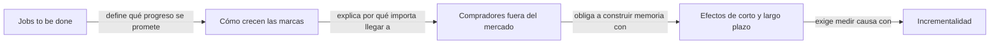

# Marketing

Conceptos generales de marketing, con sus escuelas y su evidencia: a quién hablarle y qué prometerle, cómo crecen las marcas, cómo se sale al mercado, cómo se persuade y cómo se mide si el marketing funciona.

Marketing no es una ciencia con un solo cuerpo de evidencia: conviven escuelas académicas y corrientes de práctica que llegan a conclusiones distintas. La idea que ordena el tema es leer cada afirmación sabiendo de qué corriente sale y en qué evidencia se apoya. Casi toda esa evidencia viene de marcas grandes, maduras y de mercados anglosajones. Para un emprendimiento chico, B2B o argentino se sabe poco, y cada nota lo dice.

## Por dónde entrar

- **Para entender el campo**: [Qué es marketing](Escuelas-y-fuentes/que-es-marketing.md) primero, después [Escuelas de marketing](Escuelas-y-fuentes/escuelas-de-marketing.md) y el resto de [Escuelas y fuentes](Escuelas-y-fuentes/escuelas-y-fuentes.md).
- **Para consultar**: el [Glosario de marketing](glosario-de-marketing.md) ante una sigla o un término, la [Bibliografía de marketing](Escuelas-y-fuentes/bibliografia-de-marketing.md) y las [Proporciones marca-activación](Marca-y-crecimiento/proporciones-marca-activacion.md).
- **Para decidir**: [Targeting o alcance masivo](Cliente-y-propuesta/targeting-o-alcance-masivo.md), [Distintividad o diferenciación](Cliente-y-propuesta/distintividad-o-diferenciacion.md), [Marca o activación](Marca-y-crecimiento/marca-y-activacion.md), [Dos lecturas de Jobs to be done](Cliente-y-propuesta/dos-lecturas-de-jtbd.md) y [Growth marketing y product-led growth](B2B-y-salida-al-mercado/growth-y-product-led-growth.md).
- **Para elegir un canal**: [Elección de canales](B2B-y-salida-al-mercado/eleccion-de-canales.md), con el método Bullseye de *Traction*.
- **Para escribir o probar un anuncio**: [Respuesta directa](Persuasion/respuesta-directa.md) y [Economía del comportamiento en marketing](Persuasion/economia-del-comportamiento-en-marketing.md).
- **Si algo falla**: [Mitos de marketing](Persuasion/mitos-de-marketing.md) e [Incrementalidad](Medicion/incrementalidad.md).

## Qué escuelas hay y qué sostiene cada una

Los historiadores del campo cuentan entre 10 y 12 escuelas académicas, con taxonomías que no coinciden. Las decisiones de hoy se toman con corrientes de práctica: posicionamiento, Ehrenberg-Bass, efectividad publicitaria, segmentación, Jobs to be done, [economía del comportamiento](Persuasion/economia-del-comportamiento-en-marketing.md), [respuesta directa](Persuasion/respuesta-directa.md), growth, [capital de marca](Marca-y-crecimiento/capital-de-marca.md) y B2B. [Escuelas de marketing](Escuelas-y-fuentes/escuelas-de-marketing.md) separa las dos cosas y da la evidencia de cada corriente. [Historia del marketing](Escuelas-y-fuentes/historia-del-marketing.md) cuenta de dónde vienen, y [Qué es marketing](Escuelas-y-fuentes/que-es-marketing.md) da las definiciones de referencia.

## De dónde sale el conocimiento confiable

Pesan más los datos de panel, los experimentos y los journals con revisión de pares que los casos presentados a premios, los institutos financiados por una plataforma y los practicantes. [Fuentes de marketing](Escuelas-y-fuentes/fuentes-de-marketing.md) da el peso de cada tipo y cuál manda cuando dos chocan. El [Glosario de marketing](glosario-de-marketing.md) explica las marcas de lectura con que las notas dicen cuánto se leyó de cada fuente.

## Dónde chocan las escuelas

Los choques principales son cinco: [targeting o alcance masivo](Cliente-y-propuesta/targeting-o-alcance-masivo.md), [distintividad o diferenciación](Cliente-y-propuesta/distintividad-o-diferenciacion.md), [cuánto a marca y cuánto a activación](Marca-y-crecimiento/marca-y-activacion.md), [las dos lecturas de JTBD](Cliente-y-propuesta/dos-lecturas-de-jtbd.md) y [growth y product-led growth contra marca y alcance](B2B-y-salida-al-mercado/growth-y-product-led-growth.md). Cada nota de decisión da las posiciones, su evidencia y cómo se decide en un emprendimiento chico.

## Qué cambia en B2B

En B2B compra una organización, con ciclos largos y pocos compradores en el mercado a la vez. La evidencia es escasa y en buena parte patrocinada: [Marketing B2B](B2B-y-salida-al-mercado/marketing-b2b.md) y [Compradores fuera del mercado](B2B-y-salida-al-mercado/compradores-fuera-del-mercado.md). Para lanzar un producto nuevo, [Adopción de innovaciones](B2B-y-salida-al-mercado/adopcion-de-innovaciones.md) explica la curva de Rogers y el abismo de Moore (*Crossing the Chasm*), y [Growth marketing y product-led growth](B2B-y-salida-al-mercado/growth-y-product-led-growth.md) discute cuándo el producto puede ser el canal.

B2C no tiene nota propia: se describe por contraste en [Marketing B2B](B2B-y-salida-al-mercado/marketing-b2b.md), y queda como hueco declarado del tema.

## Conceptos umbral

- [Jobs to be done](Cliente-y-propuesta/jobs-to-be-done.md) — el cliente compra progreso, no un producto.
- [Cómo crecen las marcas](Marca-y-crecimiento/como-crecen-las-marcas.md) — se crece sumando compradores, con disponibilidad mental y física.
- [Compradores fuera del mercado](B2B-y-salida-al-mercado/compradores-fuera-del-mercado.md) — casi nadie está comprando hoy.
- [Efectos de corto y largo plazo](Marca-y-crecimiento/efectos-de-corto-y-largo-plazo.md) — lo que se mide fácil no es todo lo que funciona.
- [Incrementalidad](Medicion/incrementalidad.md) — que un canal convierta no significa que cause la venta.

## Sub-temas

- [Escuelas y fuentes](Escuelas-y-fuentes/escuelas-y-fuentes.md) — qué es el marketing, su historia, sus escuelas y el peso de cada fuente. Para entender el campo antes de decidir.
- [Cliente y propuesta](Cliente-y-propuesta/cliente-y-propuesta.md) — a quién se le habla y qué se le promete. Para definir público y promesa.
- [Marca y crecimiento](Marca-y-crecimiento/marca-y-crecimiento.md) — cómo crecen las marcas y cómo se reparte el esfuerzo entre marca y activación. Para repartir el esfuerzo y el presupuesto.
- [B2B y salida al mercado](B2B-y-salida-al-mercado/b2b-y-salida-al-mercado.md) — vender a empresas, adoptar un producto nuevo, growth y canales. Para lanzar un producto o venderle a empresas.
- [Medición de marketing](Medicion/medicion-de-marketing.md) — métricas, economía unitaria e incrementalidad. Para saber si una campaña o un canal funciona.
- [Persuasión en marketing](Persuasion/persuasion-en-marketing.md) — economía del comportamiento, respuesta directa y mitos. Para escribir anuncios o evaluar una táctica.

## Relaciones

- Parte de: [Conocimiento](../conocimiento.md) — es un Tema de la base.
