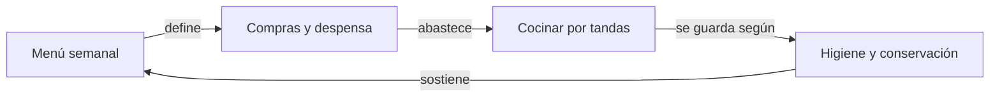

# Planificar y cocinar

Planificar y cocinar es la parte de la nutrición familiar que lleva la comida de las guías a la mesa durante la semana: qué se come cada día, qué se compra, qué se cocina de una vez y cómo se guarda sin que nadie se enferme.

Recibe de [Patrones y guías](../Patrones-y-guias/patrones-y-guias.md) qué tiene que tener una semana sana, y de [Alimentación infantil](../Alimentacion-infantil/alimentacion-infantil.md) y [Objetivos del adulto](../Objetivos-del-adulto/objetivos-del-adulto.md) lo que cambia para cada uno. Entrega la comida a [Comer en familia](../Comer-en-familia/comer-en-familia.md), donde se decide cómo se reparte en la mesa.

## La semana como una cadena de cuatro pasos

La comida de una semana pasa por cuatro pasos en orden: se decide el menú, se compra lo que pide, se cocina (una parte por tandas) y se guarda hasta comerla. Cada paso depende del anterior. Un menú sin lista de compras termina en compras sueltas, y una tanda grande sin reglas de enfriado y guardado es un riesgo (inferencia de esta base).

El menú se arma con las Guías Alimentarias para la Población Argentina (GAPA), que dan frecuencias semanales y porciones orientativas: pescado al menos dos veces por semana, carne roja hasta tres, medio plato de verduras en almuerzo y cena, según la [gráfica del Ministerio de Salud](https://argentina.gob.ar/salud/alimentacion-saludable/grafico). Esas frecuencias son las que ordenan las compras y deciden qué conviene cocinar en cantidad.

## Lo que se sabe y lo que no

Que planificar las comidas mejore la dieta no está probado. El único estudio grande encontrado, sobre 40.554 adultos franceses, halló que quienes planificaban seguían algo más la guía de su país y comían más variado, pero es un estudio transversal y sus autores aclaran que no se puede inferir causalidad (Ducrot 2017, según su resumen). Se planifica por razones prácticas, no porque haya un ensayo que lo respalde.

La parte de higiene, en cambio, tiene respaldo oficial. Las reglas de la OMS y del Ministerio de Salud coinciden: separar crudo de cocido, cocinar completo, no dejar lo cocido más de dos horas a temperatura ambiente y enfriar rápido. En una casa con un chico chico pesa más, porque el síndrome urémico hemolítico tiene su tasa más alta en los chicos de un año ([higiene y conservación](higiene-y-conservacion.md)).

## Cómo falla la semana

Tres fallas posibles, ejemplos de esta base sin fuente. El menú se arma pensando en un solo comensal y después se cocina aparte para el chico o para el adulto que hace dieta; [un menú para todos](../Comer-en-familia/un-menu-para-todos.md) trata cómo evitarlo. La tanda del domingo se deja enfriar en la olla sobre la mesada toda la tarde. Y la heladera se llena sin orden, con la carne cruda arriba goteando sobre lo cocido.

## Qué hay en planificar y cocinar

- [Menú semanal](menu-semanal.md) — cómo se arma un menú que sirva a adultos y chicos, paso a paso, con las frecuencias de las GAPA. Empezar por acá.
- [Compras y despensa](compras-y-despensa.md) — de la lista del menú a la compra, qué tener siempre en la alacena y cómo leer el envase.
- [Cocinar por tandas](cocinar-por-tandas.md) — cocinar de una vez para varios días: qué conviene, cómo enfriar, porcionar, congelar y recalentar.
- [Higiene y conservación](higiene-y-conservacion.md) — las cinco claves de la inocuidad, temperaturas, plazos de heladera y freezer, y el síndrome urémico hemolítico.
- [Canasta Básica Alimentaria](canasta-basica.md) — ficha con el valor de la canasta del INDEC de octubre de 2026, tomado de prensa.
