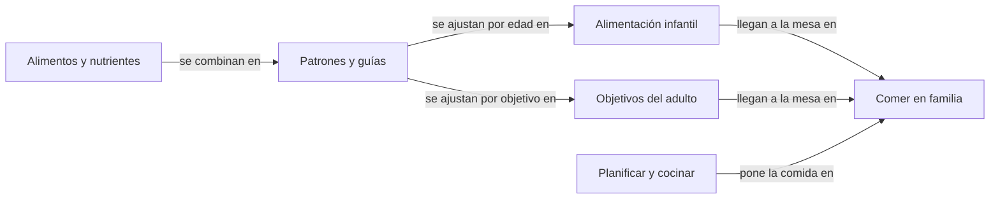

# Nutrición

La nutrición es lo que una persona come y cómo eso afecta su salud, su cuerpo y su rendimiento; esta base la explica para una familia que cocina en casa, con chicos chicos y adultos con objetivos distintos, y dice la evidencia de cada recomendación.

Una familia come casi siempre la misma comida, aunque cada uno necesite algo distinto. Un chico de jardín necesita alimentos variados en porciones a su medida, un adulto que baja grasa necesita comer menos energía sin perder músculo y otro que entrena necesita más. La base parte de lo que es común a todos (qué tiene la comida y qué patrones son sanos) y después baja a lo que cambia por edad y por objetivo, y a cómo se organiza la semana para que una sola cocina sirva a todos.

Quedan afuera el entrenamiento (cómo se entrena la fuerza o la coordinación), las enfermedades y los trastornos de la conducta alimentaria, el embarazo y la lactancia ([alcance](ALCANCE.md)). Lo que es crianza vive en [Crianza](../Crianza/crianza.md).

> [!IMPORTANT]
> Esta base resume guías oficiales, posturas de sociedades científicas y estudios, y dice cuál es cuál. No reemplaza a un médico ni a un licenciado en nutrición: una enfermedad, una pérdida de peso rápida, un chico que no crece o una relación difícil con la comida se consultan con ellos.

## De qué está hecha la nutrición de una familia

La base tiene seis partes. Los alimentos y nutrientes son la materia; los patrones y guías dicen cómo se combinan. La alimentación infantil y los objetivos del adulto ajustan esos patrones a cada persona. Comer en familia es cómo se reparte la comida en la mesa, y planificar y cocinar es cómo se llega a esa mesa durante la semana.

- [Alimentos y nutrientes](Alimentos-y-nutrientes/alimentos-y-nutrientes.md) — grupos de alimentos, macronutrientes, micronutrientes clave, ultraprocesados, bebidas y los sellos frontales.
- [Patrones y guías](Patrones-y-guias/patrones-y-guias.md) — las Guías Alimentarias argentinas, la dieta mediterránea y qué dicen los estudios de las dietas de moda.
- [Alimentación infantil](Alimentacion-infantil/alimentacion-infantil.md) — de 0 a 6 años: primeros alimentos, qué necesita de 2 a 6, el chico que no come, atragantamiento, alergias, azúcar, colaciones y vianda.
- [Comer en familia](Comer-en-familia/comer-en-familia.md) — quién decide qué en la mesa, comer juntos y una comida que sirva a todos.
- [Objetivos del adulto](Objetivos-del-adulto/objetivos-del-adulto.md) — bajar grasa, ganar músculo, rendir, salud a largo plazo, estética, suplementos y cómo medir el progreso.
- [Planificar y cocinar](Planificar-y-cocinar/planificar-y-cocinar.md) — menú semanal, compras, cocinar por tandas, higiene y conservación, y la ficha de la Canasta Básica.

Aparte de las partes, [Fundamentos](Fundamentos/fundamentos-de-nutricion.md) reúne lo que las cruza: las escuelas, por qué la evidencia en nutrición es difícil, los debates abiertos, las fuentes y el glosario.

## Qué tan segura es cada recomendación

En nutrición casi todo lo que se sabe de la salud a largo plazo sale de estudios observacionales: se mide qué come la gente y qué le pasa años después. Esos estudios muestran asociaciones, no causas, y dependen de lo que la gente recuerda que comió. Los ensayos, donde se asigna una dieta al azar, son más firmes pero duran poco. Por eso cada nota dice de qué tipo es la evidencia, y [por qué la evidencia en nutrición es difícil](Fundamentos/evidencia-en-nutricion.md) lo explica.

Un ejemplo de ensayo largo: en DIETFITS (2018), 609 adultos siguieron durante un año una dieta baja en grasas o una baja en carbohidratos y bajaron 5,3 y 6,0 kg, sin diferencia significativa (según su resumen). Ninguna de las dos mostró ventaja sobre la otra; qué más se sabe está en [pérdida de grasa](Objetivos-del-adulto/perdida-de-grasa.md).

## Qué leer según lo que quieras lograr

- Si en la casa conviven objetivos distintos (uno baja grasa, otro entrena, hay un chico chico) y tenés que organizar la semana: [un menú para todos](Comer-en-familia/un-menu-para-todos.md), [menú semanal](Planificar-y-cocinar/menu-semanal.md), y después la nota del objetivo de cada uno.
- Si querés bajar grasa sin perder músculo: [pérdida de grasa](Objetivos-del-adulto/perdida-de-grasa.md), [masa muscular y recomposición](Objetivos-del-adulto/masa-muscular-y-recomposicion.md) y [medir el progreso](Objetivos-del-adulto/medir-el-progreso.md).
- Si querés rendir más y cuidar la salud a largo plazo: [rendimiento](Objetivos-del-adulto/rendimiento.md), [salud a largo plazo](Objetivos-del-adulto/salud-a-largo-plazo.md) y [suplementos](Objetivos-del-adulto/suplementos.md).
- Si buscás un cambio estético: [estética](Objetivos-del-adulto/estetica.md).
- Si el chico no quiere comer: [el chico que no come](Alimentacion-infantil/chico-que-no-come.md) y [división de responsabilidades](Comer-en-familia/division-de-responsabilidades.md).
- Si querés saber cuánto y qué necesita un chico de jardín: [necesidades de 2 a 6](Alimentacion-infantil/necesidades-de-2-a-6.md) y [atragantamiento](Alimentacion-infantil/atragantamiento.md).
- Si tenés que armar el menú de la semana: [menú semanal](Planificar-y-cocinar/menu-semanal.md), [un menú para todos](Comer-en-familia/un-menu-para-todos.md) y [cocinar por tandas](Planificar-y-cocinar/cocinar-por-tandas.md).
- Si estás en el supermercado leyendo etiquetas: [sellos frontales](Alimentos-y-nutrientes/sellos-frontales.md) y [ultraprocesados](Alimentos-y-nutrientes/ultraprocesados.md).
- Si te tienta una dieta de moda: [dietas de moda](Patrones-y-guias/dietas-de-moda.md).

- Si una nota usa un término que no conocés (déficit, masa libre de grasa, metaanálisis, NOVA): [glosario de nutrición](Fundamentos/glosario-de-nutricion.md).

## Por dónde empezar

Para leer de corrido: [Guías Alimentarias argentinas](Patrones-y-guias/guias-alimentarias-argentinas.md), [macronutrientes](Alimentos-y-nutrientes/macronutrientes.md), [división de responsabilidades](Comer-en-familia/division-de-responsabilidades.md) y [menú semanal](Planificar-y-cocinar/menu-semanal.md). Después, la parte del objetivo de cada uno.
